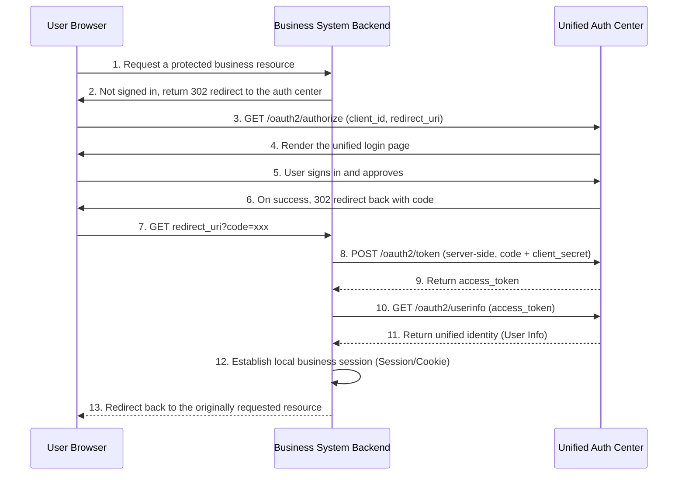

# OAuth2 Protocol Integration

The unified authentication center implements standard OAuth2/OIDC protocol endpoints. Whether it is the user-facing **authorization code flow** (browser login for business systems) or the user-less **machine-to-machine** flow (`client_credentials`), **both are part of the standard OAuth2 protocol** and are documented together in this chapter.

If your scenario only needs "a ready-made login page + frontend integration", start with [Lite Login Integration](lite-login-integration.md); if you need to sync organization / user / role data into your own system, see [Data Integration](data-integration.md).

## Which mode to use

| Scenario | Grant type | User involved | Notes |
| --- | --- | --- | --- |
| A user logs in to a business system via browser | `authorization_code` | Yes | Full-page redirect to the unified login page; the token only lives in the business system backend |
| Service-to-service integration, scheduled jobs, calling the [Open Management API](open-api-management.md) | `client_credentials` (machine-to-machine) | No | Exchange `client_id` + `client_secret` directly for a machine token, see below |

## Protocol endpoint overview

The auth center exposes OIDC Discovery metadata:

```text
GET https://<auth-host>/.well-known/openid-configuration
```

| Endpoint | Description |
| --- | --- |
| `/oauth2/authorize` | Authorization endpoint (browser redirect; renders the unified login page when not signed in) |
| `/oauth2/token` | Token endpoint (`authorization_code` / `refresh_token` / `password` etc.; **does not** support `client_credentials`) |
| `/oauth2/client_token` | Dedicated token endpoint for `client_credentials` |
| `/oauth2/userinfo` | User info endpoint (authorization-code tokens) |
| `/oauth2/introspect` | Token introspection (RFC 7662) with `permissions` / `roles` extension claims |
| `/oauth2/userinfo-oidc` | OIDC-style user info; claims include `permissions` / `roles` |
| `/oauth2/revoke` | Token revocation |
| `/oauth2/logout` | End session |
| `/.well-known/jwks.json` | JWK Set (placeholder for now, see the token form note below) |

Key discovery metadata:

- `grant_types_supported`: `authorization_code`, `implicit`, `password`, `client_credentials`, `refresh_token`
- `scopes_supported`: `openid`, `userid`, `userinfo`, `oidc`, `unionid`
- `response_types_supported`: `code`, `token`, `id_token`
- `code_challenge_methods_supported`: `S256`, `plain`
- `token_endpoint_auth_methods_supported`: `client_secret_basic`, `client_secret_post`
- `id_token_signing_alg_values_supported`: `HS256`

> **Token form**: access tokens are currently **opaque reference tokens** (stored server-side; controlled by `geelato.auth.token-store=memory|redis`). Claims are obtained via `/oauth2/introspect` or the userinfo-style endpoints — they are **not self-contained JWTs**. Token strings in the examples below are placeholders.

## Prerequisites: request application credentials

Before integrating, the business system administrator must request access credentials from the unified authentication center administrator:

- **`client_id`**: the unique identifier of the application.
- **`client_secret`**: the application secret (**never** expose it to the frontend or browser; store it securely in backend code).
- **`redirect_uri`**: a legal, secure callback URL (e.g. `https://your-app.com/login/oauth2/code/geelato`).

Clients are created and maintained in the auth center admin console under "OAuth Clients":

- **Default grant types for new clients**: `authorization_code`, `implicit`, `refresh_token`, `password`, `client_credentials`, `phone_code` — trim as needed; make sure `client_credentials` is included for machine-to-machine scenarios.
- **Default scopes**: `openid`, `userid`, `userinfo`, `oidc`.
- Supports enable/disable, secret reset, token lookup by `client_id`, and other admin operations.

## Mode 1: Authorization code flow (user login)

The overall interaction sequence of the standard OAuth2 authorization code flow:



### Step 1: Obtain the authorization code

When the user is not signed in, the business system redirects the browser to the authorization endpoint:

**Method**: `GET`
**URL**: `https://<auth-host>/oauth2/authorize`

**Query parameters**:
- `response_type`: fixed value `code`
- `client_id`: the issued `client_id`
- `redirect_uri`: the registered legal callback URL
- `state`: a random string to prevent CSRF; the business system must verify it

**Callback result**:
After the user signs in successfully at the auth center, the browser is redirected back to `redirect_uri` with a `code` parameter:
`https://your-app.com/callback?code=AUTH_CODE_HERE&state=...`

### Step 2: Exchange the code for a token

After receiving the `code`, the business system backend requests the token **from the server side**.

**Method**: `POST`
**URL**: `https://<auth-host>/oauth2/token`
**Content-Type**: `application/x-www-form-urlencoded`

**Form parameters**:
- `grant_type`: fixed value `authorization_code`
- `code`: the authorization code from the previous step
- `client_id`: the issued `client_id`
- `client_secret`: the issued `client_secret`
- `redirect_uri`: must match the previous step exactly

**Success response example**:
```json
{
  "access_token": "<opaque-token>",
  "token_type": "Bearer",
  "expires_in": 7200,
  "refresh_token": "..."
}
```

### Step 3: Fetch user data and establish a local session

With the `access_token`, the backend calls the user info endpoint to resolve the real identity of the signed-in user.

**Method**: `GET`
**URL**: `https://<auth-host>/oauth2/userinfo`
**Header**:
- `Authorization`: `Bearer <access_token>`

**Success response example**:
```json
{
  "code": 200,
  "msg": "ok",
  "data": {
    "loginId": "zhangsan",
    "user": {
      "id": "123456789",
      "name": "Zhang San",
      "tenantCode": "geelato"
    }
  }
}
```

> **Important**:
> The business system must extract user data from `data.user`, map it to its own user database by an identity key (e.g. `loginId` or `user.id`), and then establish its own session (local Session, business system cookie, etc.).

### Extras: direct code-issuing API and PKCE

For scenarios where "the user already has an auth center session" (e.g. a same-domain portal backend exchanging a code on behalf of the frontend), a JSON direct-issuing endpoint is available:

**Method**: `GET`
**URL**: `https://<auth-host>/api/oauth2/authorize-code`

**Query parameters**: `client_id`, `redirect_uri`, `state`, `scope`, `nonce`, plus optional `code_challenge` / `code_challenge_method` (`S256` or `plain`). The request must already be signed in; setting `geelato.auth.pkce.required=true` makes `code_challenge` mandatory globally.

> **Note**: the token endpoint (`/oauth2/token`) does not yet enforce `code_verifier` verification (PKCE enforcement is on the roadmap). For public clients the security baseline remains exact `redirect_uri` matching plus `state` for CSRF protection.

### Refreshing tokens

If a `refresh_token` was issued, call `/oauth2/token` with `grant_type=refresh_token` from the server side; if refreshing fails or no refresh token was issued, clear the local session and ask the user to sign in again.

## Mode 2: Machine-to-machine (client_credentials)

When **no user is involved** — server-to-service integration, scheduled jobs, batch processing, or calling the **[Open Management API](open-api-management.md)** (`/api/open/v1/**`) — exchange `client_id` + `client_secret` directly for a **machine token**.

A machine token represents the application identity (`client_id`), never a user; to identify signed-in users use Mode 1 or [Lite Login Integration](lite-login-integration.md).

### Obtain the token

**Method**: `POST`
**URL**: `https://<auth-host>/oauth2/client_token`
**Content-Type**: `application/x-www-form-urlencoded`

**Form parameters**:
- `grant_type`: fixed value `client_credentials`
- `client_id`: the issued `client_id`
- `client_secret`: the issued `client_secret`

**Example**:

```bash
curl -X POST "https://<auth-host>/oauth2/client_token" \
  -d "grant_type=client_credentials" \
  -d "client_id=<your_client_id>" \
  -d "client_secret=<your_client_secret>"
```

**Success response example**:
```json
{
  "access_token": "<opaque-token>",
  "client_token": "...",
  "token_type": "bearer",
  "expires_in": 7200
}
```

> **Note**: `client_credentials` must use the dedicated endpoint `/oauth2/client_token`; the standard `/oauth2/token` endpoint **does not** support this grant. Machine tokens have no `refresh_token` — fetch a new one after expiry; refresh proactively based on `expires_in` and cache the token.

### Calling APIs with the token

Send the Bearer token in the header (the `?access_token=` query parameter is also accepted; the header is recommended):

```bash
curl -H "Authorization: Bearer <access_token>" \
  "https://<auth-host>/api/open/v1/roles/page?pageNum=1&pageSize=10"
```

### appCode isolation

When a machine token calls Bearer-protected resources such as `/api/provisioning/**` or `/api/open/v1/**`:

- The `appCode` of a machine-token request (query parameter or the `/app/{appCode}/` path segment) **must equal** the `system_code` bound to the client, otherwise `403`;
- If `appCode` is omitted, it resolves automatically from the client binding;
- User tokens (issued by the authorization-code / password flows) are not affected by this rule, but **cannot** call the Open Management API.

### SDK support

With the `cn.geelato:geelato-auth-client` SDK, token handling is automatic: `AuthCenterTokenManager` calls `/oauth2/client_token`, caches locally until 60 seconds before expiry, and retries once after a 401 invalidation. See the SDK section in [Data Integration](data-integration.md).

### Error codes

| HTTP status | Meaning |
| --- | --- |
| `401` | Missing token, or the token is invalid or expired. |
| `403` | The token is not a client_credentials machine token (user tokens cannot call the Open API), or the client is disabled / lacks the client_credentials grant / the requested appCode does not match the client binding. |

## Token introspection and enriched user claims

Beyond standard fields, introspection and the OIDC user info endpoint **enrich permission claims**, so remote business systems can enforce API / button level authorization without pulling mirrors (zero Sa-Token dependency):

**Token introspection (RFC 7662)** — client authentication uses form parameters `client_id` / `client_secret`:

```bash
curl -X POST "https://<auth-host>/oauth2/introspect" \
  -d "token=<access_token>" \
  -d "client_id=<your_client_id>" \
  -d "client_secret=<your_client_secret>" \
  -d "appCode=<your_app_code>"
```

```json
{
  "active": true,
  "sub": "zhangsan",
  "scope": "openid userinfo",
  "exp": 1730000000,
  "permissions": ["user:list", "order:export"],
  "roles": ["demo-admin"]
}
```

**OIDC user info**:

```bash
curl "https://<auth-host>/oauth2/userinfo-oidc?access_token=<access_token>&appCode=<your_app_code>"
```

Returned claims: `sub` / `loginName` / `name` / `email` / `mobilePhone` / `preferred_username`, plus the extension claims `permissions` (function permission codes) / `roles` (role codes).

`appCode` / `tenantCode` are optional and default to the `__global__` dimension. For the full permission model and the local mirror approach, see [Permission Integration](permission-integration.md).

## FAQ

- **The `client_secret` has been leaked — what now?**
  Contact the auth center administrator to reset the secret immediately. This is critical for machine-token scenarios: a leaked secret lets a third party impersonate the application against the Open Management API.

- **Can the frontend call `/oauth2/token` via AJAX?**
  **Absolutely not.** The call requires `client_secret`; exposing it in the frontend is a severe security vulnerability. This call must happen in the business system backend.

- **Why can't `/oauth2/token` issue client_credentials tokens?**
  `client_credentials` uses the dedicated endpoint `/oauth2/client_token` (built into sa-token 1.46+); the standard `/oauth2/token` endpoint does not support that grant.

- **Can a machine token be used as a user identity?**
  No. A machine token's subject is the `client_id` (application identity) and is only valid for machine-to-machine scenarios such as the Open Management API; to identify a signed-in user use the authorization code flow or [Lite Login Integration](lite-login-integration.md).

- **How do I get permission codes for button / API authorization?**
  Call `/oauth2/introspect` or `/oauth2/userinfo-oidc` and read the `permissions` / `roles` extension claims; for the full five permission types and data-permission rules, use the provisioning API described in [Permission Integration](permission-integration.md).
