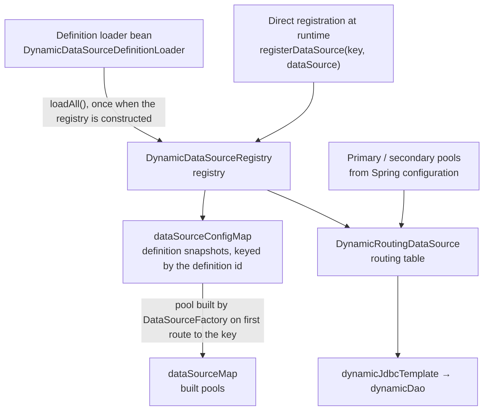

# Definition Loading and Registration

This page answers three questions in one place:

- where datasources come from
- which class they are registered into and managed by
- how the application layer implements its own loading mechanism

For switching, see [Switching](switching.md); for how entities bind to a datasource, see [Binding & Priority](entity-binding.md); for pool and other properties, see [Configuration](configuration.md).

## The Whole Chain at a Glance



| Class | Package | Responsibility |
|---|---|---|
| `DynamicDataSourceDefinitionLoader` | `cn.geelato.datasource.spi` | The extension point. Tells the registry which datasource definitions exist; implemented and registered as a bean by the host application |
| `DynamicDataSourceRegistry` | `cn.geelato.datasource` | The registry. Keeps definition snapshots and pools, and provides refresh, removal and lookup |
| `DataSourceFactory` | `cn.geelato.datasource` | Builds one definition into a HikariCP pool: decrypts the password, applies host mapping and the shared pool properties |
| `DynamicRoutingDataSource` | `cn.geelato.datasource` | The routing datasource. Picks a pool from the registry by the key in the current thread and maintains the routing table |
| `OrmDynamicDataSourceAutoConfiguration` | `cn.geelato.orm.config` | The wiring entry. Imports the beans above when a bean named `primaryJdbcTemplate` exists; `geelato-framework-starter` imports the same set when `spring.datasource.primary.jdbc-url` is configured |

## Where Datasources Come From: Three Sources

| Source | Routing key | When it enters the system | Notes |
|---|---|---|---|
| Primary and secondary pools from Spring configuration (`spring.datasource.primary.*` / `spring.datasource.secondary.*`) | `primary` / `secondary` | Built by Spring at startup | Not stored in either registry map; added to the routing table directly. The loader does not return them |
| Definition loader bean | The `id` of the definition Map | `loadAll()` is called once when the registry is constructed | Exactly **one** `DynamicDataSourceDefinitionLoader` is picked up by type |
| Direct registration at runtime | A key chosen by the caller | When `registerDataSource(key, dataSource)` is called | Registers an already-built pool; suits a small number of pools known at startup |

About the definition loader:

- The framework module `geelato-orm` ships no implementation. When the host application provides none, the registry holds no definition-based datasources and only `primary` / `secondary` can be routed to.
- A platform host (with `geelato-web-platform` on the classpath) ships one: `PlatformDynamicDataSourceDefinitionLoader`, which loads from the connection definitions maintained by the platform.

## Where They Are Registered: DynamicDataSourceRegistry

Datasources are registered in `cn.geelato.datasource.DynamicDataSourceRegistry`. It is a Spring bean and can be injected directly.

The registry keeps two maps, both keyed by the `id` of the definition:

| Map | Content | Written when |
|---|---|---|
| `dataSourceConfigMap` | Definition snapshots: a copy of each Map returned by the loader | Startup load, full refresh, refresh by key |
| `dataSourceMap` | Pools that have been built | Lazy by default: on the first route to the key; at definition registration when `delay-load-data-source=false` |

The two maps being out of step is normal. When a definition is registered but its pool is not built yet, `containsDataSource(key)` returns `true`, and calling `getDataSource(key)` is what builds the pool.

Public methods:

| Method | Behavior |
|---|---|
| `refreshAllDataSources()` | Calls `loadAll()` again and reconciles: every returned key is re-registered, keys not returned this time are removed. Returns the number of keys |
| `refreshDataSource(String key)` | Calls `loadOne(key)` and re-registers that key. When the loader returns `null`, nothing changes and `false` is returned |
| `registerDataSource(String key, DataSource dataSource)` | Registers an already-built pool. An existing pool under the same key is closed first |
| `removeDataSource(String key)` | Closes the pool and deletes the definition; the key is no longer usable |
| `destroyDataSource(String key)` | Closes and removes the pool only, keeping the definition; the pool is rebuilt on the next lookup |
| `getDataSource(String key)` | Returns the pool. Builds it here when the definition is registered but the pool is not built yet |
| `containsDataSource(String key)` | Whether the key is registered, including definitions whose pool is not built yet |
| `getAllDataSources()` | A snapshot of the built pools; keys with a definition only are not included |
| `getPrimaryDataSource()` / `getSecondaryDataSource()` | The primary pool and the optional secondary pool |

## Startup Sequence: Who Calls What

1. When a bean named `primaryJdbcTemplate` exists, `OrmDynamicDataSourceAutoConfiguration` imports the registry, the factory, the routing datasource and the other beans.
2. Creating `dynamicDataSource` requires the registry, so the registry is constructed.
3. The registry constructor injects the definition loader by type. The parameter is optional and has no qualifier: with 0 candidates it is `null`, with 1 it is that bean, and with more than 1 exactly one must be marked `@Primary`.
4. The constructor immediately calls `refreshAllDataSources()`. This is the only `loadAll()` call during startup.
5. Each definition is registered: its `id` becomes the key, any old pool under that key is closed, and a copy of the definition is stored. With `delay-load-data-source=false` the pool is built at the same time.
6. Reconciliation: keys registered in the previous round but not returned this time are removed, and their pools are closed.
7. Before `dynamicDataSource` finishes creation it calls `refreshAllDataSources()` on the routing datasource, which loads the primary, the secondary and the built pools into the routing table.

Behavior in each situation:

| Situation | Behavior |
|---|---|
| No definition loader in the container | Starts normally. The log shows `No DynamicDataSourceDefinitionLoader bean found`; there are no definition-based datasources |
| Several loaders in the container, none marked `@Primary` | Startup fails with `NoUniqueBeanDefinitionException` |
| `loadAll()` throws or returns `null` at startup | A WARN is logged and startup continues; the log contains `For dynamic data sources has been search failed`. No definition-based datasource is registered |
| One definition is invalid, for example without an `id` | An ERROR is logged and that definition is skipped; the rest are registered as usual |
| A definition is registered but the pool fails to build, for example an unsupported `db_type` or a missing required field | Under the default lazy mode this happens on the first route: an ERROR is logged and the query falls back to the primary |
| The key an entity is explicitly bound to is not registered | `EntityDataSourceResolver` throws an `IllegalStateException` and refuses to route |

The last two rows are different situations. A missing registration is a hard failure. A registration whose pool fails to build only leaves an ERROR log line, and the query lands on the primary. Work out which one applies before troubleshooting; see the table at the end of this page.

## Definition Loader Contract

```java
package cn.geelato.datasource.spi;

public interface DynamicDataSourceDefinitionLoader {

    List<Map<String, Object>> loadAll();     // all datasource definitions

    Map<String, Object> loadOne(String key); // one definition by routing key
}
```

Each Map returned by `loadAll()` is one connection definition. Field names follow the snake_case convention:

| Field | Required | Notes |
|---|---|---|
| `id` | Yes | The routing key. Its `toString()` becomes the registry key; case-sensitive |
| `db_type` | Yes | Database type, lower-cased before matching; see the table below |
| `db_hostname_ip` | Yes | Host address; can be redirected by [host mapping](host-mapping.md) |
| `db_port` | Yes | Port; must parse as an integer |
| `db_user_name` | Yes | User name |
| `db_name` | Yes | Database name |
| `db_password` | No | Password; may be `null` |

Supported `db_type` values:

| `db_type` | Driver |
|---|---|
| `mysql` | `com.mysql.cj.jdbc.Driver` |
| `postgresql` / `postgres` | `org.postgresql.Driver` |
| An alias registered through `Dialects.registerAlias(...)` that resolves to the PostgreSQL family | `org.postgresql.Driver` |

Any other value throws `UnsupportedOperationException: 不支持的数据库类型` when the pool is built. The framework assembles the JDBC URL itself; other fields in the definition are kept in the snapshot as they are and are not read when the pool is built.

**Password**: plaintext is accepted. To encrypt, write `algorithm:ciphertext` where the algorithm is one of `aes` / `rsa` / `sm2` / `sm4`; `DataSourceFactory` decrypts it when the pool is built, so the loader does nothing. A plaintext password that happens to start with one of these four algorithm names followed by a colon is treated as ciphertext and fails to decrypt; use an encrypted value in that case.

**Semantics of `loadOne(key)`**:

- Called only from `refreshDataSource(key)`, never at startup.
- The returned Map is registered under the key that was passed in, not under the `id` inside the Map.
- Returning `null` means the source has no such definition; the registry does not change.

**Implementation constraints**:

| Constraint | Reason |
|---|---|
| `loadAll()` runs synchronously inside the registry constructor, and once more on every full refresh | Its duration counts toward startup time; an exception only produces a WARN and startup continues |
| Both methods run while the registry lock is held | The implementation needs no locking of its own, and must not call back into the registry: that creates a circular dependency during construction and endless recursion during a full refresh |
| To access the primary database, inject `@Qualifier("primaryJdbcTemplate") JdbcTemplate` | No other datasource bean is available while the registry is being constructed |
| Do not use `primary` / `secondary` as an `id` | The routing datasource reserves these two keys for the primary and secondary pools |

## Implementing Custom Loading in the Application Layer

Custom loading means providing your own `DynamicDataSourceDefinitionLoader` bean. First check whether the host already has a loader:

| Host | Loader already present | What to do |
|---|---|---|
| Framework-only host: depends on `geelato-orm` or `geelato-framework-starter` only | No | Provide a bean |
| Platform host: depends on `geelato-web-platform` | Yes, `PlatformDynamicDataSourceDefinitionLoader` | Replace it completely, or merge: keep the existing source and add your own |

### Supplying Your Own Definitions

A minimal example, usable as is in a framework-only host:

```java
package com.acme.app.ds;

import cn.geelato.datasource.spi.DynamicDataSourceDefinitionLoader;
import org.springframework.stereotype.Component;

import java.util.HashMap;
import java.util.List;
import java.util.Map;

@Component
public class InMemoryDataSourceLoader implements DynamicDataSourceDefinitionLoader {

    @Override
    public List<Map<String, Object>> loadAll() {
        Map<String, Object> ds = new HashMap<>();
        ds.put("id", "biz-mysql");
        ds.put("db_type", "mysql");
        ds.put("db_hostname_ip", "10.0.0.10");
        ds.put("db_port", 3306);
        ds.put("db_user_name", "biz_user");
        ds.put("db_name", "biz_db");
        ds.put("db_password", "biz@psd");
        return List.of(ds);
    }

    @Override
    public Map<String, Object> loadOne(String key) {
        return loadAll().stream()
                .filter(m -> key.equals(String.valueOf(m.get("id"))))
                .findFirst()
                .orElse(null);
    }
}
```

After startup `biz-mysql` is registered and `containsDataSource("biz-mysql")` returns `true`. Under the default lazy mode the pool is created the first time a call is routed to it; `.useDataSource("biz-mysql")` or `@Entity(connectId = "biz-mysql")` then works as usual.

### Platform Host: Adding Your Own Source

In a platform host the container already has a loader, and the registry accepts only one. There are two options:

- **Replace completely**: add `@Primary` to your own loader. The registry asks only that loader for definitions from then on, and the connections maintained by the platform are no longer registered.
- **Merge**: choose this when the existing source must be kept and your own added. Add `@Primary` and inject the existing loader; the new loader is responsible for merging.

```java
package com.acme.app.ds;

import cn.geelato.datasource.PlatformDynamicDataSourceDefinitionLoader;
import cn.geelato.datasource.spi.DynamicDataSourceDefinitionLoader;
import org.springframework.context.annotation.Primary;
import org.springframework.stereotype.Component;

import java.util.ArrayList;
import java.util.HashMap;
import java.util.List;
import java.util.Map;

@Component
@Primary
public class MergedDataSourceLoader implements DynamicDataSourceDefinitionLoader {

    private final PlatformDynamicDataSourceDefinitionLoader platformLoader;

    public MergedDataSourceLoader(PlatformDynamicDataSourceDefinitionLoader platformLoader) {
        this.platformLoader = platformLoader;
    }

    @Override
    public List<Map<String, Object>> loadAll() {
        List<Map<String, Object>> merged = new ArrayList<>(platformLoader.loadAll());
        merged.addAll(ownDefinitions());
        return merged;
    }

    @Override
    public Map<String, Object> loadOne(String key) {
        Map<String, Object> own = ownDefinitions().stream()
                .filter(m -> key.equals(String.valueOf(m.get("id"))))
                .findFirst()
                .orElse(null);
        return own != null ? own : platformLoader.loadOne(key);
    }

    // Own source: an in-memory definition here for illustration; reading files or calling an API works the same way
    private List<Map<String, Object>> ownDefinitions() {
        Map<String, Object> ds = new HashMap<>();
        ds.put("id", "report-pg");
        ds.put("db_type", "postgresql");
        ds.put("db_hostname_ip", "10.0.0.20");
        ds.put("db_port", 5432);
        ds.put("db_user_name", "report_user");
        ds.put("db_name", "report_db");
        ds.put("db_password", "report@psd");
        return List.of(ds);
    }
}
```

Merging rule: when definitions are registered, a later one overrides an earlier one with the same key. Own definitions come after the platform definitions, so an own definition wins when the `id` is the same. `loadOne` looks up own definitions first and platform definitions second, which matches that order.

The database in this example is not the same kind as the primary, so the "Known Limitation: Dialect Resolution Does Not Read the Registry" section below applies as well.

### More Styles: Loading from Files or an API

**From JSON files.** Each `src/main/resources/datasource/*.json` file describes one connection:

```json
{
  "id": "biz-mysql",
  "dbType": "mysql",
  "host": "10.0.0.10",
  "port": 3306,
  "userName": "biz_user",
  "dbName": "biz_db",
  "password": "sm4:Y3yK9+...ciphertext"
}
```

```java
package com.acme.app.ds;

import cn.geelato.datasource.spi.DynamicDataSourceDefinitionLoader;
import com.alibaba.fastjson2.JSON;
import com.alibaba.fastjson2.JSONObject;
import org.springframework.core.io.Resource;
import org.springframework.core.io.support.PathMatchingResourcePatternResolver;
import org.springframework.stereotype.Component;

import java.io.IOException;
import java.io.InputStream;
import java.nio.charset.StandardCharsets;
import java.util.ArrayList;
import java.util.HashMap;
import java.util.List;
import java.util.Map;

@Component
public class JsonFileDataSourceLoader implements DynamicDataSourceDefinitionLoader {

    @Override
    public List<Map<String, Object>> loadAll() {
        List<Map<String, Object>> definitions = new ArrayList<>();
        try {
            var resolver = new PathMatchingResourcePatternResolver();
            for (Resource res : resolver.getResources("classpath:datasource/*.json")) {
                definitions.add(parse(res));
            }
        } catch (IOException e) {
            throw new IllegalStateException("Failed to read datasource definition files", e);
        }
        return definitions;
    }

    @Override
    public Map<String, Object> loadOne(String key) {
        return loadAll().stream()
                .filter(m -> key.equals(String.valueOf(m.get("id"))))
                .findFirst()
                .orElse(null);
    }

    private Map<String, Object> parse(Resource res) throws IOException {
        try (InputStream in = res.getInputStream()) {
            JSONObject json = JSON.parseObject(new String(in.readAllBytes(), StandardCharsets.UTF_8));
            // keys must use the snake_case convention of the framework
            Map<String, Object> ds = new HashMap<>();
            ds.put("id", json.getString("id"));
            ds.put("db_type", json.getString("dbType"));
            ds.put("db_hostname_ip", json.getString("host"));
            ds.put("db_port", json.getIntValue("port"));
            ds.put("db_user_name", json.getString("userName"));
            ds.put("db_name", json.getString("dbName"));
            ds.put("db_password", json.getString("password"));
            return ds;
        }
    }
}
```

`loadAll()` rescans the directory on every call, so after adding or changing a `*.json` file one full refresh is enough; no restart is needed.

**From an external API.** The API returns an array that already matches the field convention:

```java
package com.acme.app.ds;

import cn.geelato.datasource.spi.DynamicDataSourceDefinitionLoader;
import org.springframework.core.ParameterizedTypeReference;
import org.springframework.http.HttpMethod;
import org.springframework.http.ResponseEntity;
import org.springframework.stereotype.Component;
import org.springframework.web.client.RestTemplate;

import java.util.List;
import java.util.Map;

@Component
public class HttpApiDataSourceLoader implements DynamicDataSourceDefinitionLoader {

    private final RestTemplate client = new RestTemplate();

    @Override
    public List<Map<String, Object>> loadAll() {
        ResponseEntity<List<Map<String, Object>>> response = client.exchange(
                "http://ds-registry.internal.svc/api/datasources",
                HttpMethod.GET,
                null,
                new ParameterizedTypeReference<List<Map<String, Object>>>() {});
        List<Map<String, Object>> body = response.getBody();
        return body == null ? List.of() : body;
    }

    @Override
    public Map<String, Object> loadOne(String key) {
        return loadAll().stream()
                .filter(m -> key.equals(String.valueOf(m.get("id"))))
                .findFirst()
                .orElse(null);
    }
}
```

### `@Primary` Is Required on a Platform Host

The three loaders above need no `@Primary` in a framework-only host. In a platform host the container ends up with two loaders, and the registry accepts only one by type, so the one that should take effect must be marked `@Primary`; otherwise startup fails. Marking it `@Primary` means a complete replacement; use the merged loader above when the platform connections must be kept.

### Where the Class Must Live to Be Found

- With `@Component`, the class must be inside the component scan of the host application. A platform host scans `cn.geelato`; whether the application's own packages are scanned depends on the host's component scan configuration.
- When the class is outside the scan, return an instance from a `@Bean` method in any configuration class.
- The framework auto-configuration does no scanning of its own; it only looks up this bean by type.

### Verifying

After implementing a loader, confirm that the definition actually reached the registry, not only that startup succeeded:

```java
@Autowired
private DynamicDataSourceRegistry registry;

public void verify() throws SQLException {
    // The definition is registered; in lazy mode there is no pool yet
    boolean registered = registry.containsDataSource("biz-mysql");

    // The pool is built on the first lookup; a null return means the build failed, see the preceding ERROR log
    DataSource dataSource = registry.getDataSource("biz-mysql");
    try (Connection connection = dataSource.getConnection()) {
        boolean ok = connection.isValid(3);
    }
}
```

Getting a connection means the "load definitions, build the pool" part works. Routing and switching after that point are covered in [Switching](switching.md).

### Known Limitation: Dialect Resolution Does Not Read the Registry

Which dialect is used to generate SQL, for example the identifier quote character, is decided by `MetaBaseSqlProvider` in the following order; the first non-blank value wins:

1. The `dbType` carried by the entity metadata
2. The datasource explicitly given to the current command, that is, the key passed to `.useDataSource(...)` on the DSL
3. The connection definition for the entity's `connectId`
4. The connection definition for the platform default key
5. The actual database type of the primary

The connection definitions read in steps 2 to 4 come from the snapshot held by `cn.geelato.core.ds.DataSourceManager`, not from `DynamicDataSourceRegistry`. That snapshot is provided by a separate interface, `cn.geelato.core.ds.spi.DataSourceDefinitionLoader`: a platform host wires it during startup, see [Platform Startup](../reference/startup-process.md); a framework-only host does not wire it automatically.

This leads to one limitation. When a custom-source database is not the same kind as the primary, for example a MySQL primary and a PostgreSQL custom source, and the entity metadata carries no `dbType`, the generated SQL still follows the primary's dialect.

Two ways to handle it:

- Keep custom-source databases of the same kind as the primary.
- Make the custom loader implement the core-side interface as well, so both snapshots share one source:

```java
import cn.geelato.core.ds.spi.DataSourceDefinitionLoader;
import cn.geelato.core.orm.Dao;

@Component
@Primary
public class MergedDataSourceLoader
        implements DynamicDataSourceDefinitionLoader, DataSourceDefinitionLoader {

    // loadAll() and loadOne(String) stay as they are

    @Override
    public List<Map<String, Object>> load(Dao dao) {
        return loadAll();
    }
}
```

The `loadOne(String)` signatures of the two interfaces are identical, so one method satisfies both. The startup sequence of a platform host injects the core-side interface by type and picks the custom loader marked `@Primary`. A framework-only host also has to wire it once at startup:

```java
DataSourceManager.singleInstance().setDefinitionLoader(loader);
```

Once wired, a snapshot miss is loaded on demand through the loader's `loadOne`.

## Runtime Changes: Refresh, Add, Remove

After the definition source changes, for example an updated file or a new record in an external API, no restart is needed.

Each operation has two steps: change the registry first, then make the routing datasource aware of it. Both are Spring beans and can be injected directly:

```java
@Autowired
private DynamicDataSourceRegistry registry;

@Autowired
@Qualifier("dynamicDataSource")
private DynamicRoutingDataSource routingDataSource;
```

| Operation | Step 1: registry | Step 2: routing datasource |
|---|---|---|
| A definition was added or changed in the source | `registry.refreshDataSource(key)`; use `registry.refreshAllDataSources()` for bulk changes | `routingDataSource.refreshDataSource(key)` or `refreshAllDataSources()` |
| Register an already-built pool directly | `registry.registerDataSource(key, dataSource)` | Not needed for a new key: it joins the routing table on the first route. To replace a key already in the routing table, call `routingDataSource.refreshDataSource(key)` |
| Remove | `registry.removeDataSource(key)` | `routingDataSource.refreshDataSource(key)` |

Notes:

- Step 1 closes the old pool for that key while the routing table still points to it. Without step 2, queries on that key fail outright.
- A full refresh closes and re-registers **every** definition-based pool; a refresh by key affects only one.
- A `false` return from `refreshDataSource(key)` means the loader returned no such definition and the registry did not change, so step 2 is not needed.
- A directly registered pool has no definition snapshot, so a full refresh does not remove it; it is overridden when the loader later returns a definition with the same `id`.

## Easy to Confuse: DataSourceManager Is Not the Registry

The framework has another class with a similar name: `cn.geelato.core.ds.DataSourceManager`. It builds no pools and takes no part in routing:

| | `DynamicDataSourceRegistry` | `DataSourceManager` |
|---|---|---|
| Module | `geelato-orm` | `geelato-core` |
| Form | Spring bean | Static singleton |
| Holds | Definition snapshots, pools | Definition snapshots, the default datasource key, the primary pool |
| Definitions provided by | `DynamicDataSourceDefinitionLoader` | `cn.geelato.core.ds.spi.DataSourceDefinitionLoader` |
| Used by | The routing datasource, the entity ownership check, capability modules that need a pool | SQL dialect resolution, cross-database location in scripts |

The two interfaces have similar names and the same return structure, a Map with an `id` plus snake_case fields, but they are independent: implementing one has no effect on the other. `geelato.orm.default-data-source-key` is written into `DataSourceManager` as well.

## Troubleshooting Quick Reference

| Symptom | Cause | Fix |
|---|---|---|
| Startup fails with `NoUniqueBeanDefinitionException` | Several loaders in the container, none marked `@Primary` | Mark the one that should take effect with `@Primary` |
| Startup log shows `No DynamicDataSourceDefinitionLoader bean found` | No loader bean in the container | Make sure the class is inside the component scan, or register it with `@Bean` |
| Startup log shows `For dynamic data sources has been search failed` | `loadAll()` threw or returned `null` | Fix the source according to the exception in the log; no definition-based datasource was registered in this run |
| Log shows `dynamic data source config failed` | One definition is invalid, usually a missing `id` | Check that definition against the field table |
| Entity ownership fails with an `IllegalStateException` saying not registered | The loader did not return this `id` | Check that the definition `id` matches the key the entity is bound to |
| A query landed on the primary and the log shows `无法从DynamicDataSourceRegistry获取数据源` | No pool could be obtained for the routed key: not registered, or registered but the pool failed to build | For the former, check the key; for the latter, read the `delayed create dynamic datasource fail` ERROR log |
| The key in that same log line is `secondary` | The current implementation logs this WARN on every route to the secondary; the routing result is unaffected | Safe to ignore |
| A definition change did not take effect | Only the registry step was done | Add the routing datasource refresh |
| `refreshDataSource(key)` returns `false` | The loader's `loadOne(key)` returned `null` | Make sure the source has this key; on a platform host, use the merged loader |

## Suggested Reading

- [Configuration](configuration.md) — pool properties, the lazy-loading switch and the default datasource
- [Binding & Priority](entity-binding.md) — how the `id` in a definition is tied to entities
- [Switching](switching.md) — automatic and manual switching
- [Host Mapping](host-mapping.md) — mapping intranet addresses to local ones in development
