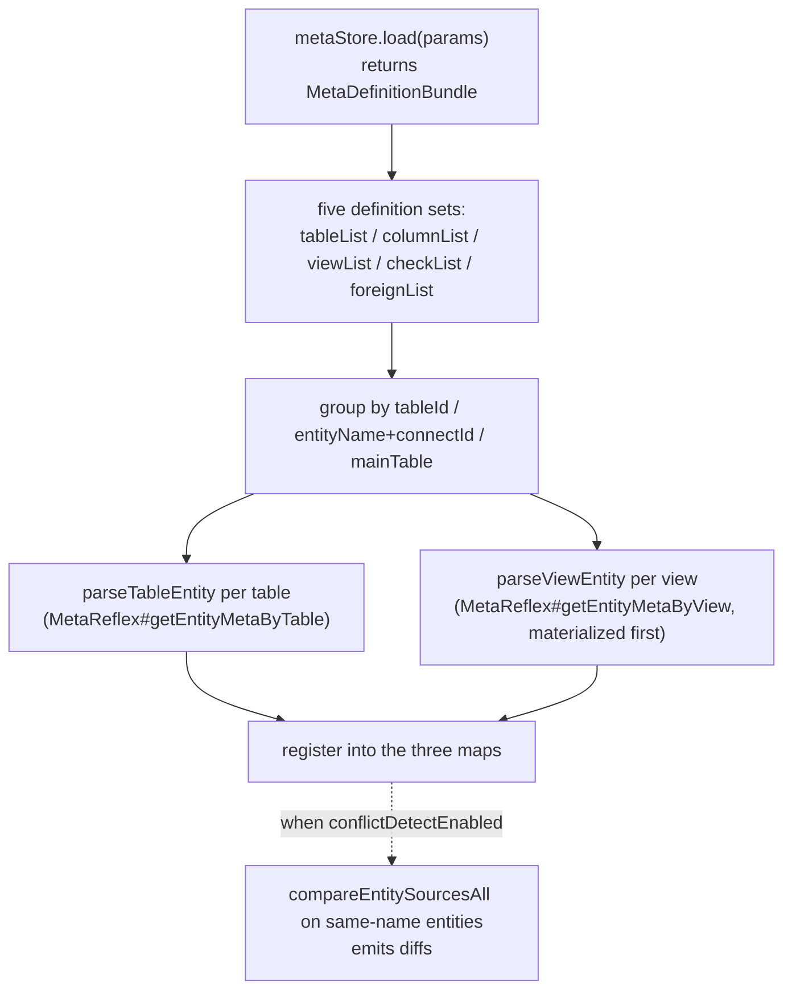

# Metadata Loading

This page explains where metadata comes from, when it is registered, how same-name conflicts are adjudicated, and what role caching plays. The model classes are documented in [Metadata Model](./model.md); runtime query and refresh APIs in [Runtime Operations](./operations.md).

## MetaManager: The Singleton Registry

Path: `cn.geelato.core.meta.MetaManager` (geelato-core). A global singleton (`singleInstance()` with a ReentrantLock); its constructor first registers the two definition classes themselves — `parseOne(ColumnMeta.class)` and `parseOne(TableMeta.class)` — so that "the definition of metadata" also has metadata.

### Registry Structure

| Container | Key | Purpose |
| --- | --- | --- |
| `entityMetadataMap` | entityName | **The main registry** — the only map ORM/MQL read at runtime; the merged view of both sources |
| `entityMetadataMapFromClass` | entityName | ORM annotation-source cache |
| `entityMetadataMapFromDatabase` | entityName | Online definition-source cache |
| `tableNameMetadataMap` | tableName | Structure name → entity; the entry point for by-name lookups |
| `entityLiteMetaList` | — | Slim entity list for outward lightweight queries |
| `entityFieldNameTitleMap` (static) | fieldName/columnName | Field-title mapping for debugging |
| `scannedPackages` | package name | Cross-module scan deduplication (`ConcurrentHashMap.newKeySet`) |

### Configuration State Outside the Registry

| Field | Default | Meaning |
| --- | --- | --- |
| `metaStore` | null | Injected MetaStore SPI (the data source of the online definition source) |
| `metaResourceProvider` | DefaultMetaResourceProvider | Static-resource SPI (default columns / column select types / structure upgrade columns) |
| `conflictStrategy` | CLASS | Same-name conflict strategy; config key `geelato.meta.conflict-strategy` |
| `conflictDetectEnabled` | false | Conflict detection switch; config key `geelato.meta.conflict-detect.enabled` |
| `catalogConnectIdMapping` | empty map | catalog → connectId mapping from `geelato.datasource.dynamic.catalog-mapping` |

## Three Startup Load Paths

### Path A: geelato-orm scans the main class package

`OrmAutoConfiguration#ormEntityMetadataInitializer` in `geelato-orm` is a `SmartInitializingSingleton` bean — it runs after all singleton beans are ready:

1. `AutoConfigurationPackages.get(applicationContext)` gets the Spring Boot main class package;
2. `metaManager.isPackageAlreadyScanned(pkg)` filters already-scanned packages;
3. `ClassPathScanningCandidateComponentProvider` with `AnnotationTypeFilter(Entity.class)` finds `@Entity` classes;
4. Each class is loaded via `ClassUtils.forName` and registered through `MetaManager#parseOne(Class)`.

### Path B: MetaConfiguration scans cn.geelato and loads the online definition source

`cn.geelato.web.platform.boot.MetaConfiguration` in `geelato-web-platform` (a `@Configuration` discovered through component scanning of `cn.geelato`) runs on `setApplicationContext`:

1. Injects `metaStore` / `metaResourceProvider` / conflict configuration;
2. `initClassPackageMeta()`: reads `geelato.meta.scan-package-names` (default **`cn.geelato`**), splits by comma, and calls `metaManager.scanAndParse(packageName, false)` for each — internally `AnnotatedClassScanner` (ASM reads bytecode annotations and only calls ClassUtils.forName on hits, avoiding full class loading) feeds `parseOne(clazz)`;
3. `initDataBaseMeta()`: calls `metaManager.parseDBMeta()` to load the online definition source;
4. If a `MetaBootstrap` bean exists, calls `metaBootstrap.bootstrap(metaManager, dao)` for host-specific initialization.

### Path C: standalone MCP host loading

`MetaInitConfig` in `geelato-mcp` (`@PostConstruct init()`) repeats the logic of Path B with scan-package-names read from a System property. MCP hosts run independently of the aggregate build.

### What the Order Means

Path A scans the application main class package (business entities); Path B scans `cn.geelato` (platform entities). For same-name entities, registration order decides who wins "first-come-first-served"; but entities with `catalog=platform` always take the Java class definition (see the conflict strategy below), so platform entities are never accidentally overridden by online definitions.

## Loading the Online Definition Source: parseDBMeta

`MetaManager#parseDBMeta()` requires `metaStore` to be injected:



## The MetaStore SPI Contract

The framework does not mandate where metadata definitions live. Definitions can be designer-maintained structure lists, Excel files, MongoDB collections, config-center entries, or external metadata services — the framework only knows the interface:

| SPI | Method / responsibility | Notes |
| --- | --- | --- |
| `MetaStore` | `load(Map)` / `loadByEntityName(String)` / `loadByViewName(String)` | The definition-source interface: full load, load by entity name, load by view name |
| `MetaDefinitionBundle` | five final Lists | The contract bundle of load results: table definitions / column definitions / view definitions / CHECK constraint definitions / foreign-key definitions — the storage medium is decided by the implementation |
| `MetaStoreProvider` | `getMetaStore()` | Provider extension point |
| `MetaBootstrap` | `bootstrap(MetaManager, Dao)` | Host-specific initialization hook after loading |
| `MetaResourceProvider` | default columns / column select types / structure upgrade columns | Static-resource source SPI; the default implementation reads classpath JSON resources |

The platform ships the default implementation `DefaultMetaStore`, which reads from the platform's design-time storage; the full guide to a custom source (field conventions and wiring) is [MetaStore Extension](../reference/metastore-extension.md).

## Same-Name Conflict Strategy

Two sources coexisting means a same-name entity may yield two definitions. Adjudication rules:

| Scenario | Behavior |
| --- | --- |
| Conflict detection off (default) | **First-come-first-served**: when the entityName is already in the main map, the online source only supplies its TableMeta to the existing EntityMeta without a full override |
| Entities with `catalog=platform` | **Always the Java class definition**, under any strategy |
| Detection on + `conflictStrategy=CLASS` | Ignore online-definition overrides, keep the ORM annotation source |
| Detection on + `conflictStrategy=DATABASE` | `removeOne(entityName)` then a full override by the online definition |
| Detection on | `compareEntitySourcesAll` emits field-level diffs for same-name entities, queryable by conflict-query consumers |

Related configuration:

```yaml
geelato:
  meta:
    conflict-strategy: CLASS          # CLASS | DATABASE
    conflict-detect:
      enabled: false                  # when on, dual-source diffs are emitted and conflict lists become queryable
```

## Cache Responsibilities

Three layers of "cache" are involved in the metadata system, with entirely different responsibilities:

| Layer | Carrier | What is cached | Characteristics |
| --- | --- | --- | --- |
| **Metadata registry** | HashMaps inside MetaManager | EntityMeta itself | Purely in-process, **no distributed cache**; cross-instance consistency relies on explicit synchronization (refreshDBMeta) or a restart reload |
| **Meta-driven query-result cache** | MetaCacheProvider (j2cache `metaquery` region; falls back to a static `LocalBoundedCache`, ttl 60s / capacity 2000 when j2cache is unavailable) | **Results** of metadata-driven queries, not the registry | Eviction handled by the `PlatformQueryCacheEvictOnDelete/OnSave` listeners and `removeCacheByPattern` (supports `*x`/`x*`/`*x*`) |
| **Entity-level query cache gate** | `EntityMeta.isBackEndCacheEnabled()` | — | Decided by the design-time configured cache type (`EntityMeta.cacheType`, values `None/BackEnd/FrontEnd/BackEndAndFrontEnd`) |

Beyond these, several places use `LocalBoundedCache` for short-lived caches of metadata **derivatives** (e.g. the `$gl.sql` table locator at 60s/4096); these are downstream snapshots of the registry and expire naturally after registry changes.

:::warning Sharing and Eviction
The MetaManager registry is mutable singleton state; a runtime refresh (refreshDBMeta) only affects the current process. In multi-instance deployments, refreshes triggered by design-time changes must reach every instance (the platform achieves this via sync interfaces or restarts); writing to the storage directly leaves other instances unaware.
:::

## Distinction: Spring Bean Scanning vs Metadata Entity Scanning

`@ComponentScan` scans Spring beans; metadata scanning scans `@Entity` classes — the two are independent. An `@Entity` class does not need to be a Spring bean to get registered; a bean without `@Entity` never enters the registry. The historical `auto-scan`/`base-packages` configurations have been removed; the scan scope is now fixed to "main class package + `geelato.meta.scan-package-names`".

## Further Reading

- [Runtime Operations](./operations.md) — refreshDBMeta call sites and API details
- [MetaStore Extension](../reference/metastore-extension.md) — the full guide to a custom metadata source
- [Startup Process](../reference/startup-process.md) — where metadata initialization sits in the startup sequence (stage two)
- [Entity-Datasource Binding](../dynamic-datasource/entity-binding.md) — how catalog/connectId route to datasources
