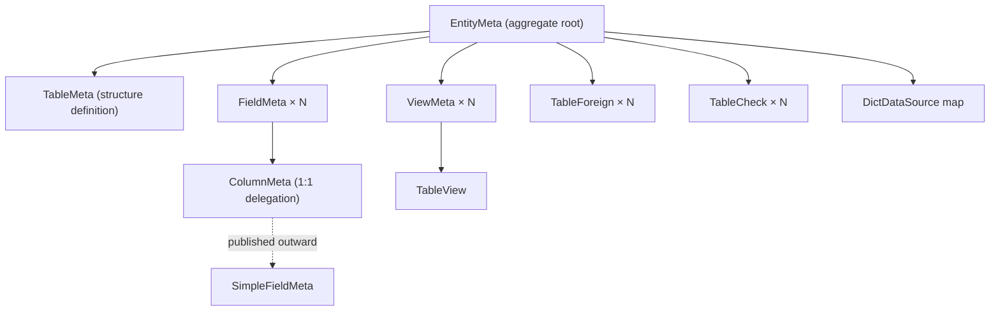

# Metadata Model

This page documents every model class in the metadata system, attribute by attribute. Code locations: the `cn.geelato.core.meta.model` package in `geelato-core`; annotations in the `cn.geelato.lang.meta` package in `geelato-lang`.

These models describe structured data itself, independent of the storage medium: the same attribute contracts can sit behind a MySQL table, an Excel worksheet, a MongoDB collection, or any other structured carrier.

Model relationships:

## EntityMeta: The Aggregate Root

Path: `cn.geelato.core.meta.model.entity.EntityMeta`.

### Attributes

| Attribute | Type | Meaning |
| --- | --- | --- |
| `entityName` | String | Entity name. Long class name for the ORM annotation source; the designer-maintained entity name for the online definition source |
| `entityTitle` | String | Entity title (from `@Title` or design-time maintenance) |
| `classType` | Class | The source Java class. Null for online-definition entities — the direct discriminator between the two sources |
| `entityType` | EntityType | Enum `Table / View / Class`, marking the form the metadata came from |
| `catalog` | String, default `"none"` | Logical database grouping, from `@Entity(catalog)`; participates in datasource routing |
| `id` | FieldMeta | Primary key field metadata; `setId` also adds the key to the ignore-update map |
| `tableMeta` | TableMeta | Structure-level definition (see below) |
| `tableAlias` | String | Structure alias used by SQL generation |
| `fieldNames` | String[] | All field names in a fixed order (see `setFieldMetas`) |
| `fieldMetas` | Collection\<FieldMeta\> | All field metadata |
| `viewMetas` | Collection\<ViewMeta\> | Associated view definitions |
| `tableForeigns` | Collection\<TableForeign\> | Foreign-key relations; `setTableForeigns` also builds the `foreignTable → TableForeign` index |
| `tableChecks` | Collection\<TableCheck\> | CHECK constraints |
| `dictDataSourceMap` | Map\<String, DictDataSource\> | Dictionary sources (fieldName → group/code), from `@DictDataSrc` |
| `fieldMetaMap` | LinkedHashMap | Redundant index: fieldName → FieldMeta for fast lookup |
| `simpleFieldMetaMap` | LinkedHashMap | Redundant index: outward-facing slim field metadata, filtered of storage-layer info |
| `tableForeignsMap` | Map\<String, TableForeign\> | Redundant index: foreignTable → TableForeign |
| `ignoreUpdateFieldMap` | Map\<String, Boolean\> | Non-updatable fields. Constructor adds `create_at/createAt/creator`; `setId` adds the primary key |
| `encryptedColumnNames` | Set\<String\> | All encrypted column names, lazily computed once, recomputed after `setFieldMetas` |
| `jsonFieldKeys` | Set\<String\> | Keys of JSON-typed fields (both fieldName and columnName), lazily computed; used by Dao row conversion to decide JSON parsing |
| `versionControl` | Boolean, default false | Version control (optimistic lock). **Currently suspended**: SQL generation does not consume it — treat it as not in effect |
| `deleteMode` | DeleteMode, default `AUTO` | Entity-level delete mode. AUTO means follow the global default; final resolution converges in `DeleteCommands.resolve` with priority call-site > entity > global |
| `cacheType` | EntityCacheType (private setter) | **The getter reads `tableMeta.cacheType` live**, deferring to the design-time configuration rather than storing its own value |

### Key Methods

| Method | Behavior |
| --- | --- |
| `setFieldMetas(Collection)` | Builds the three redundant indexes and reorders fields into a fixed sequence: `id` → `title` → `name` → business fields (incoming order) → `seq_no` → `description` → `del_status` → `create_at` → `creator` → `creator_name` → `update_at` → `updater` → `updater_name`. Also clears the encrypted/JSON lazy caches |
| `getColumnName(fieldName)` | Field name → column name; throws with the fieldName when missing |
| `getFieldMeta(fieldName)` / `getFieldMetas(String[])` | Field name → FieldMeta (reads `fieldMetaMap`) |
| `getFieldMetaByColumn(columnName)` | Column name → FieldMeta, linear scan; throws with entity/structure/column when missing — the pack/deploy structure consistency check relies on this behavior |
| `getSimpleFieldMetas(String[])` / `getAllSimpleFieldMetas()` | Outward-facing slim field metadata |
| `containsField(fieldName)` | Field existence; audit filling, logic-delete filling and permission injection all key off it |
| `isIgnoreUpdateField(field)` | Whether the field is non-updatable |
| `isBackEndCacheEnabled()` | Query-result cache gate: true when `cache_type ∈ {BackEnd, BackEndAndFrontEnd}` |
| `getViewMeta(viewName)` | Associated view by name |

## FieldMeta

Path: `cn.geelato.core.meta.model.field.FieldMeta`. Field metadata is the bridge between the Java field name and the stored field.

| Attribute | Type | Meaning |
| --- | --- | --- |
| `columnMeta` | ColumnMeta, final | The delegated column metadata; all column-level information lives there |
| `fieldName` | String | Java field name |
| `fieldType` | Class | Java type. ORM annotation source = reflected field type; online definition source = derived from the column's data_type via `MysqlToJavaEnum.getJava` |

Derived methods: `getColumnName()` is `columnMeta.getName()`, plus `getTitle()` and `isEquals()` (whether column name equals field name).

Two constructors correspond to the two sources: the ORM annotation path `(columnName, fieldName, title)`; the online-definition load path `(ColumnMeta)`.

## ColumnMeta

Path: `cn.geelato.core.meta.model.column.ColumnMeta`. Column metadata carries the complete definition of one stored field and is the delegated object of FieldMeta.

### Attributes

| Attribute | Type/Default | Meaning |
| --- | --- | --- |
| `appId` | String | Application id |
| `title` | String | Chinese name |
| `abstractColumnExpressions` | String | Computed-column expression; non-null marks an abstract column |
| `fieldName` | String | Java field name |
| `tableId` | String | Owning structure id |
| `tableSchema` | String | Database name |
| `tableName` | String | Structure name |
| `tableCatalog` | String | Structure catalog (e.g. def) |
| `name` | String | Column name |
| `comment` | String | Comment |
| `ordinalPosition` | int=0 | Column ordinal |
| `defaultValue` | String=null | Default value (auto_increment / null / current_timestamp / custom) |
| `type` | String | Full column type (e.g. varchar(64)) |
| `key` | boolean=false | Primary key column |
| `nullable` | boolean=true | Nullable |
| `dataType` | String | Data type (VARCHAR/INT…); SQL generation uses it to bind JDBC types |
| `extra` | String | Extra info; `afterSet` derives UNIQUE/AUTO_INCREMENT/UNSIGNED |
| `autoIncrement` | boolean=false | Auto increment |
| `uniqued` | boolean=false | Unique constraint |
| `charMaxLength` | long=64 | Character max length |
| `numericPrecision` | int=19 | Numeric precision |
| `numericScale` | int=0 | Numeric scale |
| `numericSigned` | boolean=false | Signed |
| `datetimePrecision` | int=0 | Datetime precision |
| `enableStatus` | int=1 | Enabled status |
| `linked` | int=1 | Linked |
| `description` | String | Description |
| `refLocalCol` | String | Local reference field (when `isRefColumn`) |
| `refColName` | String | Foreign field ([structure].[field]) |
| `refTables` | String | Foreign structure name(s), comma-separated |
| `selectType` | String | Select type (designer widget type) |
| `typeExtra` | String | Extra data of the select type |
| `extraValue` | String | Extra value |
| `extraMap` | String | Field-to-extra-field mapping |
| `autoAdd` | boolean=false | Whether org/user fields auto-add id/name |
| `autoName` | String | Identifier of the auto-added field |
| `synced` | boolean=false | Synced |
| `encrypted` | boolean | Encrypted column; `EntityMeta.encryptedColumnNames` derives from it |
| `marker` | String | Special marker |
| `drawed` | boolean=false | Designer field visibility |
| `isRefColumn` | boolean (on the getter) | Foreign-field column |
| `befColName` | String (@Transient) | Previous column name (staged during renames) |

Special behavior: `afterSet()` derives type, extra, defaultValue and autoIncrement from dataType plus `DataTypeRadiusEnum`/`MysqlDataTypeEnum`; a `(Map<String,Object>)` constructor builds directly from definition data loaded by a MetaStore.

## TableMeta

Path: `cn.geelato.core.meta.model.entity.TableMeta`. Carries the definition of one structure — name, schema, owning datasource, cache type, etc.

| Attribute | Type/Default | Meaning |
| --- | --- | --- |
| `appId` | String | Application id |
| `title` | String | Name (Chinese) |
| `connectId` | String | Datasource connect identifier, pointing to a connection definition (`ConnectMeta`); the highest-priority routing input |
| `dbType` | String | Database type; feeds SQL dialect resolution |
| `tableSchema` | String | Database schema |
| `tableName` | String | Structure name |
| `entityName` | String | Entity name |
| `tableType` | String | Structure type: entity / view / materialized |
| `tableComment` | String | Comment |
| `enableStatus` | int=1 | Enabled status |
| `linked` | int | Linked |
| `description` | String | Description |
| `synced` | Boolean=false | Synced |
| `sourceType` | String | Source type: system / creation |
| `packBusData` | int=0 | Data packaging strategy |
| `viewSql` | String | View SQL |
| `acrossApp` | boolean=false | Cross-application |
| `acrossWorkflow` | boolean=false | Cross-workflow |
| `cacheType` | String="none" | Cache type; the actual data source of `EntityMeta.isBackEndCacheEnabled` |

`versionControl` is commented out in code, awaiting the data-model addition to be enabled in several places together. **The optimistic lock is not in effect**; SQL generation does not consume it.

Methods: `dbTableName()` falls back to entityName when tableName is empty; the `(Map)` constructor falls back title → tableName → entityName.

## The Common Base Classes of Definition Classes

TableMeta, ColumnMeta, TableView, TableForeign, TableCheck and ConnectMeta inherit one base class chain `IdEntity → BaseEntity → BaseSortableEntity`, carrying the String primary key `id`, audit fields (createAt/creator/creatorName/buId/deptId/tenantCode/updateAt/updater/updaterName/deleteAt/delStatus) and the sort sequence `seqNo`. This is the implementation base **of the definition classes themselves**, serving their loading, ordering and maintenance — not a requirement the metadata model places on business entities; business-entity common fields are covered in [ORM Annotations](../orm/annotations.md).

## TableForeign

Carries the foreign-key relation between two structures; the query SQL generator uses it to emit left joins automatically and select display columns, and `EntityMeta.tableForeignsMap` indexes it by foreignTable.

| Attribute | Meaning |
| --- | --- |
| `appId` | Application id |
| `mainTableSchema` | Main table schema |
| `mainTableId` | Main table id |
| `mainTable` | Main structure name |
| `mainTableCol` | Main table column |
| `foreignTableSchema` | Foreign table schema |
| `foreignTableId` | Foreign table id |
| `foreignTable` | Foreign structure name |
| `foreignTableCol` | Foreign table column |
| `description` | Description |
| `enableStatus` | Enabled status |
| `deleteAction` | On-delete action (default FOREIGN_ACTION_VALUE) |
| `updateAction` | On-update action (default FOREIGN_ACTION_VALUE) |

## TableCheck

Carries the CHECK constraint definitions of a structure. Attributes: `appId`, `title`, `code`, `type`, `checkClause` (the constraint expression), `connectId`, `tableSchema`, `tableId`, `tableName`, `columnId`, `columnName`, `description`, `enableStatus`, `synced`.

## View Metadata: TableView / ViewMeta / ViewColumn

**TableView** carries the definition of a view:

| Attribute | Meaning |
| --- | --- |
| `appId` | Application id |
| `connectId` | Connect id (materialized views own a connection; virtual views inherit the subject entity when empty) |
| `entityName` | Subject entity name |
| `title` | Name |
| `viewName` | View name |
| `viewType` | View type |
| `viewConstruct` | View construction statement |
| `viewColumn` | View columns (JSON string) |
| `description` | Description |
| `linked` | Linked |
| `enableStatus` | Enabled status |

**ViewMeta** (not an entity) is the runtime form registered into EntityMeta, holding `viewMeta(TableView)`, `viewName`, `viewType`, `viewConstruct`, `viewColumn`, `subjectEntity`. **ViewColumn** (not an entity) carries view column definitions (table_name/column_name/field_name/title/select_type, lengths and precisions); the static `fromColumnMeta(ColumnMeta)` converts from column metadata.

## ConnectMeta

Carries the definition of a datasource connection. The `$gl.sql` kit locates physical databases through this chain: structure → EntityMeta → connectId → this connection definition.

| Attribute | Meaning |
| --- | --- |
| `appId` | Application id |
| `dbConnectName` | Connection name |
| `dbName` | Database name |
| `dbSchema` | Schema |
| `dbType` | Database type |
| `dbUserName` | User name |
| `dbPassword` | Connection password |
| `dbPort` | Port |
| `dbHostnameIp` | Host address |
| `enableStatus` | Enabled status |

## Outward-Facing Models

These slim models never enter the MetaManager registry; they are the "export forms" of metadata.

### SimpleFieldMeta

Produced by `EntityMeta.getSimpleFieldMetas` / `getAllSimpleFieldMetas`, filtered of structure/schema/storage-layer information — the contract with which the low-code frontend renders forms and tables:

| Attribute | Type | Source (ColumnMeta) |
| --- | --- | --- |
| `name` | String | fieldName |
| `type` | String | fieldType simpleName |
| `title` | String | title |
| `comment` | String | comment |
| `nullable` | boolean | nullable |
| `charMaxLength` | long | charMaxLength |
| `precision` | int | numericPrecision |
| `scale` | int | numericScale |
| `selectType` | String | selectType |
| `typeExtra` | String | typeExtra |
| `extraValue` | String | extraValue |
| `extraMap` | String | extraMap |
| `defaultValue` | String | defaultValue |

### EntityLiteMeta

Slim entity list item (exposed via MetaManager.getAllEntityLiteMetas): `entityName`, `entityTitle`, `entityType` (String).

### DictDataSource

Dictionary source declaration (from `@DictDataSrc`): `group` (dictionary group), `code` (dictionary code, default "code"). Audit-log dictionary translation (`DictDisplayResolver`) uses it to translate field values into dictionary labels.

## Annotation → Metadata Mapping

Read these annotations together with the ORM chapter: they are at once ORM's entity-mapping declarations and the declaration form of metadata — metadata and ORM share the same annotation set; declaring is mapping. Annotations live in the `cn.geelato.lang.meta` package of `geelato-lang` and are parsed into FieldMeta/ColumnMeta by `MetaReflex#getColumnFieldMetas`. Usage and examples are in [ORM Annotations](../orm/annotations.md); this section lists only the attribute contracts.

### @Entity (on the class)

| Attribute | Default | Maps to |
| --- | --- | --- |
| `name` | `""` (empty → class name) | `entityName`; structure-name resolution order table→name→simpleName |
| `table` | `""` | Structure name |
| `catalog` | `""` | `EntityMeta.catalog`; participates in datasource routing |
| `schema` | `""` | Schema |
| `connectId` | `""` | Explicit datasource key, taking precedence over the catalog mapping |
| `deleteMode` | `DeleteMode.AUTO` | `EntityMeta.deleteMode` |

### @Col (on fields/getters)

| Attribute | Default | Maps to ColumnMeta |
| --- | --- | --- |
| `name` | required | Column name |
| `unique` | false | Unique constraint |
| `nullable` | true | Nullable |
| `dataType` | `""` (derived from the Java type when empty) | Data type |
| `charMaxlength` | 0 (0 → dataType default: 65535 for Text types, otherwise 64) | Character length |
| `numericPrecision` | 20 | Numeric precision |
| `numericScale` | 0 | Numeric scale |
| `datetimePrecision` | 0 | Datetime precision |
| `isRefColumn` | false | Foreign-field column |
| `refLocalCol` | `""` | Local reference field |
| `refColName` | `""` | Foreign field |
| `refTables` | `""` | Foreign structure name(s) |

### Other Annotations

| Annotation | Target | Attributes | Effect |
| --- | --- | --- | --- |
| `@Title` | TYPE/METHOD/FIELD | `title` (required), `description` | Entity/field title, into `entityTitle` and ColumnMeta.title |
| `@Id` | METHOD/FIELD | none | Marks the primary key; on a getter the field name is derived from the method name |
| `@Transient` | METHOD/FIELD | none | Skipped during parsing and recorded to avoid duplicate parsing in subclasses |
| `@Ignore` | FIELD | `type(): IgnoreType[]`, default `{}` | Excludes by `PAGE_QUERY/QUERY/GET/SAVE/UPDATE/DELETE` |
| `@ForeignKey` | METHOD/FIELD | `fTable` (required, foreign entity Class), `fCol` (empty → fTable's @Id column) | Produces a TableForeign |
| `@DictDataSrc` | METHOD/FIELD | `group` (required), `code` (default "code") | Enters `dictDataSourceMap` |

### DeleteMode Enum

| Value | Meaning |
| --- | --- |
| `AUTO` | Annotation default only; follow the global default (`GEELATO_DELETE_MODE` environment variable, default logic) |
| `LOGIC` | Logic delete; the entity must contain a delStatus field or resolution fails hard |
| `PHYSICAL` | Physical delete |

Parsing details: fields are scanned before get/is methods; without `@Col` a column name is generated from the field name (camelCase → snake_case); boolean defaults are read from the bean instance and normalized to "1"/"0"; an empty dataType goes through `TypeConverter.toSqlTypeString(fieldType)`; finally every column passes `ColumnMeta.afterSet()`.

## Physical-Structure Reflection Models (schema package)

The `cn.geelato.core.meta.schema` package collects structure definitions **backwards from physical storage**, supporting "physical structure ↔ metadata" comparison and consistency checks. The current adaptation targets MySQL's `information_schema` and `SHOW INDEX`; per the framework abstraction the physical carrier is not limited — reflection over other media is an extension direction.

| Class | Source | Notes |
| --- | --- | --- |
| `SchemaTable` | information_schema.tables | All 21 columns mapped directly |
| `SchemaColumn` | INFORMATION_SCHEMA.COLUMNS | Includes unique; `convertIntoMeta(ColumnMeta)` converts and triggers afterSet |
| `SchemaIndex` | SHOW INDEX | Carrier of index information; **does not enter MetaManager**, reflection use only |
| `SchemaForeign` | Constraints + KEY_COLUMN_USAGE | `convertTableForeign(TableForeign)` converts |
| `SchemaCheck` | TABLE_CONSTRAINTS + CHECK_CONSTRAINTS | CHECK constraint reflection |

There is no class named `IndexMeta` or `RelationMeta` in the framework: indexes are carried by `SchemaIndex`, and "relations" by `TableForeign`.

## Further Reading

- [Metadata Loading](./loading.md) — how these models are constructed and registered into MetaManager
- [Runtime Operations](./operations.md) — runtime query, registration and refresh APIs
- [Where Metadata Extends](./extensions.md) — the panorama of upper-layer capabilities consuming these models
- [ORM Annotations](../orm/annotations.md) — annotation usage and complete examples
