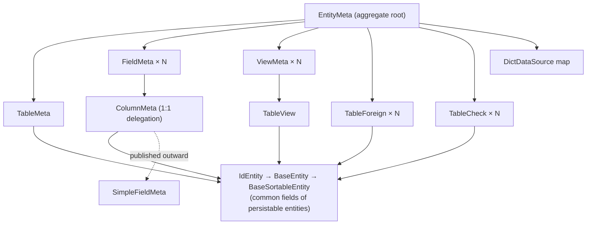

# Metadata Model

This page documents every model class in the metadata system, attribute by attribute. Code locations: the `cn.geelato.core.meta.model` package in `geelato-core`; annotations in the `cn.geelato.lang.meta` package in `geelato-lang`.

Model relationships:

## EntityMeta: The Aggregate Root

Path: `cn.geelato.core.meta.model.entity.EntityMeta`.

### Attributes

| Attribute | Type | Meaning |
| --- | --- | --- |
| `entityName` | String | Entity name. Long class name for the class source; `platform_dev_table.entity_name` for the DB source |
| `entityTitle` | String | Entity title (from `@Title` or the designer) |
| `classType` | Class | The source Java class. Null for DB-source entities — the direct discriminator between the two sources |
| `entityType` | EntityType | Enum `Table / View / Class`, marking the form the metadata came from |
| `catalog` | String, default `"none"` | Logical database grouping, from `@Entity(catalog)`; participates in datasource routing |
| `id` | FieldMeta | Primary key field metadata; `setId` also adds the key to the ignore-update map |
| `tableMeta` | TableMeta | Table-level definition (see below) |
| `tableAlias` | String | Table alias used by SQL generation |
| `fieldNames` | String[] | All field names in a fixed order (see `setFieldMetas`) |
| `fieldMetas` | Collection\<FieldMeta\> | All field metadata |
| `viewMetas` | Collection\<ViewMeta\> | Associated view definitions |
| `tableForeigns` | Collection\<TableForeign\> | Foreign-key relations; `setTableForeigns` also builds the `foreignTable → TableForeign` index |
| `tableChecks` | Collection\<TableCheck\> | CHECK constraints |
| `dictDataSourceMap` | Map\<String, DictDataSource\> | Dictionary sources (fieldName → group/code), from `@DictDataSrc` |
| `fieldMetaMap` | LinkedHashMap | Redundant index: fieldName → FieldMeta for fast lookup |
| `simpleFieldMetaMap` | LinkedHashMap | Redundant index: outward-facing slim field metadata, filtered of table/schema info |
| `tableForeignsMap` | Map\<String, TableForeign\> | Redundant index: foreignTable → TableForeign |
| `ignoreUpdateFieldMap` | Map\<String, Boolean\> | Non-updatable fields. Constructor adds `create_at/createAt/creator`; `setId` adds the primary key |
| `encryptedColumnNames` | Set\<String\> | All encrypted column names, lazily computed once, recomputed after `setFieldMetas` |
| `jsonFieldKeys` | Set\<String\> | Keys of JSON-typed fields (both fieldName and columnName), lazily computed; used by Dao row conversion to decide JSON parsing |
| `versionControl` | Boolean, default false | Version control (optimistic lock). **Currently suspended**: `platform_dev_table` has no `version_control` column yet and SQL generation does not consume it — treat it as not in effect |
| `deleteMode` | DeleteMode, default `AUTO` | Entity-level delete mode. AUTO means follow the global default; final resolution converges in `DeleteCommands.resolve` with priority call-site > entity > global |
| `cacheType` | EntityCacheType (private setter) | **The getter reads `tableMeta.cacheType` live**, deferring to the designer configuration rather than storing its own value |

### Key Methods

| Method | Behavior |
| --- | --- |
| `setFieldMetas(Collection)` | Builds the three redundant indexes and reorders fields into a fixed sequence: `id` → `title` → `name` → business fields (incoming order) → `seq_no` → `description` → `del_status` → `create_at` → `creator` → `creator_name` → `update_at` → `updater` → `updater_name`. Also clears the encrypted/JSON lazy caches |
| `getColumnName(fieldName)` | Field name → column name; throws with the fieldName when missing |
| `getFieldMeta(fieldName)` / `getFieldMetas(String[])` | Field name → FieldMeta (reads `fieldMetaMap`) |
| `getFieldMetaByColumn(columnName)` | Column name → FieldMeta, linear scan; throws with entity/table/column when missing — the pack/deploy column consistency check relies on this behavior |
| `getSimpleFieldMetas(String[])` / `getAllSimpleFieldMetas()` | Outward-facing slim field metadata |
| `containsField(fieldName)` | Field existence; audit filling, logic-delete filling and permission injection all key off it |
| `isIgnoreUpdateField(field)` | Whether the field is non-updatable |
| `isBackEndCacheEnabled()` | Query-result cache gate: true when `cache_type ∈ {BackEnd, BackEndAndFrontEnd}` |
| `getViewMeta(viewName)` | Associated view by name |

## FieldMeta

Path: `cn.geelato.core.meta.model.field.FieldMeta`. Field metadata is the bridge between the Java field name and the physical column.

| Attribute | Type | Meaning |
| --- | --- | --- |
| `columnMeta` | ColumnMeta, final | The delegated column metadata; all column-level information lives there |
| `fieldName` | String | Java field name |
| `fieldType` | Class | Java type. Class source = reflected field type; DB source = derived from the column's data_type via `MysqlToJavaEnum.getJava` |

Derived methods: `getColumnName()` is `columnMeta.getName()`, plus `getTitle()` and `isEquals()` (whether column name equals field name).

Two constructors correspond to the two sources: annotation path `(columnName, fieldName, title)`; DB load path `(ColumnMeta)`.

## ColumnMeta

Path: `cn.geelato.core.meta.model.column.ColumnMeta`.

ColumnMeta is also a persistable entity: `@Entity(name = "platform_dev_column", catalog = "platform")`, extends `BaseSortableEntity`. The definition of a column is itself stored in the platform's column-definition table.

### Attributes

| Attribute | Column | Type/Default | Meaning |
| --- | --- | --- | --- |
| `appId` | app_id | String | Application id |
| `title` | title | String | Chinese name |
| `abstractColumnExpressions` | — (no @Col) | String | Computed-column expression; non-null marks an abstract column |
| `fieldName` | field_name | String | Java field name |
| `tableId` | table_id | String | Owning table id |
| `tableSchema` | table_schema | String | Database name |
| `tableName` | table_name | String | Table name |
| `tableCatalog` | table_catalog | String | Table catalog (e.g. def) |
| `name` | column_name | String | Column name |
| `comment` | column_comment | String | Comment |
| `ordinalPosition` | ordinal_position | int=0 | Column ordinal |
| `defaultValue` | column_default | String=null | Default value (auto_increment / null / current_timestamp / custom) |
| `type` | column_type | String | Full column type (e.g. varchar(64)) |
| `key` | column_key | boolean=false | Primary key column |
| `nullable` | is_nullable | boolean=true | Nullable |
| `dataType` | data_type | String | Data type (VARCHAR/INT…); SQL generation uses it to bind JDBC types |
| `extra` | extra | String | Extra info; `afterSet` derives UNIQUE/AUTO_INCREMENT/UNSIGNED |
| `autoIncrement` | auto_increment | boolean=false | Auto increment |
| `uniqued` | is_unique | boolean=false | Unique constraint |
| `charMaxLength` | character_maxinum_length | long=64 | Character max length (the column name spelling `character_maxinum_length` is an established convention, kept as is) |
| `numericPrecision` | numeric_precision | int=19 | Numeric precision |
| `numericScale` | numeric_scale | int=0 | Numeric scale |
| `numericSigned` | numeric_signed | boolean=false | Signed |
| `datetimePrecision` | datetime_precision | int=0 | Datetime precision |
| `enableStatus` | enable_status | int=1 | Enabled status |
| `linked` | linked | int=1 | Linked |
| `description` | description | String | Description |
| `refLocalCol` | ref_local_col | String | Local reference field (when `isRefColumn`) |
| `refColName` | foreign_col_name | String | Foreign field ([table].[field]) |
| `refTables` | foreign_table | String | Foreign table(s), comma-separated |
| `selectType` | select_type | String | Select type (designer widget type) |
| `typeExtra` | type_extra | String | Extra data of the select type |
| `extraValue` | extra_value | String | Extra value |
| `extraMap` | extra_map | String | Field-to-extra-field mapping |
| `autoAdd` | auto_add | boolean=false | Whether org/user fields auto-add id/name |
| `autoName` | auto_name | String | Identifier of the auto-added field |
| `synced` | synced | boolean=false | Synced |
| `encrypted` | encrypted | boolean | Encrypted column; `EntityMeta.encryptedColumnNames` derives from it |
| `marker` | marker | String | Special marker |
| `drawed` | drawed | boolean=false | Designer field visibility |
| `isRefColumn` | is_foreign_column (on the getter) | boolean | Foreign-field column |
| `befColName` | @Transient | String | Previous column name (staged during renames) |

Inherited fields are listed under [Base class chain](#base-class-chain-of-persistable-entities).

Special behavior: `afterSet()` derives type, extra, defaultValue and autoIncrement from dataType plus `DataTypeRadiusEnum`/`MysqlDataTypeEnum`; a `(Map<String,Object>)` constructor loads rows directly from `platform_dev_column`.

## TableMeta

Path: `cn.geelato.core.meta.model.entity.TableMeta`. Persistable entity: `@Entity(name = "platform_dev_table", catalog = "platform")`, extends `BaseSortableEntity`.

| Attribute | Column | Type/Default | Meaning |
| --- | --- | --- | --- |
| `appId` | app_id | String | Application id |
| `title` | title | String | Name (Chinese) |
| `connectId` | connect_id | String | Database connect id (the id in `platform_dev_db_connect`); the highest-priority routing input |
| `dbType` | db_type | String | Database type; feeds SQL dialect resolution |
| `tableSchema` | table_schema | String | Database schema |
| `tableName` | table_name | String | Table name |
| `entityName` | entity_name | String | Entity name |
| `tableType` | table_type | String | Table type: entity / view / materialized |
| `tableComment` | table_comment | String | Comment |
| `enableStatus` | enable_status | int=1 | Enabled status |
| `linked` | linked | int | Linked |
| `description` | description | String | Description |
| `synced` | synced | Boolean=false | Synced |
| `sourceType` | source_type | String | Source type: system / creation |
| `packBusData` | pack_bus_data | int=0 | Data packaging strategy |
| `viewSql` | view_sql | String | View SQL |
| `acrossApp` | across_app | boolean=false | Cross-application |
| `acrossWorkflow` | across_workflow | boolean=false | Cross-workflow |
| `cacheType` | cache_type | String="none" | Cache type; the actual data source of `EntityMeta.isBackEndCacheEnabled` |

`versionControl` is commented out in code — by convention its column would be `version_control`; it awaits the column addition with three call sites to enable together. **The optimistic lock is not in effect**; SQL generation does not consume it.

Methods: `dbTableName()` falls back to entityName when tableName is empty; the `(Map)` constructor falls back title → tableName → entityName.

## Base Class Chain of Persistable Entities

All metadata entities stored in `platform_dev_*` tables share one base class chain.

### IdEntity

| Attribute | Meaning |
| --- | --- |
| `id` | `@Id` String primary key |

### BaseEntity (extends IdEntity)

| Attribute | Column | Meaning |
| --- | --- | --- |
| `createAt` | create_at, not null | Creation time |
| `creator` | creator, not null | Creator |
| `creatorName` | creator_name | Creator name |
| `buId` | bu_id (32) | Business unit id |
| `deptId` | dept_id (32) | Department id |
| `tenantCode` | tenant_code (32) | Tenant code |
| `updateAt` | update_at, not null | Update time |
| `updater` | updater, not null | Updater |
| `updaterName` | updater_name | Updater name |
| `deleteAt` | delete_at | Delete time |
| `delStatus` | del_status (int=0) | Logic-delete marker |

### BaseSortableEntity (extends BaseEntity)

| Attribute | Column | Meaning |
| --- | --- | --- |
| `seqNo` | seq_no | Sort sequence, implements `EntitySortable` |

## TableForeign

Persistable entity: `@Entity(name = "platform_dev_table_foreign", catalog = "platform")`, extends `BaseSortableEntity`.

| Attribute | Column | Meaning |
| --- | --- | --- |
| `appId` | app_id | Application id |
| `mainTableSchema` | main_table_schema | Main table schema |
| `mainTableId` | main_table_id | Main table id |
| `mainTable` | main_table | Main table name |
| `mainTableCol` | main_table_col | Main table column |
| `foreignTableSchema` | foreign_table_schema | Foreign table schema |
| `foreignTableId` | foreign_table_id | Foreign table id |
| `foreignTable` | foreign_table | Foreign table name |
| `foreignTableCol` | foreign_table_col | Foreign table column |
| `description` | description | Description |
| `enableStatus` | enable_status | Enabled status |
| `deleteAction` | delete_action, default FOREIGN_ACTION_VALUE | On-delete action |
| `updateAction` | update_action, default FOREIGN_ACTION_VALUE | On-update action |

The query SQL generator uses it to emit left joins automatically and select display columns; `EntityMeta.tableForeignsMap` indexes it by foreignTable.

## TableCheck

Persistable entity: `@Entity(name = "platform_dev_table_check", catalog = "platform")`, extends `BaseEntity`.

Attributes: `appId`, `title`, `code`, `type`, `checkClause` (check_clause, the constraint expression), `connectId` (connect_id), `tableSchema` (table_schema), `tableId` (table_id), `tableName` (table_name), `columnId` (column_id), `columnName` (column_name), `description`, `enableStatus` (enable_status), `synced`.

## View Metadata: TableView / ViewMeta / ViewColumn

**TableView** is the persistable entity: `@Entity(name = "platform_dev_view")`, extends `BaseSortableEntity`.

| Attribute | Column | Meaning |
| --- | --- | --- |
| `appId` | app_id | Application id |
| `connectId` | connect_id | Connect id (materialized views own a connection; virtual views inherit the subject entity when empty) |
| `entityName` | entity_name | Subject entity name |
| `title` | title | Name |
| `viewName` | view_name | View name |
| `viewType` | view_type | View type |
| `viewConstruct` | view_construct | View construction statement |
| `viewColumn` | view_column | View columns (JSON string) |
| `description` | description | Description |
| `linked` | linked | Linked |
| `enableStatus` | enable_status | Enabled status |

**ViewMeta** (not an entity) is the runtime form registered into EntityMeta, holding `viewMeta(TableView)`, `viewName`, `viewType`, `viewConstruct`, `viewColumn`, `subjectEntity`. **ViewColumn** (not an entity) carries view column definitions (table_name/column_name/field_name/title/select_type, lengths and precisions); the static `fromColumnMeta(ColumnMeta)` converts from column metadata.

## ConnectMeta

Persistable entity: `@Entity(name = "platform_dev_db_connect", catalog = "platform")`, extends `BaseEntity`.

| Attribute | Column | Constraints |
| --- | --- | --- |
| `appId` | app_id | Application id |
| `dbConnectName` | db_connect_name | not null, 255 |
| `dbName` | db_name | not null, 150 |
| `dbSchema` | db_schema | not null, 255 |
| `dbType` | db_type | not null, 20 |
| `dbUserName` | db_user_name | not null, 20 |
| `dbPassword` | db_password | Connection password |
| `dbPort` | db_port | Port |
| `dbHostnameIp` | db_hostname_ip | Host address |
| `enableStatus` | enable_status | Enabled status |

The `$gl.sql` kit locates physical databases through this chain: table → EntityMeta → connectId → this row's host/port/db.

## Outward-Facing Models

These slim models never enter the MetaManager registry; they are the "export forms" of metadata.

### SimpleFieldMeta

Produced by `EntityMeta.getSimpleFieldMetas` / `getAllSimpleFieldMetas`, filtered of table/schema/connection information — the contract with which the low-code frontend renders forms and tables:

| Attribute | Type | Source (ColumnMeta) |
| --- | --- | --- |
| `name` | String | fieldName |
| `type` | String | fieldType simpleName |
| `title` | String | title |
| `comment` | String | comment |
| `nullable` | boolean | nullable |
| `charMaxLength` | long | charMaxLength |
| `precision` | int | numericPrecision |
| `scale` | int | numericScale |
| `selectType` | String | selectType |
| `typeExtra` | String | typeExtra |
| `extraValue` | String | extraValue |
| `extraMap` | String | extraMap |
| `defaultValue` | String | defaultValue |

### EntityLiteMeta

Slim entity list item (returned by `/api/meta/entityLiteMetas`): `entityName`, `entityTitle`, `entityType` (String).

### DictDataSource

Dictionary source declaration (from `@DictDataSrc`): `group` (dictionary group), `code` (dictionary code, default "code"). Audit-log dictionary translation (`DictDisplayResolver`) uses it to translate field values into dictionary labels.

## Annotation → Metadata Mapping

Annotations live in the `cn.geelato.lang.meta` package of `geelato-lang` and are parsed into FieldMeta/ColumnMeta by `MetaReflex#getColumnFieldMetas`. Usage and examples are in [ORM Annotations](../orm/annotations.md); this section lists only the attribute contracts.

### @Entity (on the class)

| Attribute | Default | Maps to |
| --- | --- | --- |
| `name` | `""` (empty → class name) | `entityName`; table-name resolution order table→name→simpleName |
| `table` | `""` | Table name |
| `catalog` | `""` | `EntityMeta.catalog`; participates in datasource routing |
| `schema` | `""` | Schema |
| `connectId` | `""` | Explicit datasource key, taking precedence over the catalog mapping |
| `deleteMode` | `DeleteMode.AUTO` | `EntityMeta.deleteMode` |

### @Col (on fields/getters)

| Attribute | Default | Maps to ColumnMeta |
| --- | --- | --- |
| `name` | required | Column name |
| `unique` | false | Unique constraint |
| `nullable` | true | Nullable |
| `dataType` | `""` (derived from the Java type when empty) | Data type |
| `charMaxlength` | 0 (0 → dataType default: 65535 for Text types, otherwise 64) | Character length |
| `numericPrecision` | 20 | Numeric precision |
| `numericScale` | 0 | Numeric scale |
| `datetimePrecision` | 0 | Datetime precision |
| `isRefColumn` | false | Foreign-field column |
| `refLocalCol` | `""` | Local reference field |
| `refColName` | `""` | Foreign field |
| `refTables` | `""` | Foreign table(s) |

### Other Annotations

| Annotation | Target | Attributes | Effect |
| --- | --- | --- | --- |
| `@Title` | TYPE/METHOD/FIELD | `title` (required), `description` | Entity/field title, into `entityTitle` and ColumnMeta.title |
| `@Id` | METHOD/FIELD | none | Marks the primary key; on a getter the field name is derived from the method name |
| `@Transient` | METHOD/FIELD | none | Skipped during parsing and recorded to avoid duplicate parsing in subclasses |
| `@Ignore` | FIELD | `type(): IgnoreType[]`, default `{}` | Excludes by `PAGE_QUERY/QUERY/GET/SAVE/UPDATE/DELETE` |
| `@ForeignKey` | METHOD/FIELD | `fTable` (required, foreign entity Class), `fCol` (empty → fTable's @Id column) | Produces a TableForeign |
| `@DictDataSrc` | METHOD/FIELD | `group` (required), `code` (default "code") | Enters `dictDataSourceMap` |

### DeleteMode Enum

| Value | Meaning |
| --- | --- |
| `AUTO` | Annotation default only; follow the global default (`GEELATO_DELETE_MODE` environment variable, default logic) |
| `LOGIC` | Logic delete; the entity must contain a delStatus field or resolution fails hard |
| `PHYSICAL` | Physical delete |

Parsing details: fields are scanned before get/is methods; without `@Col` a column name is generated from the field name (camelCase → snake_case); boolean defaults are read from the bean instance and normalized to "1"/"0"; an empty dataType goes through `TypeConverter.toSqlTypeString(fieldType)`; finally every column passes `ColumnMeta.afterSet()`.

## DB Reflection Models (schema package)

The `cn.geelato.core.meta.schema` package maps `information_schema` and `SHOW INDEX` results directly, for physical-database reflection and comparison:

| Class | Source | Notes |
| --- | --- | --- |
| `SchemaTable` | information_schema.tables | All 21 columns mapped directly |
| `SchemaColumn` | INFORMATION_SCHEMA.COLUMNS | Includes unique; `convertIntoMeta(ColumnMeta)` converts and triggers afterSet |
| `SchemaIndex` | SHOW INDEX | Carrier of index information; **does not enter MetaManager**, reflection use only |
| `SchemaForeign` | Constraints + KEY_COLUMN_USAGE | `convertTableForeign(TableForeign)` converts |
| `SchemaCheck` | TABLE_CONSTRAINTS + CHECK_CONSTRAINTS | CHECK constraint reflection |

There is no class named `IndexMeta` or `RelationMeta` in the framework: indexes are carried by `SchemaIndex`, and "relations" by `TableForeign`.

## Further Reading

- [Metadata Loading](./loading.md) — how these models are constructed and registered into MetaManager
- [Runtime Operations](./operations.md) — runtime query, registration and refresh APIs
- [Persistence and Interfaces](./interfaces.md) — the platform_dev_* tables behind ColumnMeta/TableMeta
- [ORM Annotations](../orm/annotations.md) — annotation usage and complete examples
