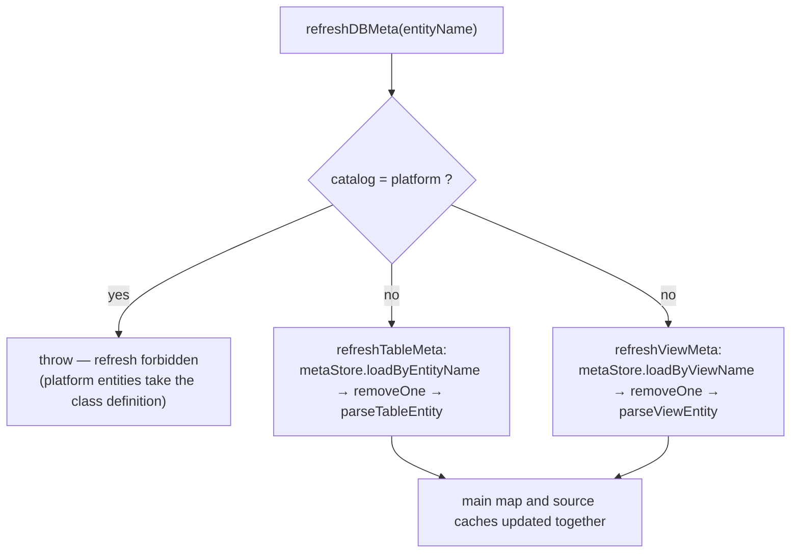

# Metadata Runtime Operations

This page collects every runtime entry point of the metadata system: the MetaManager query/registration/refresh APIs, EntityMeta field-level queries, and the trigger scenarios of refreshDBMeta. Loading mechanics are in [Metadata Loading](./loading.md).

## MetaManager Query APIs

Path: `cn.geelato.core.meta.MetaManager`.

### Fetching by Entity

| Method | Meaning |
| --- | --- |
| `get(Class clazz)` | Fetch by Java class; internally converts to an entity name via `MetaReflex.getEntityName(clazz)` and reads the main map |
| `getByEntityName(String entityName)` | Fetch by entity name (main registry) |
| `getByEntityName(String entityName, boolean cache)` | With `cache=false`, refreshes the DB-source definition first — for scenarios needing the freshest definition |
| `get(String tableName)` | Fetch by table name (reads `tableNameMetadataMap`) |
| `containsEntity(String entityName)` | Whether the entity is registered; MQL entity-existence validation uses it |
| `getAll()` / `getAllEntityNames()` / `getAllEntityLiteMetas()` | All entities / all entity names / slim list |

### Dual-Source Access and Comparison

| Method | Meaning |
| --- | --- |
| `getClassSourceEntity(String)` | The Java class-source copy |
| `getDatabaseSourceEntity(String)` | The DB online-source copy |
| `compareEntitySources(String)` | Field-level dual-source diff for one entity (Map result) |
| `compareEntitySourcesAll(String)` | Full dual-source comparison (called by parseDBMeta when conflict detection is on) |
| `getConflictingEntityNames()` / `getAllConflicts()` / `getConflictCount()` | Conflict lists backing `/api/meta/conflicts` |

### Routing and Derived Information

| Method | Meaning |
| --- | --- |
| `resolveConnectId(String entityName)` | Entity → connect id: `TableMeta.connectId` first, then `catalogConnectIdMapping[catalog]`; when both are absent returns null and the caller falls to the default primary datasource |
| `isMaterializedEntity(String entityName)` | Whether the entity is a materialized view (used by the read-only guard and MQL field stripping) |
| `newDefaultEntityMap(String|EntityMeta)` | Builds a new entity Map from field default values (save-payload default fallback) |
| `getDefaultColumn()` / `getColumnSelectType()` / `getTableUpgradeList()` | MetaResourceProvider static resources: default columns, column select types, table upgrade columns |

### Field-Level Queries

Field-level queries live on `EntityMeta`; MetaManager does not duplicate them:

| Method | Meaning |
| --- | --- |
| `getFieldMeta(String fieldName)` | Field name → FieldMeta |
| `getFieldMetaByColumn(String columnName)` | Column name → FieldMeta; throws with entity/table/column when missing |
| `getColumnName(String fieldName)` | Field name → column name; throws when missing |
| `getSimpleFieldMetas(String[])` / `getAllSimpleFieldMetas()` | Outward-facing slim field metadata |
| `containsField(String)` | Field existence; audit filling, logic delete and permission injection all key off it |
| `isIgnoreUpdateField(String)` | Whether the field is non-updatable (creation fields and the primary key) |
| `getEncryptedColumnNames()` / `getJsonFieldKeys()` | Encrypted column set / JSON column key set (lazily computed) |
| `getViewMeta(String viewName)` | Associated view by name |

## Registration and Removal

| Method | Meaning |
| --- | --- |
| `parseOne(Class clazz)` | Class-source registration. Skips when already present (warns when conflictDetect is on) |
| `parseTableEntity(TableMeta, List<ColumnMeta>, List<TableView>, List<TableCheck>, List<TableForeign>)` | DB table-source registration/merge; conflicts adjudicated per [Metadata Loading](./loading.md#same-name-conflict-strategy) |
| `parseViewEntity(TableView)` / `parseViewEntity(List<TableView>)` | View-source registration (materialized first) |
| `removeOne(String entityName)` | Removes from the main map and the source caches (used before DATABASE-strategy overrides and inside refreshDBMeta) |
| `removeLiteMeta(String entityName)` | Removes the matching slim list item |

:::tip Typical Use of Dynamic Registration
Non-platform hosts (such as the geelato-dyn module) can disable auto-scanning and register manually via `MetaManager.singleInstance().parseOne(clazz)`; see [Dynamic Integration Module Development](../geelato-dyn/develop-module.md).
:::

## Runtime Refresh: refreshDBMeta

`MetaManager#refreshDBMeta(String entityName)` reloads a named entity's DB online-source definition, replacing the stale in-memory definition:

### Trigger Scenarios

| Trigger | When |
| --- | --- |
| `DevTableController` (save/sync/enable) | After the table designer saves a table definition |
| `DevTableColumnController` (add/alter/drop column) | After the column designer changes a column definition |
| `DevViewController` | After the view designer saves |
| `MaterializedViewService` | After a materialized view is created or refreshed |
| `MetaController#sync` (`/api/meta/sync/{entity}`, direction=db-to-class) | Manual or cross-instance synchronization |
| `getByEntityName(name, cache=false)` | Ad-hoc lookups needing the freshest definition |

The designer loop is closed end to end: write the `platform_dev_*` tables → call refreshDBMeta → `/api/meta` immediately reflects the new definition, no restart required.

## Maintaining Dual-Source Consistency

The dual-source model's cost is drift between class definitions and designer definitions. The framework provides:

| Means | Entry |
| --- | --- |
| Conflict detection | With `geelato.meta.conflict-detect.enabled=true`, parseDBMeta emits diffs queryable at `/api/meta/conflicts` |
| Per-entity comparison | `compareEntitySources(entityName)` |
| Three-way consistency check | `ConsistencyChecker` in `geelato-maintenance`: field-by-field diff and repair across Java class source / metadata DB source / physical DB source (the `/meta-sync.html` tool page) |
| Reverse generation | `EntityJavaSourceGenerator` (`/api/meta/codegen/{entity}`) regenerates annotated Java source from metadata to eliminate class-source drift |
| Packaging check | Before packaging, "physical columns ⊆ entity FieldMeta columns" is enforced; inconsistency blocks packaging (see [Packaging](../packaging/contents.md)) |

## Further Reading

- [Metadata Loading](./loading.md) — registry structure and conflict strategy
- [Persistence and Interfaces](./interfaces.md) — the REST endpoints behind refreshDBMeta triggers
- [Where Metadata Extends](./extensions.md) — which subsystems consume these APIs
