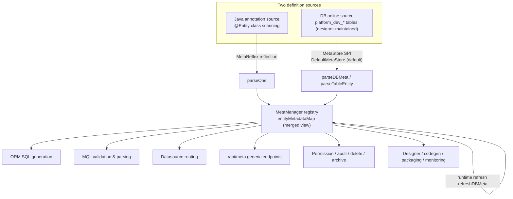

# Metadata Overview

Metadata is the foundation of the Geelato framework. For every entity (business object), the framework collects the complete definition — its name, the table it maps to, its fields, the columns those fields map to, its primary key, its foreign keys, the datasource it belongs to, and its delete mode — into one unified runtime object: `EntityMeta`. Every upper-layer capability is derived from this definition; no capability carries a second copy of the mapping.

## What Metadata Describes

The complete facts about an entity are held by the `EntityMeta` aggregate root:

- **Identity**: `entityName`, `entityTitle` (Chinese title), `entityType` (Table / View / Class source forms), `catalog` (logical database grouping)
- **Table-level definition**: `tableMeta` (table name, schema, connect id `connectId`, database type `dbType`, cache type `cacheType`, etc.)
- **Fields and columns**: `fieldMetas` (each `FieldMeta` embeds a `ColumnMeta` carrying column name, data type, length, precision, nullability, default value, encryption flag, etc.)
- **Primary key**: `id` (the primary key `FieldMeta`)
- **Relations**: foreign keys `tableForeigns`, CHECK constraints `tableChecks`, associated views `viewMetas`
- **Behavior switches**: delete mode `deleteMode`, ignore-update field map `ignoreUpdateFieldMap`, encrypted column set `encryptedColumnNames`, JSON column set `jsonFieldKeys`

## Why It Is the Foundation

Without metadata, none of the framework's upper-layer capabilities can exist. Every subsystem treats the `MetaManager` registry as the single source of truth:

| Upper-layer capability | What it reads from metadata |
| --- | --- |
| ORM SQL generation | Table name, field→column mapping, primary key, dialect quoting, foreign-key JOINs, encrypted/JSON column handling |
| MQL query language | Entity and field validation, logic-delete field filling, default value fallback |
| Datasource routing | `resolveConnectId` turns "entity→database" ownership into a routing key and resolves the SQL dialect per entity |
| Row-level permission / tenant filter | Permission rules are attached by entity name; bare column names in rules are qualified as `alias.column` |
| Generic APIs (`/api/meta/list` etc.) | One entity name is enough to expose full CRUD and publish `SimpleFieldMeta` to the low-code frontend |
| Audit field filling | `EntityMeta.containsField` decides writability: create-time fields on insert, update-time fields on update |
| Delete mode | Entity-level `deleteMode` is the middle layer of the call-site > entity > global configuration chain |
| Archive, packaging, Excel import, code generation, designer | Table/column consistency checks, value conversion and locating, reverse Java source generation, DDL upgrades |

The complete consumer map is in [Where Metadata Extends](./extensions.md).

## Panorama

## Dual-Source Model

Metadata has two sources. Each is registered into its own source cache, then merged into the main registry:

| Source | How it is produced | Where it lives | Characteristics |
| --- | --- | --- | --- |
| **Java annotation (class) source** | Startup scan of `@Entity` classes, reflection over annotations | `entityMetadataMapFromClass` | Has `classType`; field types derived from Java types; column lengths come from annotation defaults |
| **DB online source** | Startup and runtime reads of the designer-maintained `platform_dev_*` tables | `entityMetadataMapFromDatabase` | No `classType`; fields come from real column definitions (data_type/length/precision/encryption); `entityType` is Table or View |
| **Merged main map** | Merged per the conflict strategy at registration | `entityMetadataMap` | The only map ORM/MQL read at runtime; same-name entities are first-come-first-served by default; entities with `catalog=platform` always take the class definition |

You can compare the two sources at any time: MetaManager provides `getClassSourceEntity` / `getDatabaseSourceEntity` / `compareEntitySources`, and the designer also performs conflict checks through this mechanism. See [Metadata Loading](./loading.md) and [Runtime Operations](./operations.md).

## Where Metadata Is Stored

Design-time definitions persist in six `platform_dev_*` tables in the platform database and are read back through the `MetaStore` SPI at startup:

| Table | Metadata object carried |
| --- | --- |
| `platform_dev_table` | `TableMeta` (table definition) |
| `platform_dev_column` | `ColumnMeta` (column definition) |
| `platform_dev_view` | `TableView` (view definition) |
| `platform_dev_table_check` | `TableCheck` (CHECK constraints) |
| `platform_dev_table_foreign` | `TableForeign` (foreign-key relations) |
| `platform_dev_db_connect` | `ConnectMeta` (database connections) |

`ColumnMeta`, `TableMeta` and `TableView` are themselves platform entities (annotated `@Entity`) — the definition of metadata is itself metadata-driven. Table structures and the `/api/meta` endpoints are in [Persistence and Interfaces](./interfaces.md).

## Chapter Navigation

| Page | Content |
| --- | --- |
| [Metadata Model](./model.md) | Attribute-by-attribute reference for EntityMeta/FieldMeta/ColumnMeta/TableMeta and the annotation→metadata mapping |
| [Metadata Loading](./loading.md) | Registry structure, three startup load paths, conflict strategy, cache responsibilities |
| [Runtime Operations](./operations.md) | Full query/registration/refresh API list of MetaManager and EntityMeta |
| [Persistence and Interfaces](./interfaces.md) | platform_dev_* tables, /api/meta endpoints, frontend contract, script and MCP channels |
| [Where Metadata Extends](./extensions.md) | Consumer panorama: ORM/MQL/routing/permission/audit/archive/designer |
| [MetaStore Extension](../reference/metastore-extension.md) | Guide for implementing a custom metadata source |

## Further Reading

- [Platform Entities Overview](../entities/overview.md) — a field-level catalog of the 54 platform entities in the `geelato-meta` module
- [Startup Process](../reference/startup-process.md) — when metadata loading happens in the startup chain (stage two)
- [ORM Annotations](../orm/annotations.md) — how to declare entities with annotations
- [Core Modules](../reference/core-modules.md) — where `MetaManager` sits in the overall architecture
