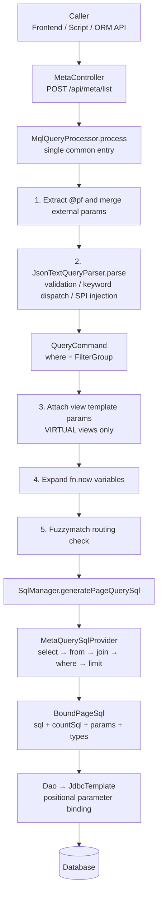
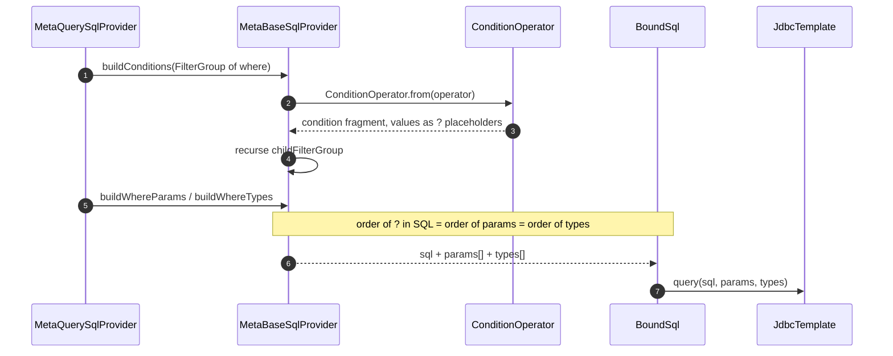

# MQL Details

This page targets developers and explains the full pipeline that turns an MQL JSON payload into the final SQL statement and executes it. Syntax and keyword usage are covered in [MQL Usage Guide](usage.md); this page answers what happens to the payload on the server side and what each step produces.

## Pipeline Overview

Processing a query MQL involves six stages:

1. **Entry**: the HTTP request body is the MQL text itself; the query endpoints of `MetaController` read the raw body.
2. **@pf extraction and parameter merge**: before parsing, `@pf` view template parameters are extracted from the JSON and merged with externally supplied template parameters (external wins).
3. **Parsing and validation**: `JsonTextQueryParser` turns the JSON into a `QueryCommand`, validating the entity and fields against metadata whitelist, and injecting tenant and data-permission conditions via SPI.
4. **Command post-processing**: view template parameters are attached (VIRTUAL views only), `$fn.now*` variables are expanded, and fuzzymatch routing is decided.
5. **SQL generation**: `SqlManager` dispatches to `MetaQuerySqlProvider`, which assembles the SQL text in a fixed order and produces a `BoundPageSql` (main SQL + count SQL + params + types).
6. **Binding and execution**: `Dao` hands the `BoundSql` to Spring `JdbcTemplate`, which binds positional parameters and executes.



## Input: How Requests Arrive and What MQL Looks Like

### Entry points

| Entry | Request form | Notes |
| :--- | :--- | :--- |
| `/api/meta/list` | body is a single-entity JSON | single-entity list query, POST / GET |
| `/api/meta/multiList` | body is a JSON array | each element is a single-key entity object; queries several entities at once |
| Script `$gl.mql.list(...)` | MQL JSON passed in the script kit | same `MqlQueryProcessor` as the REST path |
| MQL playground | `/mql-playground.html` | explain / validate / execute, all going through `MqlQueryProcessor` |
| ORM Fluent DSL | Java fluent API | no JSON involved; `QueryCommandAdapter` adapts it into `QueryCommand` and joins the same SQL pipeline |

### The request body is the MQL text

- The raw body is processed as MQL directly; GET requests read the body as well.
- The only URL query parameter is `withMeta` (whether field metadata is returned with the response); URL parameters never merge into the MQL.
- `/api/meta/multiList` takes a top-level array; each element still satisfies "exactly one root key = entity name".

### A typical query MQL

```json
{
  "platform_user": {
    "@fs": "id,name,ref(platform_org->orgName) orgName",
    "@order": "createAt|-",
    "@p": "1,10",
    "loginName|eq": "admin",
    "@b": [
      { "or": [ { "status|eq": "1" }, { "status|eq": "2" } ] }
    ]
  }
}
```

Where each part goes:

| JSON fragment | Handled at | Output |
| :--- | :--- | :--- |
| Root key `platform_user` | parsing | `command.entityName`, validated against metadata |
| `@fs` | parsing | field list + aliases + foreign-key fields |
| `@order` | parsing | order-by fragment already translated to column names with `asc/desc` |
| `@p` | parsing | `pageNum` / `pageSize` |
| `@b` | parsing | nested condition groups (the `FilterGroup` tree) |
| `"loginName\|eq": "admin"` | parsing | flat filter (missing operator defaults to `eq`) |
| `@pf` | extracted before parsing | view template parameters, VIRTUAL views only |

## Stage 1: Extract @pf and Merge Parameters

`MqlQueryProcessor.extractPfAndSerialize` runs before parsing:

- It walks every entity node of the root object, moves `@pf` into `paramsByEntity[entityName]` and removes it from the JSON, so it never reaches keyword validation.
- Callers (Controller pre-processing, script kits) may pass template parameters through the external channel; when merged with `@pf` inside the JSON, external parameters win (same-key override).

## Stage 2: Parse JSON into QueryCommand

`JsonTextQueryParser.parse` converts the cleaned JSON into a `QueryCommand`.

### Validation

- Single root element: an entity query JSON has exactly one root key, and that key is the entity name.
- Entity validation: the entity must be registered in `MetaManager`.
- Field whitelist: filter, order and projection fields must exist in the entity metadata; `ref(...)` must reference a registered foreign key; the reserved values `*` and `forceId` are exempt. Failures accumulate into one error message and throw.
- Materialized view pre-processing: a materialized view entity only contains the columns of the user-defined SELECT; references to non-existent fields (such as audit fields carried in by the query builder) are stripped before parsing, while validation itself stays strict.

### Key dispatch

Keys inside the root object fall into three groups:

1. `@` keywords → handled by `QueryKeyword` (`@fs` / `@order` / `@group` / `@p` / `@b`); unknown keywords fail immediately.
2. `~` prefix keys → parsed recursively into sub-commands (nested sub-entity queries).
3. Everything else → filter conditions in the form `"field"` or `"field|operator": "value"`; a missing operator defaults to `eq`. Function expressions such as `fuzzymatch($platform_user.name,'张三')` are reconstructed into canonical function form first.

### Keyword handling

| Keyword | Parsing behavior |
| :--- | :--- |
| `@fs` | comma split (commas inside function parentheses are kept); supports `ref(fkField->remoteField) alias`, the two-segment `field alias` rename, and function expressions kept verbatim; `ref` items are recorded as foreign-key fields |
| `@order` | `field|+` / `field|-`; **translated into a column-name `asc/desc` SQL fragment at parse time** |
| `@group` | stored verbatim into `groupBy`; table alias is added during SQL generation |
| `@p` | `"page,size"`; non-numeric or ≤ 0 values fail with a format error |
| `@b` | JSON array; each element is one bracket group whose conditions are joined by the group key `and` / `or` (defaults to `or` when both keys are absent); groups may nest further |

### SPI injection

At the end of parsing, platform-level default filters are injected through the `MqlQueryFilterInjector` SPI (the runtime resolver follows "0 implementations skip, 1 obeys `isEnabled`, multiple fail"):

- Tenant filter: a regular filter `tenantCode = current tenant` is appended (parameter-bound).
- Data permission: `command.originalWhere` is set to a server-generated SQL fragment (by default `creator = current user`, or resolved from permission rules), which is appended to the where clause later.

### Output: QueryCommand

| Field | Source | SQL destination |
| :--- | :--- | :--- |
| `entityName` | root key | `from` |
| `fields` / `alias` / `foreignFields` | `@fs` | `select` + `left join` |
| `orderBy` | `@order` (already column names) | `order by` |
| `groupBy` | `@group` | `group by` |
| `pageNum` / `pageSize` | `@p` | `limit ... offset ...` |
| `where` (FilterGroup) | filter keys + `@b` | `where` |
| `originalWhere` | SPI data-permission injection | `and ( ... )` |
| `viewTemplateParams` | `@pf` | FROM derived-table template rendering |
| `commands` | `~` sub-entity keys | each sub-command generates its own SQL |

## Stage 3: FilterGroup, the Intermediate Condition Model

Complex conditions are not assembled into SQL directly; they are first expressed as a tree:

- `logic`: how conditions of the current level are joined (top level defaults to `and`).
- `filters`: flat conditions of the current level; each `Filter` carries `field` / `operator` / `value` / `rawValue` / `arrayValue`.
- `childFilterGroup`: bracketed sub-groups (from `@b`).

Joining rules during assembly:

1. Flat conditions of the top level are joined by the top-level `logic` (`and`).
2. Each element of `@b` produces one sub-group; **sub-groups, and sub-groups versus flat conditions, are always joined by `and`**.
3. Inside a sub-group, its conditions are joined by the group's `and` / `or` key.
4. A further nested bracket inside a group is joined by the enclosing group's `logic`.

Therefore the `@b` example in `usage.md` renders as `(loginName = ? or phone = ?) and (status = ?)`.

Filters on the same field (for example two `in` conditions on one field) are auto-renamed in the parameter map to avoid key collisions.

## Stage 4: Assemble the SQL

`SqlManager` dispatches by `commandType`; SELECT goes to `MetaQuerySqlProvider.generatePageQuerySql` (producing the main SQL and the count SQL together). The assembly order is fixed:

```text
select → from → join → where → and (originalWhere) → group by → having → order by → limit offset
```

`having` is not an MQL JSON keyword; it is set only via the ORM Fluent DSL and the segment is generated only when present.

### FROM decision

| Query target | FROM generation |
| :--- | :--- |
| Regular entity | physical table name |
| Physical DB view (no platform view metadata) | query the view name directly |
| DEFAULT view | query the view name directly (DDL already created in the database) |
| MATERIALIZED view | query the view name directly (the engine guarantees the object exists) |
| CUSTOM view | `viewConstruct` inlined verbatim as a derived table `( ... )` |
| VIRTUAL view | `viewConstruct` rendered with `@pf` and inlined as a derived table `( ... )` |

- Derived-table alias: when `ref`/JOIN exists the main table gets `t0` (foreign tables get `t1`, `t2`, …), otherwise the view derived table gets a fixed `vt`.
- An empty `viewConstruct` on a CUSTOM / VIRTUAL view is a metadata defect and fails immediately instead of falling back silently.
- Materialized views are read-only, enforced by the write gate.

### View template rendering (VIRTUAL)

Template fragments inside `viewConstruct` are rendered when the FROM clause is assembled:

- `#...#` marks a template segment; `{param}` inside a segment is a placeholder.
- A parameter that is missing or blank removes **the whole segment**; segments without placeholders stay verbatim.
- Parameter values: numbers / booleans are inserted as-is; **strings are wrapped in single quotes with internal `'` escaped to `''`**.

Template example:

```sql
select o.id, o.order_no, o.status
from mql_test_order o
# {statusFilter} and o.status = {statusFilter} #
# {minAmount} and o.amount >= {minAmount} #
```

Rendering result when only `@pf: {"statusFilter": "pending"}` is passed:

```sql
select o.id, o.order_no, o.status
from mql_test_order o
 and o.status = 'pending'
```

Gate: `@pf` is accepted for VIRTUAL views only. Non-view entities, physical DB views, and DEFAULT / CUSTOM / MATERIALIZED views receiving a non-empty `@pf` throw `ViewTemplateParamException` instead of silently dropping it.

### JOIN

MQL JSON does not express JOIN directly; `ref(...)` is the only implicit source:

- `ref(fkField->remoteField)` in `@fs` produces `left join foreign_table t1 on t0.fk_col=t1.remote_col` based on the entity's foreign-key metadata.
- Aliases are allocated per foreign-key source column: two different foreign keys pointing at the same target table each get their own JOIN and alias.
- Multiple `ref` references to the same foreign key produce a single JOIN.
- Explicit custom JOINs (`inner/left/right join` with custom on conditions) are provided only by the ORM Fluent DSL.

### Dialects and pagination

- Identifier quotes: mysql uses backticks `` ` ``, sqlserver uses brackets `[]`, postgresql / oracle and other dialects use double quotes.
- Dialect aliases are normalized through the `Dialects` registry (for example RisingWave maps to the postgresql family).
- `dbType` resolution order: `TableMeta.dbType` → the datasource of the current `connectId` → `TableMeta.connectId` → the default datasource → primary.
- A view without its own `connectId` inherits the main entity's `dbType`.
- Pagination is always `limit {pageSize} offset {(pageNum-1)*pageSize}` regardless of dialect.
- Reserved words (`index` / `inner` / `enable` / `key`) are quoted automatically when used as column names.

### count SQL

The count SQL wraps the main query: `select count(*) from ( ... ) t`, without `order by` or `limit`, sharing the same parameters as the main SQL. When the total is derivable (full query, primary-key equality, first page not full), the count is skipped and the total is derived from existing rows.

## Stage 5: Assemble Parameters and Types

`MetaBaseSqlProvider` produces the `BoundSql` (`sql` / `params[]` / `types[]`) in three steps:



### Operator mapping

| MQL operator | SQL fragment (col is the column name) | Bound params | JDBC type |
| :--- | :--- | :--- | :--- |
| `eq` | `col = ?` | 1 | per column type |
| `neq` | `col != ?` | 1 | per column type |
| `gt` / `gte` / `lt` / `lte` | `col > ?`, `>= ?`, `< ?`, `<= ?` | 1 | per column type |
| `startwith` | `col like CONCAT('',?,'%')` | 1 | VARCHAR |
| `endwith` | `col like CONCAT('%',?,'')` | 1 | VARCHAR |
| `contains` | `col like CONCAT('%',?,'%')` | 1 | VARCHAR |
| `in` | `col in(?,?,…)` | N (value split into an array) | per column type |
| `nin` (alias of `notin`) | `col not in(?,?,…)` | N | per column type |
| `nil` | `col is NULL` when the value is `1`/`true`, otherwise `col is NOT NULL` | 0 | — |
| `bt` | `col between 'start' and 'end'` | 0, values written into the SQL text | — |
| `fis` | or-chain of `FIND_IN_SET('v', col) > 0` | 0, values written into the SQL text | — |
| JSON column + comparison | `JSON_CONTAINS(col->'$',"v") > 0` | 0, value written into the SQL text | — |
| Function condition | function expression + comparison sign + `?`; fuzzymatch under the experiment gate rewrites to `(col <> '' AND col REGEXP ?)` | 1 | VARCHAR |

Type mapping: `int` → INTEGER, `bigint` → BIGINT, `decimal` → DECIMAL, `datetime` → TIMESTAMP, `blob` → BLOB, everything else defaults to VARCHAR; the three like-family operators are always VARCHAR.

### Parameter order principle

The order in which `?` appears in the SQL, the order of `params[]` and the order of `types[]` are strictly identical. `in` expands to N placeholders and contributes N parameters; `nil` / `bt` / `fis` produce no bound parameters.

`Filter.rawValue` keeps the original Java-typed value (filled by the ORM DSL adapter and the external parameter path) and takes precedence over the string `value` when assembling parameters, so numbers, booleans and dates are not bound as strings on strict-typing databases such as PostgreSQL.

### Which values end up in the SQL text

Most condition values go through `?` binding. The following are written into the SQL text directly:

- `@pf` template parameter values (strings escaped, VIRTUAL views only)
- values of `bt` / `fis` / JSON column conditions
- the `originalWhere` data-permission SQL (server-generated, never user input)

Protections: field names pass the entity metadata whitelist first and unregistered fields fail immediately; `@pf` string parameters escape single quotes and strip SQL comments.

## Stage 6: Binding and Execution

- `Dao.queryForMapList(BoundPageSql)` → `JdbcTemplate.query(sql, params, types, RowMapper)`; when `types` is non-empty, values are bound with `setObject(i, value, types[i])`.
- Row mapping handles JSON column post-processing and decryption of encrypted columns.
- A page query fetches the records first, then the total; the count is skipped when the total is derivable.
- Observation points: p6spy is enabled by default (slf4j + multiline) and shows the final SQL with parameters; a `final-sql` debug log prints each generated statement.

## End-to-End Example: From JSON to SQL

Input (`POST /api/meta/list` body):

```json
{
  "mql_test_order": {
    "@fs": "orderNo,amount,ref(userId->name) userName",
    "@order": "amount|-",
    "@p": "1,10",
    "orderNo|contains": "PO",
    "@b": [
      { "or": [ { "amount|gte": "100" }, { "status|eq": "pending" } ] }
    ]
  }
}
```

Step-by-step trace (mysql dialect):

| Stage | What happens |
| :--- | :--- |
| 1. @pf extraction | no `@pf`, JSON unchanged |
| 2. Parsing | `fields=[orderNo, amount]`, `foreignFields=[userId->name]`, `alias={userId->name: userName}`; `orderBy="amount desc"`; `pageNum=1, pageSize=10`; flat condition `orderNo contains "PO"`; `@b` yields an or-group |
| 3. Post-processing | no `$fn` variables; at platform runtime SPI also appends the tenant condition and data permission (omitted below to keep the main path clear) |
| 4. SQL assembly | `ref` present → main table alias `t0`, foreign table `t1`; field names translated to column names (`orderNo` → `order_no`) |
| 5. Parameter assembly | `?` in order binds `PO`, `100`, `pending` |
| 6. Execution | main SQL and count SQL are sent in turn |

Final SQL:

```sql
select t0.order_no, t0.amount, t1.name `userName`
from mql_test_order t0
left join mql_test_user t1 on t0.user_id=t1.id
where t0.order_no like CONCAT('%',?,'%')
 and ( t0.amount >= ? or t0.status = ? )
order by t0.`amount` desc
limit 10 offset 0
```

Parameters and types:

```text
params: ["PO", "100", "pending"]
types:  [VARCHAR, DECIMAL, VARCHAR]   -- types come from column metadata
```

count SQL (same parameters):

```sql
select count(*) from (
  select t0.order_no, t0.amount, t1.name `userName`
  from mql_test_order t0
  left join mql_test_user t1 on t0.user_id=t1.id
  where t0.order_no like CONCAT('%',?,'%')
   and ( t0.amount >= ? or t0.status = ? )
) t
```

Key points:

- Field names are translated to column names; `@fs` aliases and order-by columns are quoted per dialect.
- At platform runtime, the SQL in p6spy logs additionally contains the SPI-injected `tenant_code = ?` and `and ( data-permission fragment )`.
- With a JOIN present the order-by column carries the table alias (`t0.`amount``), and the quote wraps only the column name.

## Save and Delete Share the Same Pipeline

Save and delete reuse the same parse → SQL generation → `BoundSql` → `Dao` pipeline; only the SQL provider differs:

| Operation | Provider | Result |
| :--- | :--- | :--- |
| Insert / Update | `MetaInsertSqlProvider` / `MetaUpdateSqlProvider` | `insert into table(cols…) values(?,…)` / `update table set col=? … where …` |
| Conditional delete | `MetaDeleteSqlProvider` | logical-delete mode produces `update table set del_status=? …`; physical mode produces `delete from table` |

- `/api/meta/save/{biz}` decides insert versus update by "contains `id` without `forceId` → update".
- Update values support function expressions such as `increment($platform_user.loginCount,1)`, which go into the `set` clause verbatim.
- Default fields (`creator` / `createAt` / `tenantCode` / `updateAt`, …) are injected by the `MqlSaveFieldValueFiller` SPI; `$ctx.*` and `$parent.*` variables are expanded in the save pipeline. See the [MQL Usage Guide](usage.md).

## Reading Order and Key Sources

Suggested source-reading order:

| Order | Class | Responsibility |
| :--- | :--- | :--- |
| 1 | `MetaController` | query entry, reads the body |
| 2 | `RuleService` | invokes `MqlQueryProcessor` and executes |
| 3 | `MqlQueryProcessor` | the five-step pipeline, single common entry |
| 4 | `JsonTextQueryParser` | JSON → QueryCommand |
| 5 | `QueryKeyword` | `@` keyword handling |
| 6 | `FilterGroup` | condition tree and operators |
| 7 | `SqlManager` | provider dispatch |
| 8 | `MetaQuerySqlProvider` | SELECT assembly and FROM decision |
| 9 | `MetaBaseSqlProvider` | condition expansion / params / types / template rendering |
| 10 | `ConditionOperator` | operator → SQL fragment |
| 11 | `Dao` | JdbcTemplate execution |

Source locations (relative to the repository root):

```text
geelato-web-platform/src/main/java/cn/geelato/web/platform/srv/meta/MetaController.java
geelato-web-platform/src/main/java/cn/geelato/web/platform/srv/platform/service/RuleService.java
geelato-core/src/main/java/cn/geelato/core/mql/MqlQueryProcessor.java
geelato-core/src/main/java/cn/geelato/core/mql/parser/JsonTextQueryParser.java
geelato-core/src/main/java/cn/geelato/core/mql/parser/keyword/QueryKeyword.java
geelato-core/src/main/java/cn/geelato/core/mql/filter/FilterGroup.java
geelato-core/src/main/java/cn/geelato/core/sql/SqlManager.java
geelato-core/src/main/java/cn/geelato/core/sql/provider/MetaQuerySqlProvider.java
geelato-core/src/main/java/cn/geelato/core/sql/provider/MetaBaseSqlProvider.java
geelato-core/src/main/java/cn/geelato/core/sql/provider/ConditionOperator.java
geelato-core/src/main/java/cn/geelato/core/orm/Dao.java
```

## Continue Reading

- [MQL Usage Guide](usage.md): syntax and keywords
- [MQL Overview](overview.md): positioning and boundaries of MQL
- [Query Filter and Save Fill SPI Extension](../reference/spi-query-filter-and-save-fill-extension.md): extending tenant filters and data permission
- [ORM Fluent DSL Guide](../orm/fluent-dsl.md): the same pipeline from the Java side
