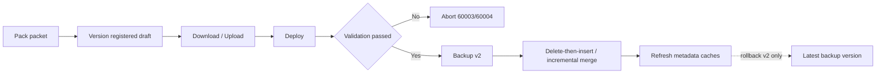

# Application Packaging

This chapter covers the packaged delivery of low-code applications only: an **application package** is the designer-produced app data bundle (`.gdp` / `.zgdp`), carrying metadata and business data between environments through pack → transfer → deploy → rollback; module `cn.geelato:geelato-package` + the `/package` service in web-platform.

:::note Not in this chapter
Plugin jars and host/launcher artifacts are different deliverables and are not part of application packaging: see [Plugin Mechanism](../plugin-mechanism/overview.md) for plugins, and the [Deployment Guide](../operations/runtime-designer-deployment.md) for host builds.
:::

## What an Application Package Is

An application package is a **complete data snapshot** of an application at a point in time: it carries, as JSON, all configuration data the app produced in the designer, and can be transferred between environments and deployed into effect.

- Package data `AppPackData`: `sourceAppId / targetAppId / version / appCode / appName` + `appMetaList` (metadata entries, each `{metaName, metaData}` where `metaName` is the table/entity name and `metaData` is the row array) + `appResourceList` (resource entries) + `basePlatformVersion` (platform baseline at pack time, taken from the platform app `geelato_admin`'s `version_info`).
- Two-level artifact: `.gdp` (full UTF-8 JSON package, default name `geelatoApp`) compressed into `.zgdp` (zip containing `<appCode>/<appCode>.gdp`).
- Package files are archived per tenant and app, and registered in the app version table `platform_app_version` (source `packet/upload/sync`, status `draft/release/unused/deployed/backup`).
- Module: `cn.geelato:geelato-package`; config prefix `geelato.package`.

## What Gets Packaged at a Glance

Packaged contents fall into four layers by runtime responsibility; per-item details in [Packaged Contents & Runtime Roles](contents.md):

| Layer | Contents | Tables |
| --- | --- | --- |
| App body | App definition, designer file tree, dependency declaration | `platform_app` |
| UI layer | Pages, menu tree | `platform_app_page`, `platform_tree_node` |
| Data layer | Database connections, models/fields/constraints/views | `platform_dev_db_connect`, `platform_dev_table/column/table_foreign/view` |
| Business data | Carried per entity's data-pack strategy | Business tables with `pack_bus_data` > 0 |
| Governance layer | Roles/permissions/authorizations, dictionaries, app config, export templates, encoding rules, resource metadata | `platform_role*`, `platform_dict(_item)`, `platform_sys_config`, `platform_export_template`, `platform_encoding`, `platform_resources` |

Service interfaces, SQL orchestrations and scheduled tasks are NOT in the package manifest and need separate handling for cross-environment migration; the full list and each item's runtime role are in [Packaged Contents & Runtime Roles](contents.md).

## End-to-End Flow

1. **Pack**: export the app's rows from 19 whitelisted platform tables plus business tables selected by data-pack strategy, produce a `.zgdp` and register a version (status `draft`); see [Packaging Flow](packaging-flow.md).
2. **Transfer**: download the `.zgdp` to the target environment and upload it there, or deploy directly in the same environment.
3. **Deploy**: environment gate → package validation (every entity and column must exist in the target platform's meta model) → backup (v2) → persistence (overwrite tables are delete-then-insert, incremental tables merge by id) → metadata cache refresh; hot-reload takes effect without restart. See [Deploying Application Packages](deployment-flow.md).
4. **Rollback** (v2 only): roll back to the latest backup version when a deployment fails or behaves unexpectedly.

## Configuration

| Key (`geelato.package.*`) | Default | Description |
| --- | --- | --- |
| `env` | — | Environment tag; `init_source` environments reject deployment |
| `path` | — | Root directory for package files |
| `uploadFolder` | — | Upload sub-directory |
| `engine` | `v1` | Pack/deploy engine version: `v1` (original) or `v2` (evolved, below); backup and rollback are v2-only |

:::note Default engine is v1
`engine` defaults to `v1`. Backup, rollback and table-name guarding only take effect with `v2`; production environments should set `geelato.package.engine=v2` explicitly. The three base keys are also described in [System Configuration: Package Module](../system-config/overview.md#package-module).
:::

## v1 vs v2 Engine

`geelato.package.engine` selects the engine (strangler pattern: v1 is frozen, new capabilities land in v2 only):

| Dimension | v1 | v2 |
| --- | --- | --- |
| Entry points | `/package/packet`, `/deploy` (same endpoints branch by engine) | same |
| State management | singleton mutable state | method-local context, no singleton state |
| Deployment persistence | programmatic transaction — delete+insert in one transaction, rolled back on failure | batched persistence (500 rows/batch); on mid-way failure already-written batches remain and a re-deploy converges the state |
| Backup/rollback | no real backup | auto backup before deploy + `GET /package/rollback/{appId}` |
| Partial-pack semantics | `appointMetas` is a whitelist: unlisted tables are excluded entirely | `appointMetas` selects rows: unlisted tables are still packed in full |
| Data cleansing | — | platform-table whitelist + table-name guard + batch 500 |

## Commercial Delivery

Commercial delivery across tenants/apps adds placeholder reset and id regeneration on top of application packages — see the app market docs ([System Configuration: Market Module](../system-config/overview.md#market-module)).

## Further Reading

- [Packaged Contents & Runtime Roles](contents.md): the 19 platform tables item by item and each item's role at runtime
- [Packaging Flow](packaging-flow.md): pre-pack gates, three packing modes, artifact pipeline, download & upload
- [Deploying Application Packages](deployment-flow.md): validation gates, backup & rollback, persistence strategy, activation
