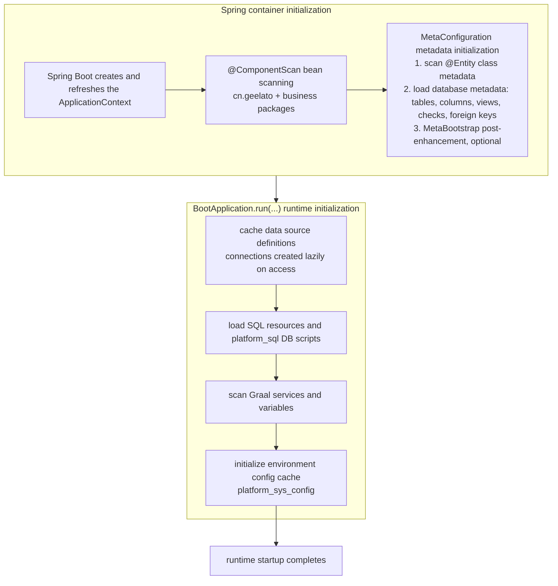

# Startup Process

This page explains the platform's startup sequence when a Geelato Runtime application is based on:

- `cn.geelato.web.platform.boot.BootApplication`

It focuses on:

- startup order
- metadata loading
- package scanning
- data source definition loading
- SQL and DB script loading
- Graal context initialization
- environment cache initialization

## Two Startup Layers

In a business application, the startup class usually extends `BootApplication`.

There are two layers involved:

1. Spring Boot starts and refreshes the `ApplicationContext`
2. after the container is ready, `BootApplication.run(...)` is executed

So `BootApplication` is not the outermost Spring Boot entry. It is the Geelato runtime bootstrap coordinator inside the Spring lifecycle.

## Overall Sequence

The current startup sequence can be summarized as:

1. Spring Boot creates and refreshes the `ApplicationContext`
2. Spring scans platform beans and business beans
3. `MetaConfiguration` initializes metadata from classes and database definitions
4. Spring executes `BootApplication.run(...)`
5. runtime managers initialize data source definitions
6. SQL resources and DB scripts are loaded
7. Graal services and variables are scanned
8. environment configuration cache is initialized

The overall sequence in its two layers:

## Metadata Initialization

Metadata initialization is performed in:

- `MetaConfiguration`

not directly in `BootApplication.run(...)`.

It does two things:

1. scan class-based metadata through `geelato.meta.scan-package-names`
2. load database metadata through `MetaManager.parseDBMeta(dao)`

### Class-Based Metadata

`MetaManager.scanAndParse(...)` scans packages for classes annotated with:

- `@Entity`

and parses them into runtime metadata such as:

- `EntityMeta`
- `FieldMeta`
- `ColumnMeta`

### Database Metadata

After class scanning, `MetaManager.parseDBMeta(dao)` loads metadata from database metadata tables through:

- `MetaStore`

The default implementation is:

- `DefaultMetaStore`

It loads:

- table definitions
- column definitions
- view definitions
- checks
- foreign keys

So runtime metadata comes from both:

- Java annotations
- database metadata definitions

### MetaBootstrap

If a custom `MetaBootstrap` bean exists, it runs after DB metadata is loaded.

This makes `MetaBootstrap` a post-metadata extension point.

## What `BootApplication.run(...)` Does

After the container is ready, `BootApplication.run(...)` executes in this order:

1. log startup arguments and config info
2. initialize data source definitions
3. load SQL resources and DB scripts
4. initialize Graal context
5. initialize environment cache
6. log runtime version

## Data Source Definition Loading

`BootApplication` first initializes:

- `DataSourceManager`

If a custom `DataSourceDefinitionLoader` bean exists, it replaces the default loader.

Then:

- `parseDataSourceMeta(dao)`

does two things:

- registers the primary data source as `primary`
- loads dynamic data source definitions into a snapshot cache (`DataSourceManager`: registered instances in `dataSourceMap`, connection definitions in `dataSourceConfigMap`, reloaded on demand via `loadOne` on a snapshot miss)

The important point is that dynamic data sources are usually not created eagerly at startup. Their definitions are cached first, and real pools are built lazily by the orm-side `DynamicDataSourceRegistry` when a specific `connectId` is routed (with `DynamicRoutingDataSource` triggering creation as a fallback). `DataSourceManager` itself is a pure registry — registered instances, connection-config snapshots and the default key; it builds no pools.

The loader used here is the core-side interface and only caches the connection definitions that dialect resolution reads. Pooling and routing use the separate orm-side `DynamicDataSourceDefinitionLoader`. See [Definition Loading and Registration](../dynamic-datasource/definition-loading.md) for the difference.

## SQL Resource and DB Script Loading

Next, `BootApplication` loads runtime SQL scripts.

### Exploded / Development Mode

If the runtime is not running as a fat jar, it uses:

- `SqlScriptManagerFactory.get("sql").loadFiles(...)`

to load SQL resources from the classpath file system.

Then it sets `dao` into `DbScriptManager` and calls:

- `loadDb()`

to load DB scripts from:

- `platform_sql`

### Fat Jar Mode

If the runtime is packaged as a fat jar, SQL resources are loaded from:

- `loadResource("/geelato/web/platform/sql/**/*.sql")`

instead of a file-system directory.

DB script loading still happens afterward.

### Why Missing `platform_sql` Does Not Block Startup

`DbScriptManager` now checks whether `platform_sql` exists first.

If the table does not exist, it logs and skips DB script loading instead of crashing startup.

## Graal Context Initialization

Then `BootApplication` initializes the Graal context through:

- `geelato.graal.scan-package-names`

For each configured package it scans:

- `@GraalService`
- `@GraalVariable`

`GraalManager` instantiates those classes and registers them into runtime Graal maps.

For Graal service beans, it also tries to inject a `Dao`, preferring:

- `dynamicDao`

when available.

## Environment Cache Initialization

Finally, `BootApplication` initializes:

- `EnvManager`

It sets the current `JdbcTemplate` and runs:

- `EnvInit()`

At the moment this mainly loads enabled records from:

- `platform_sys_config`

into in-memory caches.

So after startup, system configuration can be accessed from memory instead of querying the database every time.

## A Common Confusion

Spring bean scanning and metadata entity scanning are not the same thing.

### Spring Bean Scanning

This is about:

- `@Component`
- `@Service`
- `@Controller`
- `@Configuration`

and its goal is to register beans in the Spring container.

### Metadata Entity Scanning

This is about:

- `@Entity`

and its goal is to build runtime metadata in `MetaManager`.

## Summary

The current startup process can be remembered as:

- Spring scans beans
- `MetaConfiguration` scans and loads metadata
- `BootApplication` initializes runtime managers
- runtime startup completes

More specifically, `BootApplication` is responsible for:

1. dynamic data source definition initialization
2. SQL resource and DB script loading
3. Graal service and variable scanning
4. environment cache initialization

while metadata loading happens earlier in:

- `MetaConfiguration`

## Suggested Reading

- [Core Modules](core-modules.md)
- [MetaStore Extension](metastore-extension.md)
- [Dynamic Datasource Capability](../dynamic-datasource/overview.md)
- [System Configuration](../system-config/overview.md)
