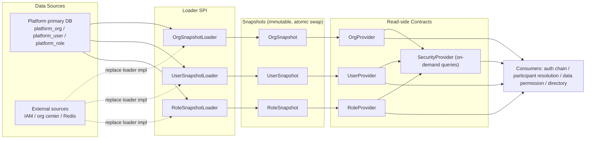

# Security Contract Overview

`geelato-security` is the security contract module of the framework: it only defines the security model, read interfaces, loading mechanisms, and context contracts — it never binds to a concrete data source. Runtime consumers (authentication, org enrichment, participant resolution, data permission) program against these contracts only; where the data comes from is decided by the implementation layer and is invisible to consumers.

## Module Positioning

`geelato-security` is a pure contract module: its pom carries no framework dependencies (only Lombok), and all contracts live in a single package `cn.geelato.security`. Implementations are distributed across two upper modules; all three deliberately share the same package name (split package) to keep consumer imports consistent:

| Layer | Module | Content |
| --- | --- | --- |
| Contracts | `geelato-security` | Security model (`Tenant`/`App`/`Org`/`User`/`Role`/`Permission`), attachment relation classes, four Provider interfaces, three snapshot & loader SPIs, `SecurityContext`, `SecurityContextRunnable` |
| Framework defaults | `geelato-core` | `DefaultOrgProvider`/`DefaultUserProvider`/`DefaultRoleProvider`, `OrgRelationResolver`, `BridgeSecurityProvider`, the two default Enrichers, `SecurityDataRefreshCoordinator` |
| Platform defaults | `geelato-web-platform` | `DBOrgSnapshotLoader`/`DBUserSnapshotLoader`/`DBRoleSnapshotLoader` (primary DB readers), `SecurityProviderConfiguration` assembly |

## Layers and Data Flow

Key points:

- Loading always flows Loader → Snapshot → Provider: loaders assemble external data into immutable snapshots, providers cache the snapshot and expose read-only queries, and consumers depend on providers only.
- Snapshots are loaded as a whole and swapped atomically (`AtomicReference`); the read side is lock-free and a refresh never exposes a half-new, half-old state.
- `SecurityProvider` coexists with the three snapshot providers: the former serves on-demand single-point queries (people resolution, hierarchy traversal, decision checks), the latter serve full-snapshot reads — each has its own job.

## Chapter Map

| Page | Content | Core classes covered |
| --- | --- | --- |
| [Security Model](model.md) | Six core entities and four attachment relation classes, attribute by attribute | `Tenant`/`App`/`Org`/`User`/`Role`/`Permission`/`UserOrg`/`UserRole`/`UserOrgRole`/`OrgRole` |
| [Provider Contracts](provider.md) | Full method tables of the four Provider interfaces and the paging contract | `OrgProvider`/`UserProvider`/`RoleProvider`/`SecurityProvider`/`Page`/`PageParam` |
| [Loading Abstractions](loader.md) | The three snapshot loader SPIs and the two loading helper contracts | `OrgSnapshotLoader`/`UserSnapshotLoader`/`RoleSnapshotLoader`/`UserOrgInfoEnricher`/`UserExtInfoEnricher` |
| [Snapshots & Loading](snapshot.md) | Index structures of the three snapshot classes, immutability guarantees, and the refresh chain | `OrgSnapshot`/`UserSnapshot`/`RoleSnapshot`/`SecurityDataRefreshCoordinator` |
| [Security Context](context.md) | The four thread-local dimensions, write boundary, and cross-thread propagation | `SecurityContext`/`SecurityContextRunnable` |
| [Platform Defaults](platform-defaults.md) | All default implementations by layer, Spring assembly, and replacement strategies | `Default*Provider`/`BridgeSecurityProvider`/`DB*SnapshotLoader`/`SecurityProviderConfiguration` |

## Relation to Authentication & Authorization

The security contract answers "what does security data look like, where is it read from, and how does it enter the context"; authentication answers "how does one HTTP request get authenticated and write the principal into the context". The latter belongs to the platform side (`DefaultSecurityInterceptor` lives in `geelato-web-common`); see [Authentication & Authorization](../authentication/security-authentication.md).

## Suggested Reading

- [Security Model](model.md) — start from the entities and relation rules
- [Provider Contracts](provider.md) — the interfaces consumers actually call
- [Platform Defaults](platform-defaults.md) — out-of-the-box assembly and replacement options
