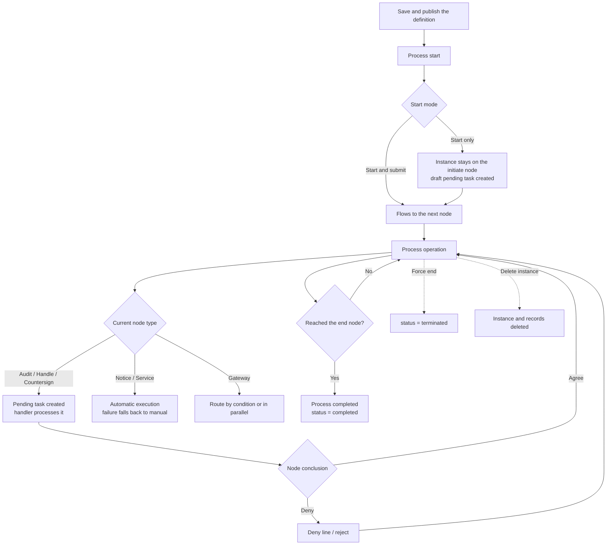
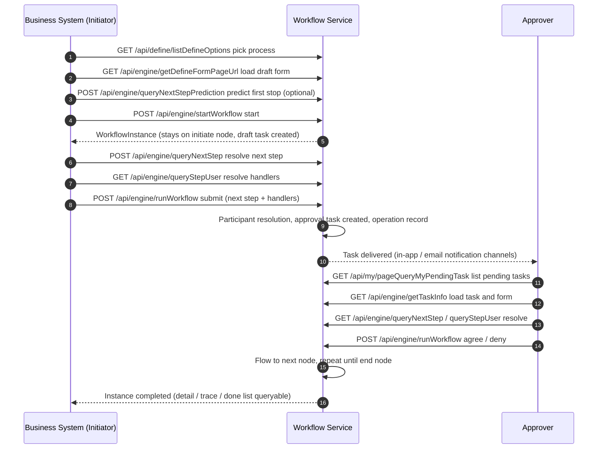

# Workflow Runtime

This page describes the full lifecycle of a process instance: **start → resolution → operation → end**, plus the actions available along the way: withdraw, reject, transfer, circulate and remind. The REST APIs for each action are documented in [Runtime Integration](integration-runtime.md) and [My Process Integration](integration-my.md).

## Lifecycle Overview

Three instance states apply throughout: `running`, `completed` (reached the end node normally) and `terminated` (force-ended).

## Process Start

Starting = attaching a business record to a published process definition. Three inputs are needed: the process definition (`defineKey`), the business id (`bizId`) and the business name (`bizName`).

Standard start chain:

1. **Pick the process**: `GET /api/define/listDefineOptions` lists the definitions that can be started in the current application.
2. **Load the draft form**: `GET /api/engine/getDefineFormPageUrl` returns the form page bound to the definition; load it as an iframe and fill in the business form.
3. **Pre-start prediction** (optional): `POST /api/engine/queryNextStepPrediction` predicts the first stop; `GET /api/engine/queryStepUserPrediction` predicts its candidate handlers.
4. **Start**: `POST /api/engine/startWorkflow` with the definition key, business id/name and form data.

Two outcomes after starting:

| API | Behavior |
| --- | --- |
| `POST /api/engine/startWorkflow` | The instance **stays on the initiate node** and a draft pending task is created for the initiator; the initiator submits later via the run API |
| `POST /api/engine/startWorkflowAtomicity` | **Start and submit**: completes the initiate node's submission in the same call and flows to the next node (requires `selectStepList`) |

Both share the same inputs (the atomic variant adds `selectStepList` and an optional `comment`); both return the instance detail ([WorkflowInstance](integration-runtime.md#workflowinstance), including instance id and current tasks). For validation use `startDebugWorkflow` / `startDebugWorkflowAtomicity` — identical except they run the `debug` version; the test data is persisted and can be deleted afterwards.

:::note Instance name and business linkage
The engine names the instance `【Definition Name】Business Name` and stores `bizId` as the business key. Business systems can look up the instance by `bizId`; the workflow side can jump back to the business record via the instance's `formRecordId`.
:::

## Resolution

"Resolution" is how the engine determines, at each submission, **which nodes are reached next and who handles them**. It happens on every submit (start-submit, approval submit) and is also available as prediction APIs before submitting.

Resolution has two layers:

1. **Route resolution**: pick the target from the current node's outgoing flows. Audit-type nodes filter by the conclusion (`isAgree`), exclusive gateways evaluate flow conditions, parallel gateways fork multiple branches. When the outgoing flow leads to a gateway or automatic node, the engine keeps traversing until it hits a user task that produces a pending task or the end node, and returns the full path via `routeTargetRefs` and `pathText`.
2. **Participant resolution**: resolve handlers for the target node. Explicitly picked users (`stepUserList`) take precedence; otherwise participants are resolved from the node `assignee` config (user/role/dept/dept-role/initiator); when the result is empty, the node's `emptyAssigneeStrategy` applies. Countersign nodes are split into groups (by department/role/custom) that vote in parallel after resolution.

The resolution result is a list of `NextStep`: each entry carries the target node (`targetRef`/`stepTargetName`), candidate handlers (`stepUserList`), whether picking is required (`needAssignee`), parallel sub-steps (`subStepList`) and more; the full structure is documented in [Runtime Integration · NextStep](integration-runtime.md#nextstep).

Related APIs:

| API | When | Description |
| --- | --- | --- |
| `POST /api/engine/queryNextStepPrediction` | Before start | Predicts the first stop by definition (form data can drive condition lines) |
| `GET /api/engine/queryNextStep` | Before submit | Predicts the next steps of a running instance's task (filterable by conclusion) |
| `GET /api/engine/queryStepUserPrediction` | Before start | Predicts candidate handlers of a node by definition |
| `GET /api/engine/queryStepUser` | Before submit | Predicts candidate handlers of a target node on a running instance |

## Process Operation

While an instance is `running`, work revolves around pending tasks:

### Approval Submission

The handler gives a conclusion and sends the task on:

1. `GET /api/my/pageQueryMyPendingTask` lists pending tasks; `GET /api/engine/getTaskInfo` loads the task detail (node info, form page url, whether next-step picking is required via `needNextStep`, countersign progress).
2. `GET /api/engine/queryNextStep` + `GET /api/engine/queryStepUser` resolve and confirm the next step and handlers.
3. `POST /api/engine/runWorkflow` submits: instance id, task id, next-step selection (`selectStepList`), comment and attachment ids.

At submit time the engine: validates task ownership (must be the current user's pending task) → writes target participants → pre-sets grouped-countersign variables → fallback-resolves participants for unpicked nodes → records comment and attachment bindings → drives the flow → writes the operation record. If one person votes deny in a multi-instance node, sibling pending tasks of the same node are cancelled and the deny line is followed.

### Countersign Progress

In a countersign node multiple people hold pending tasks in parallel: non-final submitters only record their opinion, without a next-step picker (`needNextStep=false`); when the completion rule (all/any/ratio/votes, incl. group rules) is satisfied, the last completed submission drives the node as a whole. Countersign progress is available via the instance detail `countersignProgress` or the task detail.

### All Operation Actions

| Action | API | Description |
| --- | --- | --- |
| Approval/handling submit | `POST /api/engine/runWorkflow` | The core submit action, see above |
| Withdraw | `POST /api/engine/withdraw` | The initiator withdraws a sent-out process (available when no later node has processed it); the process returns to the initiator's pending list |
| Reject to previous | `POST /api/engine/rejectToLastStep` | Returns to the previous processing node |
| Reject to initiator | `POST /api/engine/rejectToStart` | Returns to the initiate node; the initiator edits and resubmits |
| Reject to node | `POST /api/engine/rejectToNode` | Returns to any specified node in the process |
| Transfer | `POST /api/engine/transferTask` | Hands the own pending task to another user |
| Circulate | `POST /api/toRead/sendToRead` | Sends the instance to selected people for reading; creates their to-read items |
| Remind | `GET /api/engine/remindTargets` + `POST /api/engine/remind` | The initiator sends a reminder to handlers of active tasks |
| Attachment | `POST /api/attach/upload` | Uploads an attachment; its id is passed back at submit to bind it to the operation record |
| Query | instance detail / task detail / trace / instance BPMN | See [Runtime Integration](integration-runtime.md) |

## Process End

| Ending | Trigger | Instance status |
| --- | --- | --- |
| Normal end | Flow reaches the end node (`end`) | `completed`, finish time recorded |
| Force end | `POST /api/engine/forceEndProcInstance` (admin/initiator) | `terminated`, unfinished tasks are terminated |
| Delete | `POST /api/engine/deleteProcInstance` | The instance and its tasks are deleted; business data is unaffected |

After completion the following remain queryable: instance detail (rendered from history), process trace (`getProcessTrace`), instance BPMN (`getProcBpmn`) and the completed-task list.

## End-to-End Sequence

Typical interaction between the business system and the workflow service (start → approval → end):

In the start-and-submit scenario, steps 4-7 collapse into a single `POST /api/engine/startWorkflowAtomicity` call.

## Related Pages

- [Workflow Orchestration](orchestration.md): node, flow, participant and property models
- [Runtime Integration](integration-runtime.md): API contracts for every action on this page
- [My Process Integration](integration-my.md): pending/done/to-read/read APIs
- [Define Integration](integration-define.md): definition save and publish APIs
