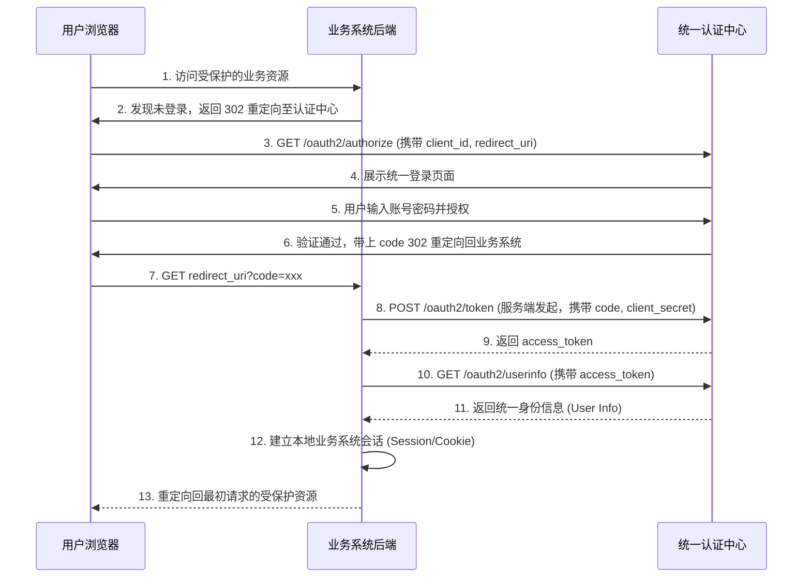

# OAuth2 协议接入

统一认证中心实现了标准的 OAuth2/OIDC 协议端点。无论是有用户参与的「授权码模式」（浏览器登录业务系统），还是没有用户参与的「机器对机器」（`client_credentials`），**都属于标准 OAuth2 协议的一部分**，本章统一说明。

若你的场景只需要「现成登录页 + 前端对接」，优先看 [Lite 轻量接入](lite-login-integration.md)；若需要把组织 / 用户 / 角色数据同步进自己的系统，请看 [数据集成](data-integration.md)。

## 接入方式速查

| 场景 | 授权模式 | 用户参与 | 说明 |
| --- | --- | --- | --- |
| 用户通过浏览器登录业务系统 | `authorization_code`（授权码模式） | 是 | 全页重定向到统一登录页，token 只存在于业务系统后端 |
| 服务间集成、定时任务、调用 [开放管理 API](open-api-management.md) | `client_credentials`（机器对机器） | 否 | `client_id` + `client_secret` 直接换取机器令牌，见下文 |

## 协议端点总览

认证中心暴露 OIDC Discovery 元数据：

```text
GET https://<auth-host>/.well-known/openid-configuration
```

| 端点 | 说明 |
| --- | --- |
| `/oauth2/authorize` | 授权端点（浏览器重定向，未登录时内嵌展示统一登录页） |
| `/oauth2/token` | 令牌端点（`authorization_code` / `refresh_token` / `password` 等；**不支持** `client_credentials`） |
| `/oauth2/client_token` | `client_credentials` 专用令牌端点 |
| `/oauth2/userinfo` | 用户信息接口（授权码模式令牌） |
| `/oauth2/introspect` | 令牌自省（RFC 7662），含 `permissions` / `roles` 扩展声明 |
| `/oauth2/userinfo-oidc` | OIDC 风格用户信息，claims 含 `permissions` / `roles` |
| `/oauth2/revoke` | 令牌撤销 |
| `/oauth2/logout` | 会话注销（end session） |
| `/.well-known/jwks.json` | JWK Set（当前为占位，见下文令牌形态说明） |

Discovery 元数据关键项：

- `grant_types_supported`：`authorization_code`、`implicit`、`password`、`client_credentials`、`refresh_token`
- `scopes_supported`：`openid`、`userid`、`userinfo`、`oidc`、`unionid`
- `response_types_supported`：`code`、`token`、`id_token`
- `code_challenge_methods_supported`：`S256`、`plain`
- `token_endpoint_auth_methods_supported`：`client_secret_basic`、`client_secret_post`
- `id_token_signing_alg_values_supported`：`HS256`

> **令牌形态说明**：当前签发的 access_token 是**不透明引用令牌**（服务端存储，`geelato.auth.token-store=memory|redis` 控制），需要通过 `/oauth2/introspect` 或 userinfo 类接口换取声明，**不是自包含 JWT**。下文响应示例中的令牌字符串仅作占位。

## 接入前提：申请应用凭证

集成前，外部业务系统管理员需向统一认证中心管理员申请应用接入凭证，并妥善保管以下信息：

- **`client_id`**：应用的唯一标识。
- **`client_secret`**：应用的安全秘钥（**不可**暴露给前端或浏览器，必须在后端代码中安全存放）。
- **`redirect_uri`**：授权成功后的合法安全回调地址（例如 `https://your-app.com/login/oauth2/code/geelato`）。

客户端在认证中心管理端「OAuth 客户端」中创建与维护：

- 新注册客户端**默认授权模式**：`authorization_code`、`implicit`、`refresh_token`、`password`、`client_credentials`、`phone_code`，可按需裁剪；`client_credentials` 场景务必确认已包含。
- **默认 scopes**：`openid`、`userid`、`userinfo`、`oidc`。
- 支持启停、重置秘钥、按 client_id 查询令牌等管理操作。

## 场景一：授权码模式（用户登录）

标准 OAuth2 授权码模式的整体交互时序如下：



### 第一步：获取授权码 (Authorization Code)

当用户未登录时，业务系统将用户浏览器重定向到认证中心的授权端点：

**请求方式**：`GET`
**请求地址**：`https://<auth-host>/oauth2/authorize`

**URL 请求参数**：
- `response_type`：固定填 `code`
- `client_id`：申请获得的 `client_id`
- `redirect_uri`：申请获得的合法回调地址
- `state`：防止 CSRF 攻击的随机字符串，业务系统需自行验证该字段

**回调结果**：
用户在认证中心登录成功后，认证中心会将浏览器重定向回 `redirect_uri`，并在 URL 中附带 `code` 参数：
`https://your-app.com/callback?code=AUTH_CODE_HERE&state=...`

### 第二步：使用授权码换取 Token

业务系统后端在收到回调的 `code` 后，**在服务端侧**向认证中心发起请求，换取 `access_token`。

**请求方式**：`POST`
**请求地址**：`https://<auth-host>/oauth2/token`
**Content-Type**：`application/x-www-form-urlencoded`

**请求参数（Form 表单数据）**：
- `grant_type`：固定填 `authorization_code`
- `code`：上一步获取到的授权码
- `client_id`：申请获得的 `client_id`
- `client_secret`：申请获得的 `client_secret`
- `redirect_uri`：必须与上一步保持完全一致

**成功响应示例**：
```json
{
  "access_token": "<opaque-token>",
  "token_type": "Bearer",
  "expires_in": 7200,
  "refresh_token": "..."
}
```

### 第三步：获取用户数据并建立本地会话

获取 `access_token` 后，业务系统后端需调用用户信息接口获取当前登录用户的真实身份。

**请求方式**：`GET`
**请求地址**：`https://<auth-host>/oauth2/userinfo`
**请求头**：
- `Authorization`: `Bearer <access_token>`

**成功响应示例**：
```json
{
  "code": 200,
  "msg": "ok",
  "data": {
    "loginId": "zhangsan",
    "user": {
      "id": "123456789",
      "name": "张三",
      "tenantCode": "geelato"
    }
  }
}
```

> **重要**：
> 业务系统必须从返回结果的 `data.user` 中提取用户数据，再根据身份标识（如 `loginId` 或 `user.id`）与业务系统自身数据库的用户体系进行映射。映射成功后，建立业务系统自己的用户会话（如写入本地 Session、下发业务系统自己的 Cookie 等）。

### 补充：授权码直签 API 与 PKCE

对于「用户已在认证中心建立会话」的场景（如同域门户的后端代前端换取授权码），认证中心提供 JSON 直签端点：

**请求方式**：`GET`
**请求地址**：`https://<auth-host>/api/oauth2/authorize-code`

**URL 请求参数**：`client_id`、`redirect_uri`、`state`、`scope`、`nonce`，以及可选的 `code_challenge` / `code_challenge_method`（`S256` 或 `plain`）。要求当前请求已登录；配置 `geelato.auth.pkce.required=true` 后全局强制要求 `code_challenge`。

> **注意**：当前令牌兑换端点（`/oauth2/token`）尚未强制校验 `code_verifier`（PKCE 强制校验在规划中）。公客户端的安全基线仍是 `redirect_uri` 精确匹配 + `state` 防 CSRF。

### 刷新令牌

如果授权时下发了 `refresh_token`，可调用 `/oauth2/token`（`grant_type=refresh_token`）在服务端刷新；若刷新失败或未下发，清理本地会话并要求用户重新登录。

## 场景二：机器对机器（client_credentials）

若场景**没有用户参与**——例如服务端之间的集成、定时任务、后台批处理，或者需要调用统一认证中心的**[开放管理 API](open-api-management.md)**（`/api/open/v1/**`）——直接使用 `client_id` + `client_secret` 换取**机器令牌**。

机器令牌的主体是 `client_id`（应用身份），不代表任何用户；需要识别登录用户的场景请走场景一或 [Lite 轻量接入](lite-login-integration.md)。

### 获取令牌

**请求方式**：`POST`
**请求地址**：`https://<auth-host>/oauth2/client_token`
**Content-Type**：`application/x-www-form-urlencoded`

**请求参数（Form 表单数据）**：
- `grant_type`：固定填 `client_credentials`
- `client_id`：申请获得的 `client_id`
- `client_secret`：申请获得的 `client_secret`

**示例**：

```bash
curl -X POST "https://<auth-host>/oauth2/client_token" \
  -d "grant_type=client_credentials" \
  -d "client_id=<your_client_id>" \
  -d "client_secret=<your_client_secret>"
```

**成功响应示例**：
```json
{
  "access_token": "<opaque-token>",
  "client_token": "...",
  "token_type": "bearer",
  "expires_in": 7200
}
```

> **注意**：`client_credentials` 必须使用独立端点 `/oauth2/client_token`。标准的 `/oauth2/token` 端点**不支持**该授权模式。机器令牌不提供 `refresh_token`，过期后重新获取即可；建议按 `expires_in` 提前刷新并缓存。

### 使用令牌调用接口

后续请求在 Header 中携带 Bearer 令牌（兼容 `?access_token=` 查询参数，推荐 Header）：

```bash
curl -H "Authorization: Bearer <access_token>" \
  "https://<auth-host>/api/open/v1/roles/page?pageNum=1&pageSize=10"
```

### appCode 隔离

携带机器令牌请求 `/api/provisioning/**`、`/api/open/v1/**` 等 Bearer 保护资源时：

- 机器令牌请求的 `appCode`（query 参数或路径 `/app/{appCode}/` 段）**必须等于**客户端绑定的 `system_code`，否则返回 `403`；
- 不传 `appCode` 时自动按客户端绑定值解析；
- 用户令牌（授权码 / 密码模式签发）不受此限制，但**不能**调用开放管理 API。

### SDK 支持

使用 `cn.geelato:geelato-auth-client` SDK 可免去手工管理令牌：`AuthCenterTokenManager` 自动调用 `/oauth2/client_token`、本地缓存至到期前 60 秒余量、401 自动失效重试一次。配置见 [数据集成](data-integration.md) 中 SDK 部分。

### 错误码

| HTTP 状态码 | 含义 |
| --- | --- |
| `401` | 缺少令牌、令牌无效或已过期。 |
| `403` | 携带的不是 client_credentials 机器令牌（用户令牌不能调开放 API），或客户端已停用 / 未开通 client_credentials 授权模式 / 请求的 appCode 与客户端绑定不符。 |

## 令牌自省与用户信息扩展声明

除标准字段外，自省与 OIDC 用户信息接口会**富化权限声明**，远程业务系统无需拉取镜像即可做接口 / 按钮级鉴权（零 Sa-Token 依赖）：

**令牌自省（RFC 7662）**——client 认证使用 form 参数 `client_id` / `client_secret`：

```bash
curl -X POST "https://<auth-host>/oauth2/introspect" \
  -d "token=<access_token>" \
  -d "client_id=<your_client_id>" \
  -d "client_secret=<your_client_secret>" \
  -d "appCode=<your_app_code>"
```

```json
{
  "active": true,
  "sub": "zhangsan",
  "scope": "openid userinfo",
  "exp": 1730000000,
  "permissions": ["user:list", "order:export"],
  "roles": ["demo-admin"]
}
```

**OIDC 用户信息**：

```bash
curl "https://<auth-host>/oauth2/userinfo-oidc?access_token=<access_token>&appCode=<your_app_code>"
```

返回 claims：`sub` / `loginName` / `name` / `email` / `mobilePhone` / `preferred_username`，以及扩展声明 `permissions`（功能权限码集合）/ `roles`（角色编码集合）。

`appCode` / `tenantCode` 可选，缺省为 `__global__` 维度。权限模型的完整说明与本地镜像方案见 [权限集成](permission-integration.md)。

## 常见问题

- **`client_secret` 不慎泄露如何处理？**
  必须立即联系统一认证中心管理员重置秘钥。对机器令牌场景尤其重要：secret 泄露意味着第三方可以冒充该应用调用开放管理 API。

- **可以直接在前端 AJAX 调用 `/oauth2/token` 吗？**
  **绝对不行**。因为调用该接口需要携带 `client_secret`，将其放在前端会导致极其严重的安全漏洞。此调用必须在业务系统后端发生。

- **为什么不能用 `/oauth2/token` 获取 client_credentials 令牌？**
  `client_credentials` 使用独立端点 `/oauth2/client_token`（sa-token 1.46+ 内建），标准 `/oauth2/token` 端点不支持该授权模式。

- **机器令牌能当用户身份用吗？**
  不能。机器令牌的主体是 `client_id`（应用身份），仅用于开放管理 API 等机器对机器场景；需要识别具体登录用户的场景请使用授权码模式或 [Lite 轻量接入](lite-login-integration.md)。

- **如何拿到用户的权限码做按钮 / 接口鉴权？**
  调用 `/oauth2/introspect` 或 `/oauth2/userinfo-oidc` 读取 `permissions` / `roles` 扩展声明；需要完整五类权限与数据权限规则时，走 [权限集成](permission-integration.md) 的下发 API。
