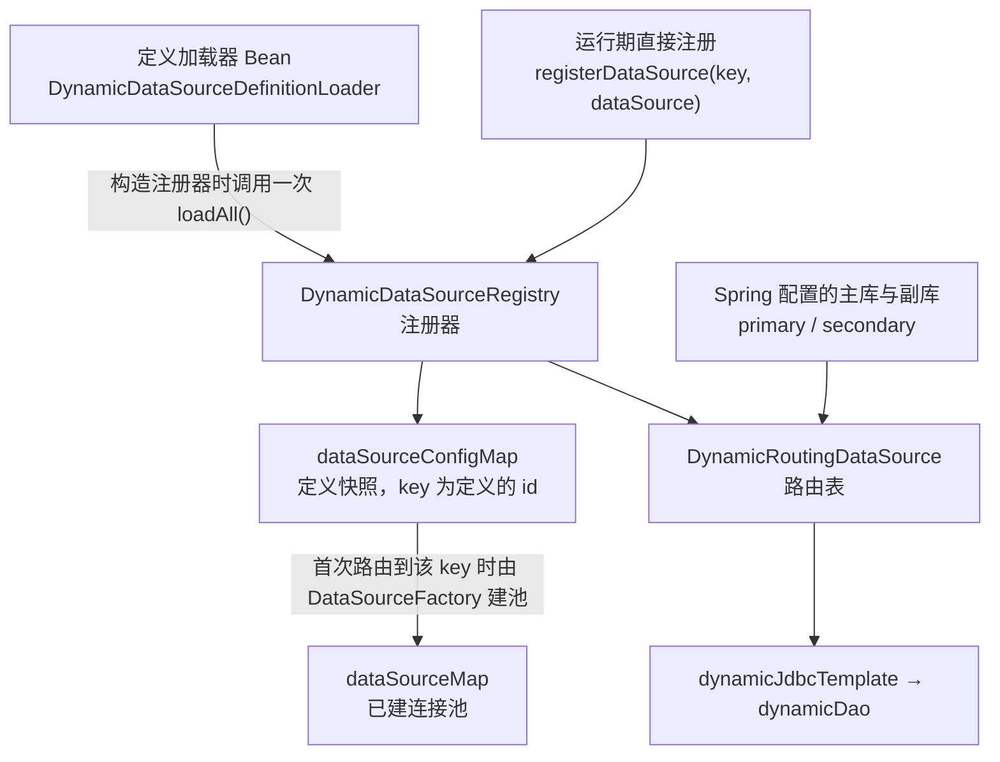

# 数据源定义的装载与注册

本页集中回答三个问题：

- 数据源从哪里来
- 注册到哪个类里管理
- 应用层如何自定义装载机制

切换用法见[切换方式](switching.md)，实体如何绑定数据源见[实体绑定与优先级](entity-binding.md)，连接池等参数见[配置方式](configuration.md)。

## 全链路一览



| 类 | 所在包 | 职责 |
|---|---|---|
| `DynamicDataSourceDefinitionLoader` | `cn.geelato.datasource.spi` | 扩展点。向注册器提供"有哪些数据源定义"，由宿主应用实现并注册为 Bean |
| `DynamicDataSourceRegistry` | `cn.geelato.datasource` | 注册中心。保存定义快照与连接池，提供刷新、移除和取用 |
| `DataSourceFactory` | `cn.geelato.datasource` | 把一条定义建成 HikariCP 连接池：解密密码、主机地址映射、套用统一连接池参数 |
| `DynamicRoutingDataSource` | `cn.geelato.datasource` | 路由数据源。按线程里的 key 从注册器取连接池，并维护路由表 |
| `OrmDynamicDataSourceAutoConfiguration` | `cn.geelato.orm.config` | 装配入口。容器中存在名为 `primaryJdbcTemplate` 的 Bean 时导入以上各 Bean；`geelato-framework-starter` 在配置了 `spring.datasource.primary.jdbc-url` 时导入同一批 |

## 数据源从哪里来：三个来源

| 来源 | 路由 key | 进入系统的时机 | 说明 |
|---|---|---|---|
| Spring 配置的主库与副库（`spring.datasource.primary.*` / `spring.datasource.secondary.*`） | `primary` / `secondary` | 启动时由 Spring 建池 | 不经过注册器的两张表，由路由表直接加入；加载器不需要返回它们 |
| 定义加载器 Bean | 定义 Map 的 `id` | 注册器构造时调用一次 `loadAll()` | 容器中按类型只认**一个** `DynamicDataSourceDefinitionLoader` |
| 运行期直接注册 | 调用方指定的 key | 调用 `registerDataSource(key, dataSource)` 时 | 登记一个已经建好的连接池，适合数量少、启动期已知的库 |

关于定义加载器：

- 框架模块 `geelato-orm` 自身不带任何实现。宿主应用不提供时注册器里没有定义来源的数据源，只有 `primary` / `secondary` 可以路由。
- 平台宿主（classpath 中含 `geelato-web-platform`）自带一个实现：`PlatformDynamicDataSourceDefinitionLoader`，从平台维护的连接定义中加载。

## 注册到哪个类：DynamicDataSourceRegistry

数据源统一注册在 `cn.geelato.datasource.DynamicDataSourceRegistry`。它是一个 Spring Bean，业务代码可以直接注入。

注册器维护两张表，都以定义的 `id` 为 key：

| 表 | 内容 | 何时写入 |
|---|---|---|
| `dataSourceConfigMap` | 定义快照，即加载器返回的那条 Map 的副本 | 启动装载、全量刷新、按 key 刷新时 |
| `dataSourceMap` | 已经建好的连接池 | 默认懒加载：首次路由到该 key 时；`delay-load-data-source=false` 时在登记定义的同时建池 |

两张表不同步是正常状态。一条定义已登记但尚未建池时，`containsDataSource(key)` 返回 `true`，调用 `getDataSource(key)` 才会建池。

公开方法：

| 方法 | 作用 |
|---|---|
| `refreshAllDataSources()` | 重新调用 `loadAll()` 并全量对账：返回的 key 逐条重新登记，本次没有返回的 key 被移除。返回本次的 key 数量 |
| `refreshDataSource(String key)` | 调用 `loadOne(key)` 重新登记该 key。加载器返回 `null` 时不做任何变更并返回 `false` |
| `registerDataSource(String key, DataSource dataSource)` | 直接登记一个已建好的连接池。key 已存在时会先关闭旧池 |
| `removeDataSource(String key)` | 关闭连接池并删除定义，该 key 不再可用 |
| `destroyDataSource(String key)` | 只关闭并移除连接池，保留定义；下次取用时重新建池 |
| `getDataSource(String key)` | 取连接池。定义已登记但尚未建池时在此建池 |
| `containsDataSource(String key)` | key 是否已登记，包括只有定义、尚未建池的情况 |
| `getAllDataSources()` | 已建连接池的快照，不含只有定义的 key |
| `getPrimaryDataSource()` / `getSecondaryDataSource()` | 主库与可选副库的连接池 |

## 启动时谁调谁

1. 容器中存在名为 `primaryJdbcTemplate` 的 Bean 时，`OrmDynamicDataSourceAutoConfiguration` 导入注册器、工厂、路由数据源等 Bean。
2. 创建 `dynamicDataSource` 时需要注入注册器，注册器随之构造。
3. 注册器构造器按类型注入定义加载器。这个参数是可选的，也没有限定名：容器里有 0 个就是 `null`，有 1 个就是它，多于 1 个时必须有且只有一个标了 `@Primary`。
4. 构造器内立即调用 `refreshAllDataSources()`。这是启动阶段唯一一次 `loadAll()`。
5. 逐条登记：取 `id` 作为 key，关闭同 key 的旧池，保存定义副本；`delay-load-data-source=false` 时同时建池。
6. 对账：上一轮登记过、本次没有返回的 key 被移除，连接池随之关闭。
7. `dynamicDataSource` 创建完成前调用路由数据源的 `refreshAllDataSources()`，把主库、副库与已建池的条目装入路由表。

各种情形下的行为：

| 情形 | 行为 |
|---|---|
| 容器中没有定义加载器 | 正常启动。日志出现 `No DynamicDataSourceDefinitionLoader bean found`，没有定义来源的数据源 |
| 容器中有多个加载器，且都没有 `@Primary` | 启动失败，抛 `NoUniqueBeanDefinitionException` |
| `loadAll()` 在启动时抛异常或返回 `null` | 记一条 WARN 后继续启动，日志含 `For dynamic data sources has been search failed`；本次没有登记任何定义来源的数据源 |
| 某条定义非法，例如没有 `id` | 记一条 ERROR 并跳过这一条，其余照常登记 |
| 定义已登记，但建池失败，例如 `db_type` 不支持或必填字段缺失 | 默认懒加载下发生在首次路由时：记一条 ERROR，该次查询回落到主库 |
| 实体显式绑定的 key 没有登记 | `EntityDataSourceResolver` 抛 `IllegalStateException`，拒绝路由 |

最后两行是两种不同的情况：没有登记是硬失败；已经登记但建池失败只会留下一条 ERROR 日志，查询会落到主库。排查时先确认属于哪一种，见文末的排障速查。

## 定义加载器契约

```java
package cn.geelato.datasource.spi;

public interface DynamicDataSourceDefinitionLoader {

    List<Map<String, Object>> loadAll();     // 全部数据源定义

    Map<String, Object> loadOne(String key); // 按路由 key 加载单条定义
}
```

`loadAll()` 返回的每个 Map 是一条连接定义，字段名约定为 snake_case：

| 字段 | 必需 | 说明 |
|---|---|---|
| `id` | 是 | 路由 key。取 `toString()` 后作为注册器的 key，区分大小写 |
| `db_type` | 是 | 数据库类型，转小写后匹配，取值见下表 |
| `db_hostname_ip` | 是 | 主机地址，可被[主机地址映射](host-mapping.md)重定向 |
| `db_port` | 是 | 端口，必须能解析为整数 |
| `db_user_name` | 是 | 用户名 |
| `db_name` | 是 | 库名 |
| `db_password` | 否 | 密码，可以为 `null` |

`db_type` 支持的值：

| `db_type` | 驱动 |
|---|---|
| `mysql` | `com.mysql.cj.jdbc.Driver` |
| `postgresql` / `postgres` | `org.postgresql.Driver` |
| 经 `Dialects.registerAlias(...)` 注册、归属 PostgreSQL 家族的别名 | `org.postgresql.Driver` |

其他取值会在建池时抛 `UnsupportedOperationException: 不支持的数据库类型`。JDBC URL 由框架自己拼接，定义里的其他字段原样保存在定义快照中，建池时不读取。

**密码**：可以写明文；需要加密时写成 `算法:密文`，算法取值 `aes` / `rsa` / `sm2` / `sm4`，由 `DataSourceFactory` 在建池时解密，加载器不需要处理。明文恰好以这四个算法名加冒号开头时会被当作密文而解密失败，这种情况需要改用加密写法。

**`loadOne(key)` 的语义**：

- 只在 `refreshDataSource(key)` 时被调用，启动时不调用。
- 返回的 Map 按传入的 key 登记，而不是按 Map 里的 `id`。
- 返回 `null` 表示来源里没有这条定义，注册器不做变更。

**实现约束**：

| 约束 | 原因 |
|---|---|
| `loadAll()` 在注册器构造器里同步执行，之后每次全量刷新再执行一次 | 它的耗时直接计入启动时间；抛异常只会得到一条 WARN，启动照常继续 |
| 两个方法都在注册器的锁内执行 | 实现内部不必再加锁，也不要在方法里回调注册器：构造期会形成循环依赖，全量刷新时会无限递归 |
| 需要访问主库时注入 `@Qualifier("primaryJdbcTemplate") JdbcTemplate` | 注册器构造时其他数据源 Bean 还不可用 |
| `id` 不要使用 `primary` / `secondary` | 这两个 key 由路由数据源保留给主库和副库 |

## 应用层如何自定义装载

自定义装载就是提供自己的 `DynamicDataSourceDefinitionLoader` Bean。先判断宿主里有没有现成的加载器：

| 宿主形态 | 容器里是否已有加载器 | 做法 |
|---|---|---|
| 纯框架宿主：只依赖 `geelato-orm` 或 `geelato-framework-starter` | 没有 | 直接提供一个 Bean |
| 平台宿主：依赖 `geelato-web-platform` | 有，`PlatformDynamicDataSourceDefinitionLoader` | 完全替换，或者组合：保留原来源并追加自有来源 |

### 提供自己的数据源来源

最小示例，纯框架宿主直接可用：

```java
package com.acme.app.ds;

import cn.geelato.datasource.spi.DynamicDataSourceDefinitionLoader;
import org.springframework.stereotype.Component;

import java.util.HashMap;
import java.util.List;
import java.util.Map;

@Component
public class InMemoryDataSourceLoader implements DynamicDataSourceDefinitionLoader {

    @Override
    public List<Map<String, Object>> loadAll() {
        Map<String, Object> ds = new HashMap<>();
        ds.put("id", "biz-mysql");
        ds.put("db_type", "mysql");
        ds.put("db_hostname_ip", "10.0.0.10");
        ds.put("db_port", 3306);
        ds.put("db_user_name", "biz_user");
        ds.put("db_name", "biz_db");
        ds.put("db_password", "biz@psd");
        return List.of(ds);
    }

    @Override
    public Map<String, Object> loadOne(String key) {
        return loadAll().stream()
                .filter(m -> key.equals(String.valueOf(m.get("id"))))
                .findFirst()
                .orElse(null);
    }
}
```

启动后 `biz-mysql` 已登记，`containsDataSource("biz-mysql")` 返回 `true`。默认懒加载下，连接池在第一次路由到它时创建；之后通过 `.useDataSource("biz-mysql")` 或 `@Entity(connectId = "biz-mysql")` 即可使用。

### 平台宿主：追加自有来源

平台宿主里容器已经有一个加载器，而注册器只认一个。有两种选择：

- **完全替换**：在自己的加载器上加 `@Primary`。注册器从此只向它要定义，平台维护的连接不再被登记。
- **组合**：需要保留原来源并追加自有来源时选这种。加 `@Primary` 的同时把原加载器注入进来，由新加载器负责合并。

```java
package com.acme.app.ds;

import cn.geelato.datasource.PlatformDynamicDataSourceDefinitionLoader;
import cn.geelato.datasource.spi.DynamicDataSourceDefinitionLoader;
import org.springframework.context.annotation.Primary;
import org.springframework.stereotype.Component;

import java.util.ArrayList;
import java.util.HashMap;
import java.util.List;
import java.util.Map;

@Component
@Primary
public class MergedDataSourceLoader implements DynamicDataSourceDefinitionLoader {

    private final PlatformDynamicDataSourceDefinitionLoader platformLoader;

    public MergedDataSourceLoader(PlatformDynamicDataSourceDefinitionLoader platformLoader) {
        this.platformLoader = platformLoader;
    }

    @Override
    public List<Map<String, Object>> loadAll() {
        List<Map<String, Object>> merged = new ArrayList<>(platformLoader.loadAll());
        merged.addAll(ownDefinitions());
        return merged;
    }

    @Override
    public Map<String, Object> loadOne(String key) {
        Map<String, Object> own = ownDefinitions().stream()
                .filter(m -> key.equals(String.valueOf(m.get("id"))))
                .findFirst()
                .orElse(null);
        return own != null ? own : platformLoader.loadOne(key);
    }

    // 自有来源：这里以内存定义示意，也可以读文件或调用接口
    private List<Map<String, Object>> ownDefinitions() {
        Map<String, Object> ds = new HashMap<>();
        ds.put("id", "report-pg");
        ds.put("db_type", "postgresql");
        ds.put("db_hostname_ip", "10.0.0.20");
        ds.put("db_port", 5432);
        ds.put("db_user_name", "report_user");
        ds.put("db_name", "report_db");
        ds.put("db_password", "report@psd");
        return List.of(ds);
    }
}
```

合并规则：登记时排在后面的定义覆盖前面的。自有定义排在平台定义之后，两者 `id` 相同时以自有定义为准；`loadOne` 先查自有定义、再查平台定义，顺序与此一致。

这个示例里的库与主库不是同一种数据库，需要同时处理下文的"已知限制：方言解析不读注册器"。

### 更多写法：从文件或接口加载

**从 JSON 文件加载。** 每个 `src/main/resources/datasource/*.json` 文件描述一条连接：

```json
{
  "id": "biz-mysql",
  "dbType": "mysql",
  "host": "10.0.0.10",
  "port": 3306,
  "userName": "biz_user",
  "dbName": "biz_db",
  "password": "sm4:Y3yK9+...加密串"
}
```

```java
package com.acme.app.ds;

import cn.geelato.datasource.spi.DynamicDataSourceDefinitionLoader;
import com.alibaba.fastjson2.JSON;
import com.alibaba.fastjson2.JSONObject;
import org.springframework.core.io.Resource;
import org.springframework.core.io.support.PathMatchingResourcePatternResolver;
import org.springframework.stereotype.Component;

import java.io.IOException;
import java.io.InputStream;
import java.nio.charset.StandardCharsets;
import java.util.ArrayList;
import java.util.HashMap;
import java.util.List;
import java.util.Map;

@Component
public class JsonFileDataSourceLoader implements DynamicDataSourceDefinitionLoader {

    @Override
    public List<Map<String, Object>> loadAll() {
        List<Map<String, Object>> definitions = new ArrayList<>();
        try {
            var resolver = new PathMatchingResourcePatternResolver();
            for (Resource res : resolver.getResources("classpath:datasource/*.json")) {
                definitions.add(parse(res));
            }
        } catch (IOException e) {
            throw new IllegalStateException("读取数据源定义文件失败", e);
        }
        return definitions;
    }

    @Override
    public Map<String, Object> loadOne(String key) {
        return loadAll().stream()
                .filter(m -> key.equals(String.valueOf(m.get("id"))))
                .findFirst()
                .orElse(null);
    }

    private Map<String, Object> parse(Resource res) throws IOException {
        try (InputStream in = res.getInputStream()) {
            JSONObject json = JSON.parseObject(new String(in.readAllBytes(), StandardCharsets.UTF_8));
            // key 必须是框架约定的 snake_case
            Map<String, Object> ds = new HashMap<>();
            ds.put("id", json.getString("id"));
            ds.put("db_type", json.getString("dbType"));
            ds.put("db_hostname_ip", json.getString("host"));
            ds.put("db_port", json.getIntValue("port"));
            ds.put("db_user_name", json.getString("userName"));
            ds.put("db_name", json.getString("dbName"));
            ds.put("db_password", json.getString("password"));
            return ds;
        }
    }
}
```

`loadAll()` 每次调用都重新扫描目录，新增或修改 `*.json` 后执行一次全量刷新即可生效，无需重启。

**从外部接口加载。** 接口直接返回符合字段约定的数组：

```java
package com.acme.app.ds;

import cn.geelato.datasource.spi.DynamicDataSourceDefinitionLoader;
import org.springframework.core.ParameterizedTypeReference;
import org.springframework.http.HttpMethod;
import org.springframework.http.ResponseEntity;
import org.springframework.stereotype.Component;
import org.springframework.web.client.RestTemplate;

import java.util.List;
import java.util.Map;

@Component
public class HttpApiDataSourceLoader implements DynamicDataSourceDefinitionLoader {

    private final RestTemplate client = new RestTemplate();

    @Override
    public List<Map<String, Object>> loadAll() {
        ResponseEntity<List<Map<String, Object>>> response = client.exchange(
                "http://ds-registry.internal.svc/api/datasources",
                HttpMethod.GET,
                null,
                new ParameterizedTypeReference<List<Map<String, Object>>>() {});
        List<Map<String, Object>> body = response.getBody();
        return body == null ? List.of() : body;
    }

    @Override
    public Map<String, Object> loadOne(String key) {
        return loadAll().stream()
                .filter(m -> key.equals(String.valueOf(m.get("id"))))
                .findFirst()
                .orElse(null);
    }
}
```

### 平台宿主下必须加 `@Primary`

以上三个加载器用在纯框架宿主时不需要 `@Primary`。用在平台宿主时，容器里会有两个加载器，注册器按类型只认一个，因此必须给要生效的那一个加 `@Primary`，否则启动失败。加了 `@Primary` 就是完全替换；需要保留平台连接时改用上面的组合加载器。

### 放在哪里才会被发现

- 用 `@Component` 时，类必须位于宿主应用的组件扫描范围内。平台宿主扫描的是 `cn.geelato`；应用自身的包是否在扫描范围内取决于宿主的组件扫描配置。
- 不在扫描范围内时，在任意配置类里用 `@Bean` 方法返回加载器实例。
- 框架的自动装配不做任何扫描，只按类型查找这个 Bean。

### 验证

实现加载器后，除了看启动是否成功，再确认定义确实进了注册器：

```java
@Autowired
private DynamicDataSourceRegistry registry;

public void verify() throws SQLException {
    // 定义已登记；懒加载模式下此时还没有连接池
    boolean registered = registry.containsDataSource("biz-mysql");

    // 首次取用时建池；返回 null 说明建池失败，原因见前面的 ERROR 日志
    DataSource dataSource = registry.getDataSource("biz-mysql");
    try (Connection connection = dataSource.getConnection()) {
        boolean ok = connection.isValid(3);
    }
}
```

能取到连接，说明"定义加载、建池"这一段是通的；之后的路由与切换见[切换方式](switching.md)。

### 已知限制：方言解析不读注册器

生成 SQL 时用哪种方言，例如标识符的引用符号，由 `MetaBaseSqlProvider` 按下面的顺序决定，取到第一个非空值为止：

1. 实体元数据自带的 `dbType`
2. 本次命令显式指定的数据源，即 DSL 上 `.useDataSource(...)` 传入的 key
3. 实体 `connectId` 对应的连接定义
4. 平台默认 key 对应的连接定义
5. 主库的实际数据库类型

第 2 到第 4 步读取的连接定义来自 `cn.geelato.core.ds.DataSourceManager` 持有的快照，而不是 `DynamicDataSourceRegistry`。这份快照由另一个接口 `cn.geelato.core.ds.spi.DataSourceDefinitionLoader` 提供：平台宿主在启动流程中装配它，见[平台启动](../reference/startup-process.md)；纯框架宿主不会自动装配。

因此存在一个限制：自定义来源里的库与主库不是同一种数据库时，例如主库是 MySQL、自定义来源是 PostgreSQL，如果实体元数据里没有 `dbType`，生成的 SQL 仍按主库方言处理。

两种处理方式：

- 让自定义来源的库与主库保持同一种数据库类型。
- 让自定义加载器同时实现 core 侧的接口，使两份快照同源：

```java
import cn.geelato.core.ds.spi.DataSourceDefinitionLoader;
import cn.geelato.core.orm.Dao;

@Component
@Primary
public class MergedDataSourceLoader
        implements DynamicDataSourceDefinitionLoader, DataSourceDefinitionLoader {

    // loadAll() 与 loadOne(String) 保持不变

    @Override
    public List<Map<String, Object>> load(Dao dao) {
        return loadAll();
    }
}
```

两个接口的 `loadOne(String)` 签名相同，一个方法同时满足。平台宿主的启动流程按类型注入 core 侧接口，带 `@Primary` 的自定义加载器会被选中。纯框架宿主还需要在启动时自行装配一次：

```java
DataSourceManager.singleInstance().setDefinitionLoader(loader);
```

装配后快照未命中时会经该加载器的 `loadOne` 实时补载。

## 运行期变更：刷新、追加、移除

定义来源发生变化后，例如文件更新、外部接口有了新记录，不需要重启应用。

操作分两步：先改注册器，再让路由数据源感知。两者都是 Spring Bean，直接注入：

```java
@Autowired
private DynamicDataSourceRegistry registry;

@Autowired
@Qualifier("dynamicDataSource")
private DynamicRoutingDataSource routingDataSource;
```

| 操作 | 第 1 步：注册器 | 第 2 步：路由数据源 |
|---|---|---|
| 来源里新增或修改了定义 | `registry.refreshDataSource(key)`；批量变更用 `registry.refreshAllDataSources()` | `routingDataSource.refreshDataSource(key)`，或 `refreshAllDataSources()` |
| 直接登记一个已建好的连接池 | `registry.registerDataSource(key, dataSource)` | 新 key 不需要：首次路由时自动加入路由表。替换路由表中已有的 key 时用 `routingDataSource.refreshDataSource(key)` |
| 移除 | `registry.removeDataSource(key)` | `routingDataSource.refreshDataSource(key)` |

注意：

- 第 1 步会关闭该 key 的旧连接池，而路由表仍指向它。不做第 2 步，这个 key 上的查询会直接失败。
- 全量刷新会关闭并重新登记**全部**定义来源的连接池，按 key 刷新只影响一个。
- `refreshDataSource(key)` 返回 `false` 表示加载器没有返回这条定义，注册器没有变化，此时不需要第 2 步。
- 直接登记的连接池没有定义快照，全量刷新不会移除它；加载器之后返回同 `id` 的定义时，它会被覆盖。

## 容易混淆：DataSourceManager 不是注册中心

框架里还有一个名字相近的类：`cn.geelato.core.ds.DataSourceManager`。它不建池，也不参与路由：

| | `DynamicDataSourceRegistry` | `DataSourceManager` |
|---|---|---|
| 所在模块 | `geelato-orm` | `geelato-core` |
| 形态 | Spring Bean | 静态单例 |
| 保存什么 | 定义快照、连接池 | 定义快照、默认数据源 key、主库连接池 |
| 定义由谁提供 | `DynamicDataSourceDefinitionLoader` | `cn.geelato.core.ds.spi.DataSourceDefinitionLoader` |
| 谁在使用 | 路由数据源、实体归属校验、各能力模块取连接池 | SQL 方言解析、脚本跨库定位 |

两个接口名字相近，返回的数据结构也相同，都是 `id` 加若干 snake_case 字段的 Map，但互相独立：实现其中一个不会对另一个生效。`geelato.orm.default-data-source-key` 写入的也是 `DataSourceManager`。

## 排障速查

| 现象 | 原因 | 处理 |
|---|---|---|
| 启动失败，抛 `NoUniqueBeanDefinitionException` | 容器里有多个加载器，且都没有 `@Primary` | 在要生效的那一个上加 `@Primary` |
| 启动日志出现 `No DynamicDataSourceDefinitionLoader bean found` | 容器里没有加载器 Bean | 确认类在组件扫描范围内，或改用 `@Bean` 注册 |
| 启动日志出现 `For dynamic data sources has been search failed` | `loadAll()` 抛了异常或返回了 `null` | 按日志里的异常信息修复来源；这次启动没有登记任何定义来源的数据源 |
| 日志出现 `dynamic data source config failed` | 某条定义非法，通常是缺少 `id` | 对照字段表检查该条定义 |
| 实体归属报 `IllegalStateException`，提示未注册 | 加载器没有返回这个 `id` | 核对定义的 `id` 与实体绑定的 key 是否一致 |
| 查询落到了主库，日志出现 `无法从DynamicDataSourceRegistry获取数据源` | 路由到的 key 取不到连接池：没有登记，或者已登记但建池失败 | 前者核对 key；后者查看 `delayed create dynamic datasource fail` 的 ERROR 日志 |
| 同一条日志的 key 是 `secondary` | 现有实现每次路由到副库都会打这条 WARN，路由结果不受影响 | 可以忽略 |
| 改了定义但没有生效 | 只做了注册器这一步 | 补上路由数据源的刷新 |
| `refreshDataSource(key)` 返回 `false` | 加载器的 `loadOne(key)` 返回了 `null` | 确认来源里有这个 key；平台宿主下改用组合加载器 |

## 推荐继续阅读

- [配置方式](configuration.md) —— 连接池参数、懒加载开关与默认数据源
- [实体绑定与优先级](entity-binding.md) —— 定义里的 `id` 如何与实体关联
- [切换方式](switching.md) —— 自动切库与手工切换
- [主机地址映射](host-mapping.md) —— 开发环境把内网地址映射到本地
