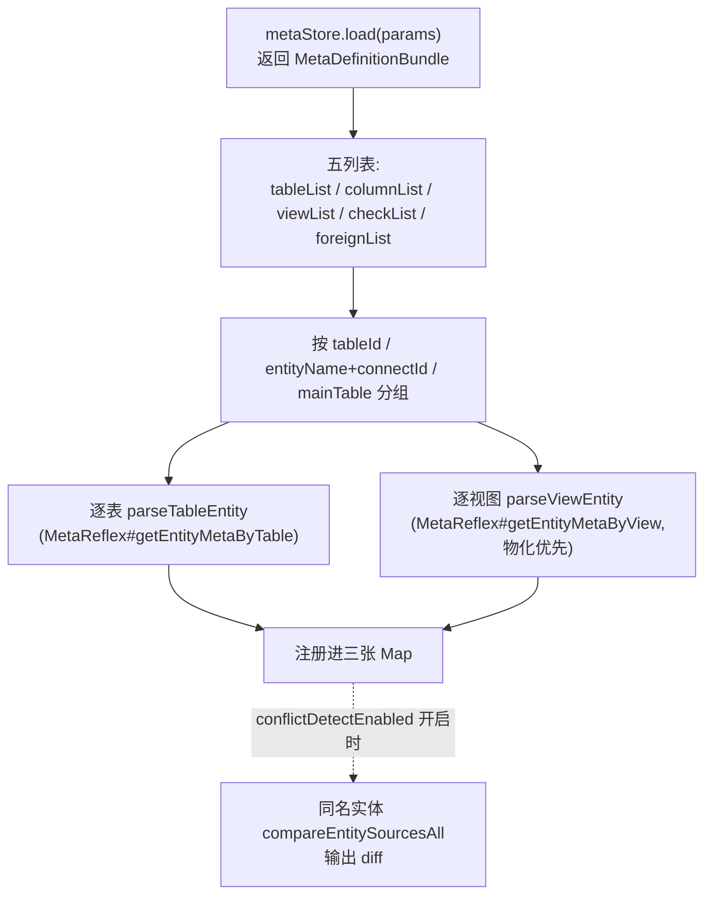

# 元数据加载机制

本页说明元数据"从哪里来、何时注册、同名冲突如何裁决、缓存扮演什么角色"。模型类的属性构成见[元数据模型](./model.md),运行期查询与刷新 API 见[元数据运行期操作](./operations.md)。

## MetaManager:单例注册表

路径:`cn.geelato.core.meta.MetaManager`(geelato-core)。全局单例(`singleInstance()` + ReentrantLock),构造时先注册两张元数据表自身——`parseOne(ColumnMeta.class)` 与 `parseOne(TableMeta.class)`——保证"元数据的定义本身"也有元数据。

### 注册表结构

| 容器 | key | 作用 |
| --- | --- | --- |
| `entityMetadataMap` | entityName | **主注册表**,ORM/MQL 运行期只查这张,是双源的合并视图 |
| `entityMetadataMapFromClass` | entityName | Java 类源缓存 |
| `entityMetadataMapFromDatabase` | entityName | DB 在线源缓存 |
| `tableNameMetadataMap` | tableName | 表名 → 实体,按表名查询的入口 |
| `entityLiteMetaList` | — | 精简实体列表,供 `/api/meta/entityLiteMetas` |
| `entityFieldNameTitleMap`(static) | fieldName/columnName | 字段-标题映射,debug 用途 |
| `scannedPackages` | 包名 | 跨组件扫描去重(`ConcurrentHashMap.newKeySet`) |

### 注册表之外的配置状态

| 字段 | 默认值 | 说明 |
| --- | --- | --- |
| `metaStore` | null | MetaStore SPI 注入(DB 在线源的数据来源) |
| `metaResourceProvider` | DefaultMetaResourceProvider | 静态资源 SPI(默认列定义/列选择类型/表升级列) |
| `conflictStrategy` | CLASS | 同名冲突策略,配置键 `geelato.meta.conflict-strategy` |
| `conflictDetectEnabled` | false | 冲突检测开关,配置键 `geelato.meta.conflict-detect.enabled` |
| `catalogConnectIdMapping` | 空 Map | catalog → connectId 映射,来自 `geelato.datasource.dynamic.catalog-mapping` |

## 三条启动加载路径

### 路径 A:geelato-orm 扫描主类包

`geelato-orm` 的 `OrmAutoConfiguration#ormEntityMetadataInitializer` 是一个 `SmartInitializingSingleton` Bean——所有单例 Bean 就绪后执行:

1. `AutoConfigurationPackages.get(applicationContext)` 取 Spring Boot 主类所在包;
2. `metaManager.isPackageAlreadyScanned(pkg)` 过滤已扫过的包;
3. `ClassPathScanningCandidateComponentProvider` + `AnnotationTypeFilter(Entity.class)` 找出 `@Entity` 类;
4. 逐个 `ClassUtils.forName` 加载,调用 `MetaManager#parseOne(Class)` 注册。

### 路径 B:MetaConfiguration 扫 cn.geelato 并装载 DB 在线源

`geelato-web-platform` 的 `cn.geelato.web.platform.boot.MetaConfiguration`(`@Configuration`,经 `cn.geelato` 组件扫描发现),在 `setApplicationContext` 时执行:

1. 注入 `metaStore` / `metaResourceProvider` / 冲突配置;
2. `initClassPackageMeta()`:读配置 `geelato.meta.scan-package-names`(默认 **`cn.geelato`**),逗号分隔逐个调用 `metaManager.scanAndParse(packageName, false)`——内部经 `AnnotatedClassScanner`(ASM 读字节码注解,命中才 ClassUtils.forName,不触发全量类加载)逐个 `parseOne(clazz)`;
3. `initDataBaseMeta()`:调用 `metaManager.parseDBMeta()` 装载 DB 在线源;
4. 若容器中有 `MetaBootstrap` Bean,调用 `metaBootstrap.bootstrap(metaManager, dao)` 做宿主自定义初始化。

### 路径 C:mcp 宿主独立装载

`geelato-mcp` 的 `MetaInitConfig`(`@PostConstruct init()`),逻辑与路径 B 相同,scan-package-names 走 System property。MCP 宿主独立于聚合构建使用。

### 装载顺序的含义

路径 A 扫的是应用主类包(业务实体),路径 B 扫的是 `cn.geelato`(平台实体)。对同名实体,注册顺序与扫描顺序决定"先到先得"的胜者;而 `catalog=platform` 的实体恒以 Java 类为准(见下文冲突策略),因此平台实体不会被 DB 定义意外覆盖。

## DB 在线源装载:parseDBMeta

`MetaManager#parseDBMeta()` 要求 `metaStore` 已注入,流程:



`MetaDefinitionBundle` 是五个 final List 的契约包(对应 `platform_dev_table/column/view/table_check/table_foreign` 的行)。默认实现 `DefaultMetaStore`(`@Component`,注入 `primaryDao`)用 `MetaDaoSql` 的五条 SQL 以 CompletableFuture 并行查询,均带 `del_status=0` 过滤。

自定义"元数据从哪里来"(JSON 文件、配置中心、外部元数据服务等)的完整指南见 [MetaStore 扩展](../reference/metastore-extension.md)。

## 同名冲突策略

双源并存的直接后果是同名实体可能给出两份定义。裁决规则:

| 场景 | 行为 |
| --- | --- |
| 冲突检测关闭(默认) | **先到先得**:entityName 已在主表时,DB 来源仅把自身的 TableMeta 补给已有 EntityMeta,不整体覆盖 |
| `catalog=platform` 的实体 | **恒以 Java 类为准**,任何策略下 DB 定义都不覆盖 |
| 冲突检测开启 + `conflictStrategy=CLASS` | 忽略 DB 覆盖,保留类源 |
| 冲突检测开启 + `conflictStrategy=DATABASE` | `removeOne(entityName)` 后整体以 DB 定义覆盖 |
| 冲突检测开启 | 对同名实体 `compareEntitySourcesAll` 输出字段级 diff,可经 `/api/meta/conflicts` 查看 |

相关配置:

```yaml
geelato:
  meta:
    conflict-strategy: CLASS          # CLASS | DATABASE
    conflict-detect:
      enabled: false                  # 开启后输出双源 diff 并可查询冲突清单
```

## 缓存的角色辨析

元数据体系涉及三层"缓存",职责完全不同,不可混谈:

| 层 | 载体 | 缓存的对象 | 特性 |
| --- | --- | --- | --- |
| **元数据注册表** | MetaManager 内的 HashMap | EntityMeta 本身 | 纯进程内,**无分布式缓存**;跨实例一致性靠 `/api/meta/sync/{entity}` 触发各实例 refreshDBMeta,或重启重载 |
| **meta 驱动查询结果缓存** | MetaCacheProvider(j2cache `metaquery` region;j2cache 不可用时降级到 static `LocalBoundedCache`,ttl 60s/容量 2000) | 元数据驱动查询的**结果**,不缓存注册表 | 失效由 `PlatformQueryCacheEvictOnDelete/OnSave` 监听器与 `removeCacheByPattern`(支持 `*x`/`x*`/`*x*`)负责 |
| **实体级查询缓存门控** | `EntityMeta.isBackEndCacheEnabled()` | — | 由 `platform_dev_table.cache_type` 决定(`None/BackEnd/FrontEnd/BackEndAndFrontEnd`),是否启用后端缓存以设计器配置为准 |

此外框架内多处用 `LocalBoundedCache` 做元数据**派生信息**的短周期缓存(如 `$gl.sql` 表定位的 60s/4096),这些都是"注册表的下游快照",注册表变更后自然过期。

:::warning 共享与失效
MetaManager 注册表是单例内可变状态,运行期刷新(refreshDBMeta)只影响当前进程。多实例部署时,设计器保存触发的刷新需要在每个实例执行(平台经 `/api/meta/sync` 或重启保证),直接改库不会让其他实例感知。
:::

## 易混点:Spring Bean 扫描与元数据实体扫描

`@ComponentScan` 扫的是 Spring Bean,元数据扫描扫的是 `@Entity` 注解类——两套扫描相互独立。`@Entity` 类不需要是 Spring Bean 也能注册元数据;反之是 Bean 但没有 `@Entity` 的类不会进注册表。历史配置 `auto-scan`/`base-packages` 已删除,现在的扫描范围固定为"主类包 + `geelato.meta.scan-package-names`"。

## 延伸阅读

- [元数据运行期操作](./operations.md)——refreshDBMeta 的调用场景与 API 细节
- [MetaStore 扩展](../reference/metastore-extension.md)——自定义元数据来源的完整实现指南
- [启动过程](../reference/startup-process.md)——元数据初始化在启动时序中的位置(阶段二)
- [实体与数据源绑定](../dynamic-datasource/entity-binding.md)——catalog/connectId 如何路由到数据源
