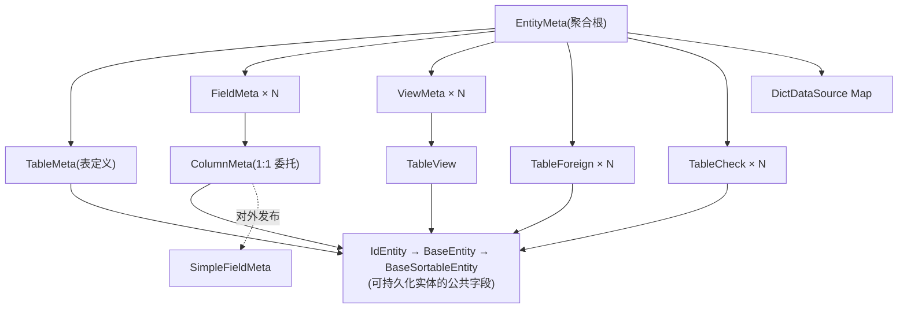

# 元数据模型

本页逐属性说明元数据体系的全部模型类。代码位置:`geelato-core` 的 `cn.geelato.core.meta.model` 包;注解在 `geelato-lang` 的 `cn.geelato.lang.meta` 包。

模型关系总览:

## EntityMeta:实体元数据(聚合根)

路径:`cn.geelato.core.meta.model.entity.EntityMeta`。

### 属性

| 属性 | 类型 | 含义 |
| --- | --- | --- |
| `entityName` | String | 实体名。类源为长类名;DB 源为 `platform_dev_table.entity_name` |
| `entityTitle` | String | 实体中文标题(来自 `@Title` 或设计器) |
| `classType` | Class | 来源 Java 类。DB 源实体为 null,这是区分两种来源的直接判据 |
| `entityType` | EntityType | 枚举 `Table / View / Class`,标记元数据的来源形态 |
| `catalog` | String,默认 `"none"` | 逻辑数据库分组,来自 `@Entity(catalog)`,参与数据源路由 |
| `id` | FieldMeta | 主键字段元数据;`setId` 时同时把主键加入不可更新字段表 |
| `tableMeta` | TableMeta | 表级定义(表名/schema/连接 id/缓存类型等),见下文 |
| `tableAlias` | String | 表别名(SQL 生成时使用) |
| `fieldNames` | String[] | 全部字段名的数组,按固定顺序排列(见 `setFieldMetas`) |
| `fieldMetas` | Collection\<FieldMeta\> | 全部字段元数据 |
| `viewMetas` | Collection\<ViewMeta\> | 关联视图定义 |
| `tableForeigns` | Collection\<TableForeign\> | 外键关系;`setTableForeigns` 时同步构建 `foreignTable → TableForeign` 索引 |
| `tableChecks` | Collection\<TableCheck\> | CHECK 约束 |
| `dictDataSourceMap` | Map\<String, DictDataSource\> | 字典数据源(fieldName → group/code),来自 `@DictDataSrc` |
| `fieldMetaMap` | LinkedHashMap | 冗余索引:fieldName → FieldMeta,快速取列 |
| `simpleFieldMetaMap` | LinkedHashMap | 冗余索引:对外发布的精简字段元数据,过滤了表名等库信息 |
| `tableForeignsMap` | Map\<String, TableForeign\> | 冗余索引:foreignTable → TableForeign |
| `ignoreUpdateFieldMap` | Map\<String, Boolean\> | 不可更新字段。构造时放入 `create_at/createAt/creator`,`setId` 时加入主键 |
| `encryptedColumnNames` | Set\<String\> | 全部加密列名,懒计算一次,`setFieldMetas` 后重算 |
| `jsonFieldKeys` | Set\<String\> | JSON 类型字段的键集合(同时含 fieldName 与 columnName),懒计算,用于 Dao 行转换时判定 JSON 解析 |
| `versionControl` | Boolean,默认 false | 版本控制(乐观锁)。**当前暂缓启用**:`platform_dev_table` 尚无 `version_control` 列,SQL 生成未消费该属性,文档与代码均以"未生效"为准 |
| `deleteMode` | DeleteMode,默认 `AUTO` | 实体级删除模式。AUTO=未显式指定,跟随全局默认;最终解析收敛在 `DeleteCommands.resolve`,优先级:调用级显式 > 实体级 > 全局默认 |
| `cacheType` | EntityCacheType(setter 私有) | **getter 实时读 `tableMeta.cacheType`**,以设计器配置为准,不落自身字段 |

### 关键方法

| 方法 | 行为 |
| --- | --- |
| `setFieldMetas(Collection)` | 构建三个冗余索引,并把字段按固定顺序重排:`id` → `title` → `name` → 业务字段(保持传入顺序)→ `seq_no` → `description` → `del_status` → `create_at` → `creator` → `creator_name` → `update_at` → `updater` → `updater_name`。同时清空加密列与 JSON 列的懒缓存 |
| `getColumnName(fieldName)` | 字段名→列名;取不到元数据时抛异常(带 fieldName) |
| `getFieldMeta(fieldName)` / `getFieldMetas(String[])` | 按字段名取 FieldMeta(查 `fieldMetaMap`) |
| `getFieldMetaByColumn(columnName)` | 列名→FieldMeta,线性遍历;找不到时抛异常(带实体名/表名/列名),打包部署的列一致性校验即依赖此行为 |
| `getSimpleFieldMetas(String[])` / `getAllSimpleFieldMetas()` | 取对外发布的精简字段元数据 |
| `containsField(fieldName)` | 判定字段是否存在;审计字段填充、逻辑删除字段填充都以它为准 |
| `isIgnoreUpdateField(field)` | 判定是否不可更新字段 |
| `isBackEndCacheEnabled()` | 查询结果缓存门控:`cache_type ∈ {BackEnd, BackEndAndFrontEnd}` 时为 true |
| `getViewMeta(viewName)` | 按视图名取关联视图 |

## FieldMeta:字段元数据

路径:`cn.geelato.core.meta.model.field.FieldMeta`。字段元数据是"Java 字段名"与"物理列"之间的桥。

| 属性 | 类型 | 含义 |
| --- | --- | --- |
| `columnMeta` | ColumnMeta,final | 持有的列元数据,列级信息全部委托给它 |
| `fieldName` | String | Java 字段名 |
| `fieldType` | Class | Java 类型。类源=字段反射类型;DB 源=由列的 data_type 经 `MysqlToJavaEnum.getJava` 推导 |

派生方法:`getColumnName()` 即 `columnMeta.getName()`、`getTitle()`、`isEquals()`(列名与字段名是否一致)。

两个构造器对应两个来源:注解路径 `(columnName, fieldName, title)`;DB 装载路径 `(ColumnMeta)`。

## ColumnMeta:列元数据

路径:`cn.geelato.core.meta.model.column.ColumnMeta`。

ColumnMeta 同时是可持久化实体:`@Entity(name = "platform_dev_column", catalog = "platform")`,继承 `BaseSortableEntity`。即"列定义本身也存放在平台库的列定义表里"。

### 属性

| 属性 | 对应列名 | 类型/默认值 | 含义 |
| --- | --- | --- | --- |
| `appId` | app_id | String | 应用 Id |
| `title` | title | String | 中文名 |
| `abstractColumnExpressions` | —(无 @Col) | String | 计算列表达式;非空即为抽象列 |
| `fieldName` | field_name | String | Java 字段名 |
| `tableId` | table_id | String | 所属表 Id |
| `tableSchema` | table_schema | String | 数据库名 |
| `tableName` | table_name | String | 表名 |
| `tableCatalog` | table_catalog | String | 表目录(如 def) |
| `name` | column_name | String | 列名 |
| `comment` | column_comment | String | 备注 |
| `ordinalPosition` | ordinal_position | int=0 | 列次序 |
| `defaultValue` | column_default | String=null | 默认值(auto_increment / null / current_timestamp / 自定义等) |
| `type` | column_type | String | 完整列类型(如 varchar(64)) |
| `key` | column_key | boolean=false | 是否主键列 |
| `nullable` | is_nullable | boolean=true | 可空 |
| `dataType` | data_type | String | 数据类型(VARCHAR/INT…),SQL 生成时用于绑定 JDBC type |
| `extra` | extra | String | 附加信息,`afterSet` 时派生 UNIQUE/AUTO_INCREMENT/UNSIGNED |
| `autoIncrement` | auto_increment | boolean=false | 自动递增 |
| `uniqued` | is_unique | boolean=false | 唯一约束 |
| `charMaxLength` | character_maxinum_length | long=64 | 字符最大长度(列名 `character_maxinum_length` 为既有约定拼写,保持不变) |
| `numericPrecision` | numeric_precision | int=19 | 整数位精度 |
| `numericScale` | numeric_scale | int=0 | 小数位 |
| `numericSigned` | numeric_signed | boolean=false | 是否有符号 |
| `datetimePrecision` | datetime_precision | int=0 | 日期精度 |
| `enableStatus` | enable_status | int=1 | 启用状态 |
| `linked` | linked | int=1 | 已链接 |
| `description` | description | String | 描述 |
| `refLocalCol` | ref_local_col | String | 本表引用字段(`isRefColumn` 时有效) |
| `refColName` | foreign_col_name | String | 外表字段([表名].[字段]) |
| `refTables` | foreign_table | String | 外表表名(多表逗号分隔) |
| `selectType` | select_type | String | 选择类型(设计器控件类型) |
| `typeExtra` | type_extra | String | 选择类型附加数据 |
| `extraValue` | extra_value | String | 额外值 |
| `extraMap` | extra_map | String | 字段与额外字段映射关系 |
| `autoAdd` | auto_add | boolean=false | 组织/用户字段是否自动添加 id/name |
| `autoName` | auto_name | String | 自动添加的字段标识 |
| `synced` | synced | boolean=false | 是否已同步 |
| `encrypted` | encrypted | boolean | 是否加密列;`EntityMeta.encryptedColumnNames` 由此派生 |
| `marker` | marker | String | 特殊标记 |
| `drawed` | drawed | boolean=false | 设计器字段显示 |
| `isRefColumn` | is_foreign_column(getter 上标注) | boolean | 是否外表字段 |
| `befColName` | @Transient | String | 修改前列名(改列名前的暂存) |

继承字段见下文[可持久化实体的基类链](#可持久化实体的基类链)。

特殊行为:`afterSet()` 依据 dataType 与 `DataTypeRadiusEnum`/`MysqlDataTypeEnum` 派生 type、extra、defaultValue、autoIncrement;另有 `(Map<String,Object>)` 构造器,直接从 `platform_dev_column` 行装载。

## TableMeta:表元数据

路径:`cn.geelato.core.meta.model.entity.TableMeta`。可持久化实体:`@Entity(name = "platform_dev_table", catalog = "platform")`,继承 `BaseSortableEntity`。

| 属性 | 对应列名 | 类型/默认值 | 含义 |
| --- | --- | --- | --- |
| `appId` | app_id | String | 应用 Id |
| `title` | title | String | 名称(中文) |
| `connectId` | connect_id | String | 数据库连接 id(`platform_dev_db_connect` 的 id),数据源路由的最高优先级依据 |
| `dbType` | db_type | String | 数据库类型,参与 SQL 方言判定 |
| `tableSchema` | table_schema | String | 数据库 schema |
| `tableName` | table_name | String | 表名 |
| `entityName` | entity_name | String | 实体名称 |
| `tableType` | table_type | String | 表类型:entity / view / materialized |
| `tableComment` | table_comment | String | 备注 |
| `enableStatus` | enable_status | int=1 | 启用状态 |
| `linked` | linked | int | 已链接 |
| `description` | description | String | 补充描述 |
| `synced` | synced | Boolean=false | 同步状态 |
| `sourceType` | source_type | String | 来源类型:system / creation |
| `packBusData` | pack_bus_data | int=0 | 数据打包策略 |
| `viewSql` | view_sql | String | 视图语句 |
| `acrossApp` | across_app | boolean=false | 跨应用 |
| `acrossWorkflow` | across_workflow | boolean=false | 跨工作流 |
| `cacheType` | cache_type | String="none" | 缓存类型;`EntityMeta.isBackEndCacheEnabled` 的实际数据来源 |

`versionControl` 已在代码中注释禁用——按约定其列名应为 `version_control`,待表结构加列后三处同步启用。**乐观锁当前未生效**,SQL 生成不消费该属性。

方法:`dbTableName()`(tableName 为空时回退 entityName);`(Map)` 构造器(title 为空时回退 tableName→entityName)。

## 可持久化实体的基类链

所有落在 `platform_dev_*` 表的元数据实体共享一条基类链:

### IdEntity

| 属性 | 说明 |
| --- | --- |
| `id` | `@Id` String 主键 |

### BaseEntity(IdEntity 子类)

| 属性 | 列名 | 说明 |
| --- | --- | --- |
| `createAt` | create_at,not null | 创建时间 |
| `creator` | creator,not null | 创建人 |
| `creatorName` | creator_name | 创建人姓名 |
| `buId` | bu_id(32) | 业务单元 Id |
| `deptId` | dept_id(32) | 部门 Id |
| `tenantCode` | tenant_code(32) | 租户编码 |
| `updateAt` | update_at,not null | 更新时间 |
| `updater` | updater,not null | 更新人 |
| `updaterName` | updater_name | 更新人姓名 |
| `deleteAt` | delete_at | 删除时间 |
| `delStatus` | del_status(int=0) | 逻辑删除标记 |

### BaseSortableEntity(BaseEntity 子类)

| 属性 | 列名 | 说明 |
| --- | --- | --- |
| `seqNo` | seq_no | 排序号,实现 `EntitySortable` |

## TableForeign:外键关系

可持久化实体:`@Entity(name = "platform_dev_table_foreign", catalog = "platform")`,继承 `BaseSortableEntity`。

| 属性 | 列名 | 含义 |
| --- | --- | --- |
| `appId` | app_id | 应用 Id |
| `mainTableSchema` | main_table_schema | 主表 schema |
| `mainTableId` | main_table_id | 主表 Id |
| `mainTable` | main_table | 主表表名 |
| `mainTableCol` | main_table_col | 主表列 |
| `foreignTableSchema` | foreign_table_schema | 外表 schema |
| `foreignTableId` | foreign_table_id | 外表 Id |
| `foreignTable` | foreign_table | 外表表名 |
| `foreignTableCol` | foreign_table_col | 外表列 |
| `description` | description | 描述 |
| `enableStatus` | enable_status | 启用状态 |
| `deleteAction` | delete_action,默认 FOREIGN_ACTION_VALUE | 删除动作 |
| `updateAction` | update_action,默认 FOREIGN_ACTION_VALUE | 更新动作 |

ORM 查询 SQL 生成器依据它自动拼接 left join 并选取展示列;`EntityMeta.tableForeignsMap` 按 foreignTable 建索引。

## TableCheck:CHECK 约束

可持久化实体:`@Entity(name = "platform_dev_table_check", catalog = "platform")`,继承 `BaseEntity`。

属性:`appId`、`title`、`code`、`type`、`checkClause`(check_clause,约束表达式)、`connectId`(connect_id)、`tableSchema`(table_schema)、`tableId`(table_id)、`tableName`(table_name)、`columnId`(column_id)、`columnName`(column_name)、`description`、`enableStatus`(enable_status)、`synced`。

## 视图元数据:TableView / ViewMeta / ViewColumn

**TableView** 是可持久化实体:`@Entity(name = "platform_dev_view")`,继承 `BaseSortableEntity`。

| 属性 | 列名 | 含义 |
| --- | --- | --- |
| `appId` | app_id | 应用 Id |
| `connectId` | connect_id | 连接 id(物化视图有自己的连接;虚拟视图为空时继承主体实体) |
| `entityName` | entity_name | 主体实体名 |
| `title` | title | 名称 |
| `viewName` | view_name | 视图名 |
| `viewType` | view_type | 视图类型 |
| `viewConstruct` | view_construct | 视图构造语句 |
| `viewColumn` | view_column | 视图列(JSON 字符串) |
| `description` | description | 描述 |
| `linked` | linked | 已链接 |
| `enableStatus` | enable_status | 启用状态 |

**ViewMeta**(非实体)是注册进 EntityMeta 的运行时形态,持有 `viewMeta(TableView)`、`viewName`、`viewType`、`viewConstruct`、`viewColumn`、`subjectEntity`(主体实体名)。**ViewColumn**(非实体)承载视图列定义(table_name/column_name/field_name/title/select_type/长度与精度等),静态方法 `fromColumnMeta(ColumnMeta)` 从列元数据转换。

## ConnectMeta:数据库连接

可持久化实体:`@Entity(name = "platform_dev_db_connect", catalog = "platform")`,继承 `BaseEntity`。

| 属性 | 列名 | 约束 |
| --- | --- | --- |
| `appId` | app_id | 应用 Id |
| `dbConnectName` | db_connect_name | not null,255 |
| `dbName` | db_name | not null,150 |
| `dbSchema` | db_schema | not null,255 |
| `dbType` | db_type | not null,20 |
| `dbUserName` | db_user_name | not null,20 |
| `dbPassword` | db_password | 连接密码 |
| `dbPort` | db_port | 端口 |
| `dbHostnameIp` | db_hostname_ip | 主机地址 |
| `enableStatus` | enable_status | 启用状态 |

`$gl.sql` kit 的跨库定位(`MetaTableLocationResolver`)即凭"表→EntityMeta→connectId→这行的 host/port/db"完成物理库定位。

## 对外发布模型

这些轻量模型不进 MetaManager 注册表,是元数据对外的"出口形态"。

### SimpleFieldMeta

`EntityMeta.getSimpleFieldMetas` / `getAllSimpleFieldMetas` 的产出,过滤掉表名、schema 等库信息,是低码前端渲染表单/表格的契约:

| 属性 | 类型 | 来源(ColumnMeta) |
| --- | --- | --- |
| `name` | String | fieldName |
| `type` | String | fieldType 的 simpleName |
| `title` | String | title |
| `comment` | String | comment |
| `nullable` | boolean | nullable |
| `charMaxLength` | long | charMaxLength |
| `precision` | int | numericPrecision |
| `scale` | int | numericScale |
| `selectType` | String | selectType |
| `typeExtra` | String | typeExtra |
| `extraValue` | String | extraValue |
| `extraMap` | String | extraMap |
| `defaultValue` | String | defaultValue |

### EntityLiteMeta

精简实体列表项(`/api/meta/entityLiteMetas` 返回):`entityName`、`entityTitle`、`entityType`(String)。

### DictDataSource

字典数据源声明(来自 `@DictDataSrc`):`group`(字典组)、`code`(字典码,默认 "code")。审计日志的字典翻译(`DictDisplayResolver`)凭它把字段值翻译为字典标签。

## 注解 → 元数据属性映射

注解定义在 `geelato-lang` 的 `cn.geelato.lang.meta` 包,由 `MetaReflex#getColumnFieldMetas` 解析为 FieldMeta/ColumnMeta。注解的写法与示例见 [ORM 注解说明](../orm/annotations.md),本节只列属性契约。

### @Entity(标注在类上)

| 属性 | 默认值 | 映射到 |
| --- | --- | --- |
| `name` | `""`(空取类名) | `entityName`;DB 表名解析顺序 table→name→simpleName |
| `table` | `""` | 表名 |
| `catalog` | `""` | `EntityMeta.catalog`,参与数据源路由 |
| `schema` | `""` | schema |
| `connectId` | `""` | 显式数据源 key,优先级高于 catalog 映射 |
| `deleteMode` | `DeleteMode.AUTO` | `EntityMeta.deleteMode` |

### @Col(标注在字段/getter 上)

| 属性 | 默认值 | 映射到 ColumnMeta |
| --- | --- | --- |
| `name` | 必填 | 列名 |
| `unique` | false | 唯一约束 |
| `nullable` | true | 可空 |
| `dataType` | `""`(空则由 Java 类型推导) | 数据类型 |
| `charMaxlength` | 0(0 时按 dataType 取默认:Text 类 65535,其余 64) | 字符长度 |
| `numericPrecision` | 20 | 整数位 |
| `numericScale` | 0 | 小数位 |
| `datetimePrecision` | 0 | 日期精度 |
| `isRefColumn` | false | 是否外表字段 |
| `refLocalCol` | `""` | 本表引用字段 |
| `refColName` | `""` | 外表字段 |
| `refTables` | `""` | 外表表名 |

### 其余注解

| 注解 | 标注位置 | 属性 | 作用 |
| --- | --- | --- | --- |
| `@Title` | TYPE/METHOD/FIELD | `title`(必填)、`description` | 实体/字段中文名,进入 `entityTitle` 与 ColumnMeta.title |
| `@Id` | METHOD/FIELD | 无属性 | 标记主键;getter 上标注时从方法名推字段名 |
| `@Transient` | METHOD/FIELD | 无属性 | 解析时跳过,并记录防止子类重复解析 |
| `@Ignore` | FIELD | `type(): IgnoreType[]`,默认 `{}` | 按 `PAGE_QUERY/QUERY/GET/SAVE/UPDATE/DELETE` 维度排除 |
| `@ForeignKey` | METHOD/FIELD | `fTable`(必填,外表实体 Class)、`fCol`(空取 fTable 的 @Id 列) | 生成 TableForeign |
| `@DictDataSrc` | METHOD/FIELD | `group`(必填)、`code`(默认 "code") | 进入 `dictDataSourceMap` |

### DeleteMode 枚举

| 值 | 含义 |
| --- | --- |
| `AUTO` | 仅作注解默认值,表示跟随全局默认(`GEELATO_DELETE_MODE` 环境变量,默认 logic) |
| `LOGIC` | 逻辑删除;实体须含 delStatus 字段,否则硬失败 |
| `PHYSICAL` | 物理删除 |

解析细节:先扫字段再扫 get/is 方法;@Col 缺失时按字段名生成(驼峰转下划线);布尔默认值取 bean 实例字段值转 "1"/"0";dataType 为空时经 `TypeConverter.toSqlTypeString(fieldType)` 推导;最后统一走 `ColumnMeta.afterSet()`。

## DB 反射模型(schema 包)

`cn.geelato.core.meta.schema` 包的模型直接映射 `information_schema` 与 `SHOW INDEX` 查询结果,用于物理库反射对照:

| 类 | 数据来源 | 说明 |
| --- | --- | --- |
| `SchemaTable` | information_schema.tables | 21 个字段全列直映 |
| `SchemaColumn` | INFORMATION_SCHEMA.COLUMNS | 含 unique;`convertIntoMeta(ColumnMeta)` 转成 ColumnMeta 并触发 afterSet |
| `SchemaIndex` | SHOW INDEX | 索引信息载体;**不进 MetaManager**,仅反射对照使用 |
| `SchemaForeign` | 约束 + KEY_COLUMN_USAGE | `convertTableForeign(TableForeign)` 转换 |
| `SchemaCheck` | TABLE_CONSTRAINTS + CHECK_CONSTRAINTS | CHECK 约束反射 |

框架没有名为 `IndexMeta`/`RelationMeta` 的类:索引由 `SchemaIndex` 承载,"关系"由 `TableForeign` 承载。

## 延伸阅读

- [元数据加载机制](./loading.md)——这些模型如何被构造并注册进 MetaManager
- [元数据运行期操作](./operations.md)——运行期查询、注册与刷新 API
- [元数据的持久化与接口](./interfaces.md)——ColumnMeta/TableMeta 等对应的 platform_dev_* 表结构
- [ORM 注解说明](../orm/annotations.md)——注解声明实体的写法与完整示例
