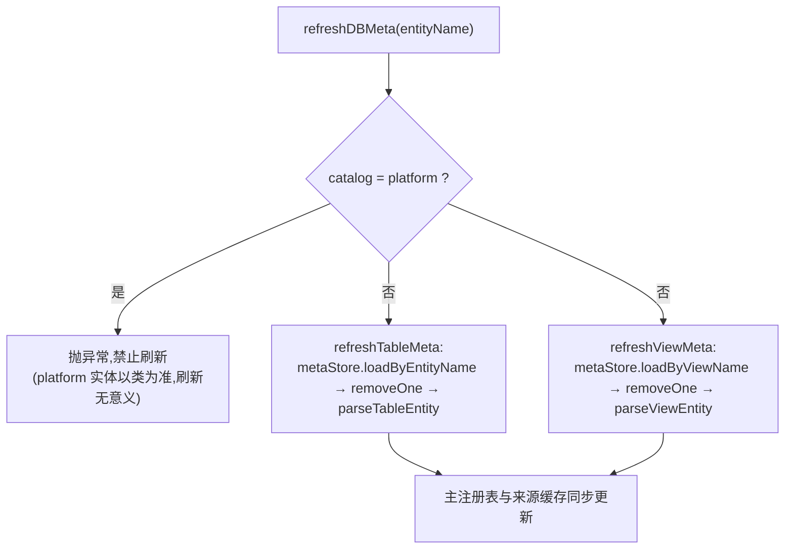

# 元数据运行期操作

本页汇总元数据在运行期的全部操作入口:MetaManager 的查询/注册/刷新 API、EntityMeta 的字段级查询、以及 refreshDBMeta 的触发场景。加载机制见[元数据加载机制](./loading.md)。

## MetaManager 查询 API

路径:`cn.geelato.core.meta.MetaManager`。

### 按实体取元数据

| 方法 | 说明 |
| --- | --- |
| `get(Class clazz)` | 按 Java 类取;内部经 `MetaReflex.getEntityName(clazz)` 转实体名查主表 |
| `getByEntityName(String entityName)` | 按实体名取(主注册表) |
| `getByEntityName(String entityName, boolean cache)` | `cache=false` 时先对在线定义源实体执行 refreshDBMeta 再取,用于需要最新定义的场景 |
| `get(String tableName)` | 按结构名取(查 `tableNameMetadataMap`) |
| `containsEntity(String entityName)` | 判定实体是否已注册;MQL 校验的实体存在性检查用它 |
| `getAll()` / `getAllEntityNames()` / `getAllEntityLiteMetas()` | 全量实体 / 全量实体名 / 精简列表 |

### 双源取与对比

| 方法 | 说明 |
| --- | --- |
| `getClassSourceEntity(String)` | 取 ORM 注解源副本 |
| `getDatabaseSourceEntity(String)` | 取在线定义源副本 |
| `compareEntitySources(String)` | 单实体双源字段级 diff(Map 结果) |
| `compareEntitySourcesAll(String)` | 双源全量对比(冲突检测开启时由 parseDBMeta 调用) |
| `getConflictingEntityNames()` / `getAllConflicts()` / `getConflictCount()` | 冲突清单 |
| `isMaterializedEntity(String entityName)` | 判定是否物化视图实体(物化只读门禁与 MQL 字段剥除都用它) |
| `resolveConnectId(String entityName)` | 实体→连接 id:优先 `TableMeta.connectId`,其次 `catalogConnectIdMapping[catalog]`,都无则返回 null 由调用方落到默认 primary 数据源 |
| `newDefaultEntityMap(String|EntityMeta)` | 按字段默认值构造新实体 Map(保存报文的默认值兜底) |
| `getDefaultColumn()` / `getColumnSelectType()` / `getTableUpgradeList()` | MetaResourceProvider 静态资源:默认列定义、列选择类型、结构升级列 |

### 字段级查询

字段级查询下沉到 `EntityMeta`,MetaManager 不重复提供:

| 方法 | 说明 |
| --- | --- |
| `getFieldMeta(String fieldName)` | 字段名→FieldMeta |
| `getFieldMetaByColumn(String columnName)` | 列名→FieldMeta;找不到抛异常(带实体名/结构名/列名) |
| `getColumnName(String fieldName)` | 字段名→列名;取不到抛异常 |
| `getSimpleFieldMetas(String[])` / `getAllSimpleFieldMetas()` | 对外发布的精简字段元数据 |
| `containsField(String)` | 字段存在性;审计填充/逻辑删除/权限注入都以此为准 |
| `isIgnoreUpdateField(String)` | 是否不可更新字段(创建类字段与主键) |
| `getEncryptedColumnNames()` / `getJsonFieldKeys()` | 加密列名集合 / JSON 列键集合(懒计算) |
| `getViewMeta(String viewName)` | 按视图名取关联视图 |

## 注册与移除

| 方法 | 说明 |
| --- | --- |
| `parseOne(Class clazz)` | ORM 注解源注册。已存在则跳过(conflictDetect 开启时 warn) |
| `parseTableEntity(TableMeta, List<ColumnMeta>, List<TableView>, List<TableCheck>, List<TableForeign>)` | 在线定义源注册/合并,冲突按[加载机制](./loading.md#同名冲突策略)裁决 |
| `parseViewEntity(TableView)` / `parseViewEntity(List<TableView>)` | 视图源注册(物化优先) |
| `removeOne(String entityName)` | 从主表与来源缓存移除(DATABASE 策略覆盖前、refreshDBMeta 内部使用) |
| `removeLiteMeta(String entityName)` | 同步移除精简列表项 |

:::tip 动态注册的典型用法
非平台宿主(如 geelato-dyn 模块)可关闭自动扫描,改用 `MetaManager.singleInstance().parseOne(clazz)` 手工注册,见[动态集成模块开发](../geelato-dyn/develop-module.md)。
:::

## 运行期刷新:refreshDBMeta

`MetaManager#refreshDBMeta(String entityName)` 把指定实体的在线定义源重新装载,覆盖内存中的旧定义:

### 触发场景

| 触发点 | 时机 |
| --- | --- |
| 设计态入口(表/列/视图设计器、物化视图管理) | 设计态定义保存或变更后 |
| 显式同步调用 | 手工触发或跨实例同步,对指定实体重新装载 |
| `getByEntityName(name, cache=false)` | 需要最新定义的即席查询 |

设计态变更的生效闭环是:定义存储变更 → 触发 `refreshDBMeta` → 注册表即时反映新定义,无需重启。

## 双源一致性维护

双源模型的成本是"类定义与设计态定义可能漂移"。框架提供的维护手段:

| 手段 | 入口 |
| --- | --- |
| 冲突检测 | `geelato.meta.conflict-detect.enabled=true` 后,parseDBMeta 输出 diff |
| 单实体对比 | `compareEntitySources(entityName)` |
| 三方一致性检查 | `geelato-maintenance` 的 `ConsistencyChecker`:ORM 注解源 / 在线定义源 / 物理库源三方逐字段 diff 与修复 |
| 反向生成 | `EntityJavaSourceGenerator` 由元数据反向生成带注解的 Java 源码,消除 ORM 注解源漂移 |
| 打包校验 | 打包前校验"物理结构列 ⊆ 实体 FieldMeta 列",不一致禁止打包(详见[打包部署](../packaging/contents.md)) |

## 延伸阅读

- [元数据加载机制](./loading.md)——注册表结构与冲突策略
- [元数据的上层延伸](./extensions.md)——这些 API 被哪些子系统消费,以及对外端点与脚本通道
