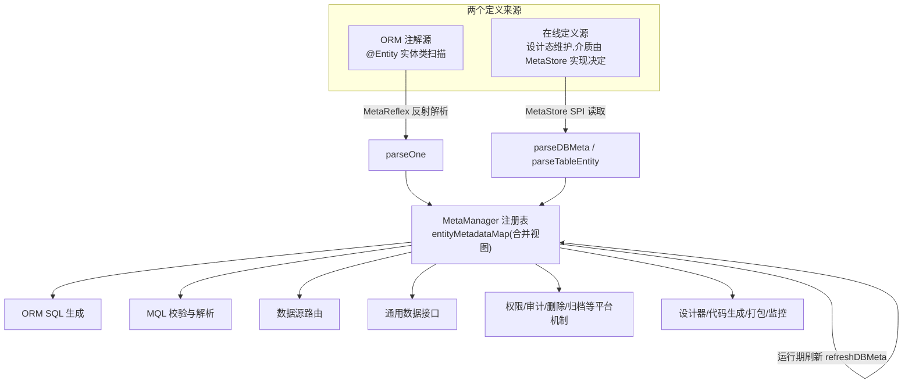

# 元数据概览

元数据是 Geelato 框架的地基。它是对**结构化数据**的映射描述:每个"实体"(业务对象)的完整定义——叫什么名字、有哪些字段、字段之间的主外键关系、挂在哪个数据源上、删除时走什么模式——收集为统一的运行时对象 `EntityMeta`,所有上层能力都从这份定义推导,没有一个能力自带第二份映射信息。

元数据描述的是结构化数据本身,**不绑定任何固定存储**:同一份元数据模型,背后可以是 MySQL 的表,也可以是 Excel 工作表、MongoDB 的集合或其他结构化载体。同理,元数据定义自身的存放位置也由 SPI 抽象,框架不规定介质。

## 元数据描述什么

一个实体的完整事实由 `EntityMeta` 聚合根承载,它持有:

- **实体身份**:`entityName`(实体名)、`entityTitle`(中文标题)、`entityType`(Table / View / Class 三种来源形态)、`catalog`(逻辑库分组)
- **结构定义**:`tableMeta`(结构名、schema、连接 id `connectId`、数据方言 `dbType`、缓存类型 `cacheType` 等)
- **字段与列**:`fieldMetas`(每个 `FieldMeta` 内嵌一个 `ColumnMeta`,承载字段名、数据类型、长度、精度、可空性、默认值、是否加密列等)
- **主键**:`id`(主键 `FieldMeta`)
- **关系**:外键 `tableForeigns`、CHECK 约束 `tableChecks`、关联视图 `viewMetas`
- **行为开关**:删除模式 `deleteMode`、不可更新字段表 `ignoreUpdateFieldMap`、加密列集合 `encryptedColumnNames`、JSON 列集合 `jsonFieldKeys`

## 为什么它是框架的地基

没有元数据,框架的上层能力全部无从谈起。每一个子系统都以 `MetaManager` 的注册表为唯一事实来源:

| 上层能力 | 依赖元数据做什么 |
| --- | --- |
| ORM SQL 生成 | 结构名、字段→列映射、主键、方言引用符、外键 JOIN、加密列/JSON 列处理 |
| MQL 查询语言 | 实体与字段的合法性校验、逻辑删除字段填充、默认值兜底 |
| 数据源路由 | `resolveConnectId` 把"实体→数据源"的归属变成路由 key,并逐实体确定 SQL 方言 |
| 行级权限/租户过滤 | 按实体名挂接权限规则,把规则中的裸列名限定为 `别名.列名` |
| 通用数据接口 | 一个实体名即可对外提供增删改查,并向低码前端发布精简字段元数据渲染表单 |
| 审计字段填充 | 以 `EntityMeta.containsField` 判定可写性,插入填创建类字段、更新填修改类字段 |
| 删除模式 | 实体级 `deleteMode` 是"调用级 > 实体级 > 全局"三级配置的中间层 |
| 归档、打包部署、Excel 导入、代码生成、设计器 | 结构一致性校验、值转换定位、反向生成 Java 源码、DDL 升级 |

完整的消费方图谱见[元数据的上层延伸](./extensions.md)。

## 全景图

## 双源模型

框架的元数据有两个来源,分别注册到两张来源缓存,再合并进主注册表:

| 来源 | 产出方式 | 存放位置 | 特点 |
| --- | --- | --- | --- |
| **ORM 注解源** | 启动扫描 ORM `@Entity` 注解类——实体映射的声明形态,反射解析注解 | `entityMetadataMapFromClass` | 有 `classType`;字段类型由 Java 类型推导;长度等来自注解缺省值 |
| **在线定义源** | 启动与运行期经 `MetaStore` SPI 读取设计态维护的定义 | `entityMetadataMapFromDatabase` | 无 `classType`;字段来自实际维护的结构定义(类型/长度/精度/是否加密);`entityType` 为 Table 或 View |
| **合并主表** | 注册时按冲突策略合并 | `entityMetadataMap` | ORM/MQL 运行期只查这张;同名实体默认"先到先得",`catalog=platform` 的实体恒以类为准 |

双源可以随时对比:MetaManager 提供 `getClassSourceEntity` / `getDatabaseSourceEntity` / `compareEntitySources` API,设计器保存后也会按此机制做冲突校验。详见[元数据加载机制](./loading.md)与[运行期操作](./operations.md)。

ORM 注解源要与 ORM 结合来看:实体类上的 `@Entity`/`@Col`/`@Title` 等注解,既是 ORM 的实体映射声明,也是元数据的声明形态——ORM 的 SQL 生成消费的正是这份由注解解析而来的元数据,声明即映射。注解写法见 [ORM 注解说明](../orm/annotations.md),ORM 的元数据驱动方式见 [ORM](../orm/overview.md)。

## 元数据定义从哪里来

框架把"元数据定义从哪里来"抽象为 `MetaStore` SPI:框架层只认接口,不约束存储介质——MySQL、Excel、MongoDB、配置中心、外部元数据服务都可以作为来源,实现接口即可整条替换。加载流程与 SPI 契约见[元数据加载机制](./loading.md);自定义来源的完整实现指南见 [MetaStore 扩展](../reference/metastore-extension.md)。

平台带有一个默认实现(`DefaultMetaStore`),其设计态存储位于平台库——具体表结构与平台实体目录不在框架文档范围内,见[平台实体](../entities/overview.md)。

## 本章节导航

| 页面 | 内容 |
| --- | --- |
| [元数据模型](./model.md) | EntityMeta/FieldMeta/ColumnMeta/TableMeta 等逐属性详解,注解→元数据映射 |
| [元数据加载机制](./loading.md) | MetaManager 注册表结构、三条启动加载路径、冲突策略、SPI 契约、缓存辨析 |
| [元数据运行期操作](./operations.md) | MetaManager 与 EntityMeta 的查询/注册/刷新 API 全列表 |
| [元数据的上层延伸](./extensions.md) | ORM/MQL/路由/权限/审计/归档/设计器等消费方全景图谱,含脚本引擎通道 |
| [MetaStore 扩展](../reference/metastore-extension.md) | 自定义元数据来源的实现指南 |

## 延伸阅读

- [平台实体总览](../entities/overview.md)——`geelato-meta` 模块 54 个平台业务实体的字段级目录
- [启动过程](../reference/startup-process.md)——元数据加载在启动链路中的时机(阶段二)
- [ORM 注解说明](../orm/annotations.md)——用注解声明实体的写法
- [核心模块说明](../reference/core-modules.md)——`MetaManager` 在整体架构中的位置
