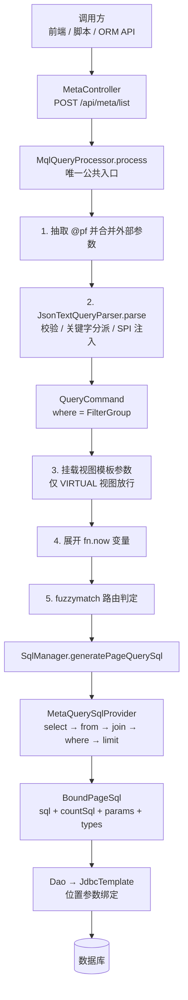
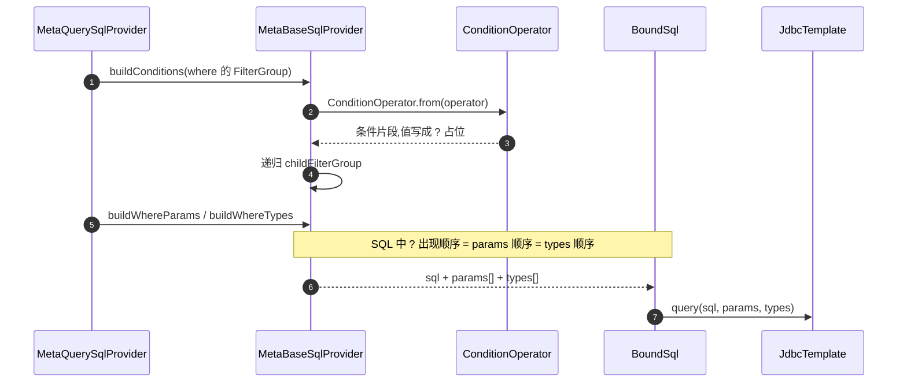

# MQL 详细说明

本页面向开发人员，说明一段 MQL JSON 从进入平台到拼装成最终 SQL 并执行的完整链路。MQL 的语法与关键字用法见 [MQL 使用指引](usage.md)，本页回答的是：这段 JSON 在服务端经历了什么、每一步产出了什么。

## 全链路总览

一条查询 MQL 的处理分为六个阶段：

1. **入口接收**：HTTP 请求 body 即 MQL 全文，`MetaController` 的查询接口读取 body 原文。
2. **抽取 @pf 与参数合并**：进入解析前，先把 `@pf` 视图模板参数从 JSON 中取出，与调用方外部传入的模板参数合并（外部优先）。
3. **JSON 解析与校验**：`JsonTextQueryParser` 把 JSON 解析为 `QueryCommand` 查询对象，期间完成实体校验、字段白名单校验，并通过 SPI 注入租户与数据权限条件。
4. **查询对象加工**：挂载视图模板参数（仅 VIRTUAL 视图）、展开 `$fn.now*` 变量、fuzzymatch 路由判定。
5. **SQL 生成**：`SqlManager` 分发到 `MetaQuerySqlProvider`，按固定顺序拼装 SQL 文本，产出 `BoundPageSql`（主 SQL + count SQL + 参数 + 类型）。
6. **参数绑定与执行**：`Dao` 把 `BoundSql` 交给 Spring `JdbcTemplate`，按位置参数绑定执行。



## 输入：请求怎么进来、MQL 长什么样

### 入口

| 入口 | 请求形式 | 说明 |
| :--- | :--- | :--- |
| `/api/meta/list` | body 为单实体 JSON | 单实体列表查询，POST / GET 均可 |
| `/api/meta/multiList` | body 为 JSON 数组 | 数组每个元素是一个单键实体对象，一次查多个实体 |
| 脚本 `$gl.mql.list(...)` | 脚本 kit 内传 MQL JSON | 与 REST 链路同归 `MqlQueryProcessor` |
| MQL 调试页 | `/mql-playground.html` | explain / validate / execute，同样走 `MqlQueryProcessor` |
| ORM Fluent DSL | Java 链式 API | 不经 JSON，由 `QueryCommandAdapter` 适配成 `QueryCommand`，汇入同一 SQL 生成主干 |

### 请求体即 MQL 全文

- body 原文直接作为 MQL 处理，GET 请求同样读取 body。
- URL 上的查询参数只有 `withMeta`（是否随响应返回字段元数据），不参与 MQL 组装。
- 多实体查询 `/api/meta/multiList` 的 body 是顶层数组，每个元素仍满足"有且只有一个根键 = 实体名"。

### 一段典型的查询 MQL

```json
{
  "platform_user": {
    "@fs": "id,name,ref(platform_org->orgName) orgName",
    "@order": "createAt|-",
    "@p": "1,10",
    "loginName|eq": "admin",
    "@b": [
      { "or": [ { "status|eq": "1" }, { "status|eq": "2" } ] }
    ]
  }
}
```

各部分的去向：

| JSON 片段 | 处理位置 | 产物 |
| :--- | :--- | :--- |
| 根键 `platform_user` | 解析阶段 | `command.entityName`，经实体校验 |
| `@fs` | 解析阶段 | 字段列表 + 别名 + 外键关联字段 |
| `@order` | 解析阶段 | 已翻译为列名 `asc/desc` 的排序片段 |
| `@p` | 解析阶段 | `pageNum` / `pageSize` |
| `@b` | 解析阶段 | 嵌套子条件组（`FilterGroup` 树） |
| `"loginName\|eq": "admin"` | 解析阶段 | 平铺过滤条件（省略操作符时默认 `eq`） |
| `@pf` | 解析前被抽取 | 视图模板参数，仅 VIRTUAL 视图放行 |

## 阶段一：抽取 @pf 与参数合并

`MqlQueryProcessor.extractPfAndSerialize` 在进入解析前执行：

- 遍历根对象每个实体节点，取出 `@pf` 存入 `paramsByEntity[实体名]`，并从 JSON 中移除。`@pf` 因此不参与后续关键字校验。
- 调用方（如 Controller 预处理、脚本 kit）可以通过外部参数通道传入模板参数；与 JSON 内 `@pf` 合并时，外部参数优先（同 key 覆盖）。

## 阶段二：JSON 解析为 QueryCommand

`JsonTextQueryParser.parse` 将净化后的 JSON 解析为 `QueryCommand`。

### 校验

- 根元素唯一：一个实体查询 JSON 有且只有一个根键，根键即实体名。
- 实体校验：实体名必须已在 `MetaManager` 注册。
- 字段白名单校验：过滤字段、排序字段、投影字段必须真实存在于实体元数据；`ref(...)` 必须是实体上登记的外键；`*` 与 `forceId` 两个保留值豁免。校验失败会累积报错信息并直接抛出异常。
- 物化视图预处理：物化视图实体只包含用户 SELECT 定义的列，解析前会先移除实体上不存在的字段引用（如查询构造端误带入的标准审计字段），验证逻辑本身不放宽。

### 键分派

根对象内的键分三类：

1. `@` 开头的关键字 → `QueryKeyword` 处理（`@fs` / `@order` / `@group` / `@p` / `@b`）；不认识的关键字直接报错。
2. `~` 开头的键 → 递归解析为子命令（查询嵌套子实体）。
3. 其余键 → 过滤条件，格式为 `"字段名"` 或 `"字段名|操作符": "值"`，省略操作符默认 `eq`。字段若是函数表达式（如 `fuzzymatch($platform_user.name,'张三')`），先经函数解析器重建为标准函数形式。

### 关键字处理

| 关键字 | 解析行为 |
| :--- | :--- |
| `@fs` | 按逗号切分（避开函数括号内的逗号）；支持 `ref(外键字段->远端字段) 别名`、`字段 别名` 两段式重命名、函数表达式原样保留；`ref` 项记入外键关联字段列表 |
| `@order` | `字段|+` / `字段|-`；**在解析期就翻译为列名 `asc/desc` 的 SQL 片段** |
| `@group` | 原样记入 `groupBy`，SQL 生成期再补充表别名 |
| `@p` | `"页码,每页条数"`，非数字或 ≤ 0 报格式错误 |
| `@b` | JSON 数组，每个元素是一个括号组；组内条件由组键 `and` / `or` 决定连接方式（两个键都缺省时按 `or`），组内还可以继续嵌套括号组 |

### SPI 注入

解析末尾通过 `MqlQueryFilterInjector` SPI 注入平台级默认过滤（运行时解析器遵循"0 个跳过、1 个按 `isEnabled`、多个报错"）：

- 租户过滤：追加 `tenantCode = 当前租户` 的普通过滤条件（走参数绑定）。
- 数据权限：设置 `command.originalWhere`（服务端生成的 SQL 片段，默认为 `creator = 当前用户` 或解析数据权限规则所得），后续拼进 where 尾部。

### 产物：QueryCommand

| 字段 | 来源 | SQL 去向 |
| :--- | :--- | :--- |
| `entityName` | 根键 | `from` |
| `fields` / `alias` / `foreignFields` | `@fs` | `select` + `left join` |
| `orderBy` | `@order`（已是列名片段） | `order by` |
| `groupBy` | `@group` | `group by` |
| `pageNum` / `pageSize` | `@p` | `limit ... offset ...` |
| `where`（FilterGroup） | 过滤键 + `@b` | `where` |
| `originalWhere` | SPI 数据权限注入 | `and ( ... )` |
| `viewTemplateParams` | `@pf` | `from` 派生表模板渲染 |
| `commands` | `~` 子实体键 | 子命令各自生成 SQL |

## 阶段三：条件的中间表达 FilterGroup

复杂条件不直接拼 SQL，而是先表达成树状模型：

- `logic`：当前层条件的连接方式（顶层默认 `and`）。
- `filters`：当前层平铺条件，每项 `Filter` 含 `field` / `operator` / `value` / `rawValue` / `arrayValue`。
- `childFilterGroup`：括号嵌套的子组（来自 `@b`）。

拼装期的连接规则：

1. 顶层平铺条件之间按顶层 `logic`（`and`）连接。
2. `@b` 的每个元素生成一个子组；**子组之间、子组与平铺条件之间一律按 `and` 连接**。
3. 子组内部按该组的 `and` / `or` 键连接。
4. 组内再嵌套的子括号，按其外层组的 `logic` 连接。

因此 `usage.md` 中 `@b` 示例渲染结果为 `(loginName = ? or phone = ?) and (status = ?)`。

同名过滤字段（如同一字段写两次 `in`）在参数表中自动重命名，避免参数 key 冲突。

## 阶段四：SQL 拼装

`SqlManager` 按 `commandType` 分发：SELECT 走 `MetaQuerySqlProvider.generatePageQuerySql`（同时产出主 SQL 与 count SQL）。拼装顺序固定：

```text
select → from → join → where → and (originalWhere) → group by → having → order by → limit offset
```

`having` 不在 MQL JSON 关键字之列，仅由 ORM Fluent DSL 设置；存在时才生成该段。

### FROM 决策

| 查询对象 | FROM 生成方式 |
| :--- | :--- |
| 普通实体 | 物理表名 |
| 物理 DB 视图（无平台视图元数据） | 视图名直查 |
| DEFAULT 默认视图 | 视图名直查（DDL 已在库中创建） |
| MATERIALIZED 物化视图 | 视图名直查（对象由引擎保证存在） |
| CUSTOM 自定义视图 | `viewConstruct` 原样内联为派生表 `( ... )` |
| VIRTUAL 虚拟视图 | `viewConstruct` 渲染 `@pf` 后内联为派生表 `( ... )` |

- 派生表别名：有 `ref`/JOIN 时主表分配 `t0`（外键表依次 `t1`、`t2`…），否则视图派生表固定 `vt`。
- CUSTOM / VIRTUAL 视图的 `viewConstruct` 为空属于元数据缺陷，直接报错，不静默回退。
- 物化视图只读由写门禁保证。

### 视图模板渲染（VIRTUAL）

`viewConstruct` 中的模板片段在拼 FROM 时渲染：

- `#...#` 是模板段，段内 `{param}` 是占位符。
- 段内占位符对应的参数缺失或为空 → **整段移除**；无占位符的段原样保留。
- 参数值：数字 / 布尔按原值；**字符串包单引号并将内部 `'` 转义为 `''`**。

模板示例：

```sql
select o.id, o.order_no, o.status
from mql_test_order o
# {statusFilter} and o.status = {statusFilter} #
# {minAmount} and o.amount >= {minAmount} #
```

只传 `@pf: {"statusFilter": "pending"}` 时渲染结果：

```sql
select o.id, o.order_no, o.status
from mql_test_order o
 and o.status = 'pending'
```

门禁：`@pf` 仅 VIRTUAL 视图放行。非视图实体、物理 DB 视图、DEFAULT / CUSTOM / MATERIALIZED 视图收到非空 `@pf` 会抛 `ViewTemplateParamException`，不静默丢弃。

### JOIN

MQL JSON 不直接表达 JOIN，`ref(...)` 是唯一的隐式 JOIN 来源：

- `@fs` 中的 `ref(外键字段->远端字段)` 依据实体外键元数据生成 `left join 外键表 t1 on t0.外键列=t1.外表列`。
- 别名按外键源列分配：两个不同外键即使指向同一张目标表，也各自生成独立 JOIN 与别名。
- 同一外键被多个 `ref` 引用只产生一个 JOIN。
- 显式自定义 JOIN（`inner/left/right join` + 自定义 on 条件）仅由 ORM Fluent DSL 提供。

### 方言与分页

- 标识符引用符：mysql 用反引号 `` ` ``，sqlserver 用方括号 `[]`，postgresql / oracle 及其他方言用双引号。
- 方言别名经 `Dialects` 注册表归一（如 RisingWave 归入 postgresql 家族）。
- `dbType` 解析优先级：`TableMeta.dbType` → 当前 `connectId` 对应数据源 → `TableMeta.connectId` → 默认数据源 → primary。
- 视图自身无 `connectId` 时继承主体实体的 `dbType`。
- 分页固定为 `limit {pageSize} offset {(pageNum-1)*pageSize}`，不随方言变化。
- 保留字（`index` / `inner` / `enable` / `key`）作为列名输出时自动加引用符。

### count SQL

count 由主查询整体包裹生成：`select count(*) from ( ... ) t`，不含 `order by` 与 `limit`，参数与主 SQL 相同。分页总数在可推导场景（全量查询、主键等值、首页未满一页）直接由已有行数推导，不再执行 count。

## 阶段五：参数与类型组装

`MetaBaseSqlProvider` 分三步产出 `BoundSql`（`sql` / `params[]` / `types[]`）：



### 操作符映射总表

| MQL 操作符 | SQL 片段（col 为列名） | 绑定参数 | JDBC 类型 |
| :--- | :--- | :--- | :--- |
| `eq` | `col = ?` | 1 | 按列类型 |
| `neq` | `col != ?` | 1 | 按列类型 |
| `gt` / `gte` / `lt` / `lte` | `col > ?`、`>= ?`、`< ?`、`<= ?` | 1 | 按列类型 |
| `startwith` | `col like CONCAT('',?,'%')` | 1 | VARCHAR |
| `endwith` | `col like CONCAT('%',?,'')` | 1 | VARCHAR |
| `contains` | `col like CONCAT('%',?,'%')` | 1 | VARCHAR |
| `in` | `col in(?,?,…)` | N（值拆数组） | 按列类型 |
| `nin`（`notin` 别名） | `col not in(?,?,…)` | N | 按列类型 |
| `nil` | 值为 `1`/`true` 时 `col is NULL`，否则 `col is NOT NULL` | 0 | — |
| `bt` | `col between '起' and '止'` | 0，值直接写入 SQL 文本 | — |
| `fis` | 见下方「fis 方言差异」 | 0，值直接写入 SQL 文本 | — |
| JSON 列 + 比较类 | `JSON_CONTAINS(col->'$',"v") > 0`（仅 mysql） | 0，值直接写入 SQL 文本 | — |
| 函数条件 | 函数表达式 + 比较符 + `?`；fuzzymatch 在实验开关下等价改写为 `(col <> '' AND col REGEXP ?)`（方言形态见下） | 1 | VARCHAR |

#### fis 方言差异

`fis`（集合成员匹配）按当前数据源方言生成等价 SQL，值直接写入 SQL 文本：

| 方言 | 非 JSON 列 | JSON 列 |
| :--- | :--- | :--- |
| mysql | `FIND_IN_SET('v', col) > 0` 的 or 组合 | `JSON_CONTAINS(col->'$','"v"') > 0` |
| postgresql | `(',' \|\| col \|\| ',') LIKE '%,v,%' ESCAPE '\'` 的 or 组合（值已做 LIKE 通配符与单引号转义） | `(col)::jsonb @> ('"v"')::jsonb` |
| sqlserver | `CONCAT(',', col, ',') LIKE '%,v,%' ESCAPE '\'` 的 or 组合 | 不支持，生成阶段明确报错 |
| oracle | `(',' \|\| col \|\| ',') LIKE '%,v,%' ESCAPE '\'` 的 or 组合 | 不支持，生成阶段明确报错 |

未识别方言按 postgresql 形态（ANSI `\|\|` 连接）生成；经 `Dialects.registerAlias` 注册的 PG 协议引擎自动落入 postgresql 分支。

#### gfn_* 自定义函数方言改写

MQL 内置函数（`increment` / `findinset` / `fuzzymatch`）经解析器归一为 `gfn_*` 表达式后，默认调用 `geelato.gfn_*` 存储函数（需按方言预建函数脚本）。已知语义的内置函数在生成阶段按方言改写为等价 SQL，无需存储函数：

| 函数 | 改写 | 说明 |
| :--- | :--- | :--- |
| `gfn_increment(a,b)` | 全方言全上下文 → `(a + b)` | 纯算术等价 |
| `gfn_findinset(x,set)` | 仅条件上下文：postgresql → `position(...)`、sqlserver → `CHARINDEX(...)`、oracle → `INSTR(...)`；mysql 保留存储函数路径 | 保留 FIND_IN_SET 数值位置语义，外层比较符行为不变 |
| `gfn_fuzzymatch(col,'kw')>0` | mysql → `REGEXP ?`、postgresql → `~ ?`、oracle → `REGEXP_LIKE(col, ?)`；sqlserver 无原生正则，明确报错 | 仅实验开关开启时改写 |

未注册的 `gfn_*` 函数不改写，保留 `geelato.` 前缀存储函数路径（`geelato.` 前缀在四种方言上均为合法 schema 限定语法）。

类型映射：`int` → INTEGER、`bigint` → BIGINT、`decimal` → DECIMAL、`datetime` → TIMESTAMP、`blob` → BLOB，其余默认 VARCHAR；like 三件套一律 VARCHAR。

### 参数顺序原则

SQL 中 `?` 的出现顺序、`params[]` 的填充顺序、`types[]` 的填充顺序三者严格一致。`in` 展开为 N 个占位符即贡献 N 个参数；`nil` / `bt` / `fis` 不产生绑定参数。

`Filter.rawValue` 保留原始 Java 类型值（ORM DSL 适配与外部参数路径填充），组装参数时优先于字符串 `value`，避免数值、布尔、日期在严格类型数据库（如 PostgreSQL）中被当成字符串绑定。

### 哪些值会进入 SQL 文本

绝大多数条件值走 `?` 绑定。以下内容直接写入 SQL 文本：

- `@pf` 模板参数值（字符串已转义，且仅 VIRTUAL 视图放行）
- `bt` / `fis` / JSON 列条件的值
- `originalWhere` 数据权限 SQL（来自服务端注入，非用户输入）

防护措施：字段名先过实体元数据白名单，未登记字段直接报错；`@pf` 字符串参数转义单引号并移除 SQL 注释。

## 阶段六：绑定与执行

- `Dao.queryForMapList(BoundPageSql)` → `JdbcTemplate.query(sql, params, types, RowMapper)`；`types` 非空时按 `setObject(i, value, types[i])` 带类型绑定。
- 行映射时完成 JSON 列后处理与加密列解密。
- 分页查询先取当前页记录，再取 total；total 可推导时跳过 count。
- 观测点：p6spy 缺省开启（slf4j + multiline），可看到最终 SQL 与参数；debug 级别另有 `final-sql` 日志输出每条生成结果。

## 端到端示例：从 JSON 到 SQL

输入（`POST /api/meta/list` body）：

```json
{
  "mql_test_order": {
    "@fs": "orderNo,amount,ref(userId->name) userName",
    "@order": "amount|-",
    "@p": "1,10",
    "orderNo|contains": "PO",
    "@b": [
      { "or": [ { "amount|gte": "100" }, { "status|eq": "pending" } ] }
    ]
  }
}
```

逐步跟踪（以 mysql 方言为例）：

| 阶段 | 发生了什么 |
| :--- | :--- |
| 1. 抽取 @pf | 无 `@pf`，JSON 原样 |
| 2. 解析 | `fields=[orderNo, amount]`、`foreignFields=[userId->name]`、`alias={userId->name: userName}`；`orderBy="amount desc"`；`pageNum=1, pageSize=10`；平铺条件 `orderNo contains "PO"`；`@b` 生成 or 子组 |
| 3. 加工 | 无 `$fn` 变量；平台运行时 SPI 还会追加租户条件与数据权限（下例 SQL 为突出主干未列） |
| 4. SQL 拼装 | 有 `ref` → 主表别名 `t0`、外键表 `t1`；字段名翻译为列名（`orderNo` → `order_no`） |
| 5. 参数组装 | `?` 依次对应 `PO`、`100`、`pending` |
| 6. 执行 | 主 SQL + count SQL 先后下发 |

最终 SQL：

```sql
select t0.order_no, t0.amount, t1.name `userName`
from mql_test_order t0
left join mql_test_user t1 on t0.user_id=t1.id
where t0.order_no like CONCAT('%',?,'%')
 and ( t0.amount >= ? or t0.status = ? )
order by t0.`amount` desc
limit 10 offset 0
```

参数与类型：

```text
params: ["PO", "100", "pending"]
types:  [VARCHAR, DECIMAL, VARCHAR]   -- 类型来自列元数据
```

count SQL（参数相同）：

```sql
select count(*) from (
  select t0.order_no, t0.amount, t1.name `userName`
  from mql_test_order t0
  left join mql_test_user t1 on t0.user_id=t1.id
  where t0.order_no like CONCAT('%',?,'%')
   and ( t0.amount >= ? or t0.status = ? )
) t
```

要点：

- 字段名统一翻译为列名；`@fs` 别名与排序列按方言加引用符。
- 平台宿主运行时，p6spy 日志里的 SQL 会比上例多出 SPI 注入的 `tenant_code = ?` 与 `and ( 数据权限片段 )` 两段。
- 排序列在有 JOIN 时带表别名（`t0.`amount``），引用符只包列名。

## 保存与删除的同构链路

保存与删除复用同一套解析 → SQL 生成 → `BoundSql` → `Dao` 主干，差异只在 SQL Provider：

| 操作 | Provider | 生成结果 |
| :--- | :--- | :--- |
| 新增 / 更新 | `MetaInsertSqlProvider` / `MetaUpdateSqlProvider` | `insert into 表(列…) values(?,…)` / `update 表 set 列=? … where …` |
| 条件删除 | `MetaDeleteSqlProvider` | 逻辑删除模式生成 `update 表 set del_status=? …`；物理模式生成 `delete from 表` |

- `/api/meta/save/{biz}` 按"含 `id` 且未设 `forceId` → 更新"判定走 insert 还是 update。
- 更新值支持函数设值（如 `increment($platform_user.loginCount,1)`），函数表达式直接进入 `set` 子句。
- `creator` / `createAt` / `tenantCode` / `updateAt` 等默认字段由 `MqlSaveFieldValueFiller` SPI 注入；`$ctx.*`、`$parent.*` 变量在保存链路展开。用法见 [MQL 使用指引](usage.md)。

## 阅读顺序与关键代码位置

建议按以下顺序阅读源码：

| 顺序 | 类 | 职责 |
| :--- | :--- | :--- |
| 1 | `MetaController` | 查询入口，读取 body |
| 2 | `RuleService` | 调 `MqlQueryProcessor` 并下发执行 |
| 3 | `MqlQueryProcessor` | 五步流水线，唯一公共入口 |
| 4 | `JsonTextQueryParser` | JSON → QueryCommand |
| 5 | `QueryKeyword` | `@` 关键字处理 |
| 6 | `FilterGroup` | 条件树与操作符 |
| 7 | `SqlManager` | Provider 分发 |
| 8 | `MetaQuerySqlProvider` | SELECT 拼装与 FROM 决策 |
| 9 | `MetaBaseSqlProvider` | 条件展开 / 参数 / 类型 / 模板渲染 |
| 10 | `ConditionOperator` | 操作符 → SQL 片段 |
| 11 | `Dao` | JdbcTemplate 执行 |

代码位置（相对仓库根）：

```text
geelato-web-platform/src/main/java/cn/geelato/web/platform/srv/meta/MetaController.java
geelato-web-platform/src/main/java/cn/geelato/web/platform/srv/platform/service/RuleService.java
geelato-core/src/main/java/cn/geelato/core/mql/MqlQueryProcessor.java
geelato-core/src/main/java/cn/geelato/core/mql/parser/JsonTextQueryParser.java
geelato-core/src/main/java/cn/geelato/core/mql/parser/keyword/QueryKeyword.java
geelato-core/src/main/java/cn/geelato/core/mql/filter/FilterGroup.java
geelato-core/src/main/java/cn/geelato/core/sql/SqlManager.java
geelato-core/src/main/java/cn/geelato/core/sql/provider/MetaQuerySqlProvider.java
geelato-core/src/main/java/cn/geelato/core/sql/provider/MetaBaseSqlProvider.java
geelato-core/src/main/java/cn/geelato/core/sql/provider/ConditionOperator.java
geelato-core/src/main/java/cn/geelato/core/orm/Dao.java
```

## 继续阅读

- [MQL 使用指引](usage.md)：语法与关键字用法
- [MQL 总览](overview.md)：MQL 的定位与边界
- [查询过滤与字段填充 SPI 扩展](../reference/spi-query-filter-and-save-fill-extension.md)：租户过滤与数据权限的扩展方式
- [ORM Fluent DSL 指引](../orm/fluent-dsl.md)：后端 Java 侧的同源链路
