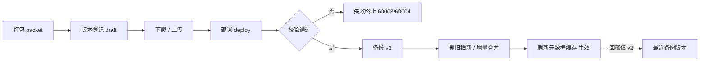

# 应用打包

本章只覆盖低代码应用的打包交付：**应用包**是设计器产出的应用数据包（`.gdp` / `.zgdp`），承载元数据与业务数据，在环境间打包→传输→部署→回滚；对应模块 `cn.geelato:geelato-package` 与 web-platform 的 `/package` 服务。

:::note 本章不含
插件 jar 与宿主/启动壳制品是另外的交付物，不属于应用打包：插件见[插件机制](../plugin-mechanism/overview.md)，宿主工程的构建部署见[平台部署指南](../operations/runtime-designer-deployment.md)。
:::

## 应用包是什么

应用包是一个应用在某一时刻的**完整数据快照**：以 JSON 形式携带该应用在设计器中产出的全部配置数据，可在环境之间传输并部署生效。

- 包数据 `AppPackData`：`sourceAppId / targetAppId / version / appCode / appName` + `appMetaList`（元数据条目数组，每条为 `{metaName, metaData}`，`metaName` 即表名/实体名，`metaData` 为该表的行数组）+ `appResourceList`（资源条目）+ `basePlatformVersion`（打包时平台基准版本，取自平台应用 `geelato_admin` 的 `version_info`）。
- 产物两级：`.gdp`（UTF-8 JSON 全量包，默认名 `geelatoApp`）压缩为 `.zgdp`（zip，内含 `<appCode>/<appCode>.gdp`）。
- 包文件按租户与应用归档存储，并在应用版本表 `platform_app_version` 登记（来源 `packet/upload/sync`，状态 `draft/release/unused/deployed/backup`）。
- 模块坐标 `cn.geelato:geelato-package`；配置前缀 `geelato.package`。

## 打包内容一览

应用包携带的内容按运行期职责分为四层，逐类说明见[打包内容与运行作用](contents.md)：

| 层 | 内容 | 包内表 |
| --- | --- | --- |
| 应用本体 | 应用定义、设计器文件树、依赖声明 | `platform_app` |
| 界面层 | 页面、菜单树 | `platform_app_page`、`platform_tree_node` |
| 数据层 | 数据源连接、模型/字段/约束/视图 | `platform_dev_db_connect`、`platform_dev_table/column/table_foreign/view` |
| 业务数据 | 按实体的数据打包策略携带 | `pack_bus_data` 大于 0 的业务表 |
| 治理层 | 角色/权限/授权关系、字典、应用配置、导出模板、编码规则、资源元数据 | `platform_role*`、`platform_dict(_item)`、`platform_sys_config`、`platform_export_template`、`platform_encoding`、`platform_resources` |

服务接口、接口编排、定时任务等不在打包清单中，跨环境迁移需另行处理；完整清单与各类内容的运行期作用见[打包内容与运行作用](contents.md)。

## 全流程鸟瞰

1. **打包**：从源环境按应用导出 19 张平台白名单表 + 按数据打包策略选定的业务表，生成 `.zgdp` 并登记版本（状态 `draft`）；流程见[打包流程](packaging-flow.md)。
2. **传输**：下载 `.zgdp` 到目标环境后上传登记，或在同一环境直接部署。
3. **部署**：环境门禁 → 包数据校验（实体与列必须在目标平台元模型中存在）→ 备份（v2）→ 落库（覆盖型删旧插新、增量型跳过已有行）→ 刷新元数据缓存；热加载生效，不需重启。流程见[应用包部署](deployment-flow.md)。
4. **回滚**（仅 v2）：部署失败或结果异常时回滚到最近一次备份版本。

## 配置

| 键（`geelato.package.*`） | 默认 | 说明 |
| --- | --- | --- |
| `env` | — | 环境标识；`init_source` 环境禁止部署 |
| `path` | — | 包文件存储根目录 |
| `uploadFolder` | — | 上传包子目录 |
| `engine` | `v1` | 打包/部署引擎版本：`v1`（原始实现）或 `v2`（演进版，见下）；备份与回滚仅 v2 支持 |

:::note 默认引擎是 v1
`engine` 缺省为 `v1`。备份、回滚、表名防注入等能力只在 `v2` 生效，生产环境建议显式配置 `geelato.package.engine=v2`。三个基础键的含义另见[系统配置：Package 模块](../system-config/overview.md#package-模块)。
:::

## v1 与 v2 引擎

`geelato.package.engine` 选择打包/部署引擎（绞杀者模式，v1 原地冻结、新能力只在 v2）：

| 维度 | v1 | v2 |
| --- | --- | --- |
| 打包/部署入口 | `/package/packet`、`/deploy`（同一端点按 engine 分流） | 同左 |
| 状态管理 | 单例可变状态 | 方法局部上下文，无单例可变状态 |
| 部署落库 | 编程式事务，删除与插入包在一个事务、失败回滚 | 分批落库（500 行/批），中途失败已写入批次保留，可通过重新部署补齐 |
| 备份/回滚 | 无真实备份 | 部署前自动备份 + `GET /package/rollback/{appId}` |
| 指定范围打包语义 | `appointMetas` 为白名单：未列出的表整张排除 | `appointMetas` 为选行修饰：未列出的表仍全量打包 |
| 数据清洗 | — | 平台表白名单 + 表名防注入 + 分批 500 |

## 商品化交付

跨租户/跨应用的商品化交付在应用包基础上另有占位符重置与主键重生成逻辑，见应用市场相关文档（[系统配置：Market 模块](../system-config/overview.md#market-模块)）。

## 推荐继续阅读

- [打包内容与运行作用](contents.md)：19 张平台表逐类说明与各内容对应用运行的作用
- [打包流程](packaging-flow.md)：前置门禁、三种打包方式、产物链路、下载与上传
- [应用包部署](deployment-flow.md)：校验门禁、备份与回滚、落库策略、生效机制
