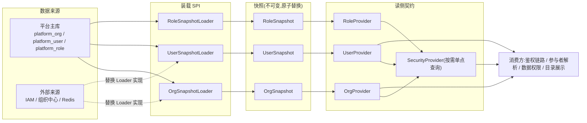

# 安全契约概览

`geelato-security` 是框架的安全契约模块:它只定义安全模型、读取接口、装载机制与上下文契约,不绑定任何具体数据来源。运行时(认证、组织补全、参与者解析、数据权限)只面向这些契约编程,"数据从哪里来"由实现层决定,消费方无感知。

## 模块定位

`geelato-security` 是纯契约模块,pom 不携带任何框架依赖(仅 Lombok),全部契约位于单一包 `cn.geelato.security`。契约的实现分布在两个上层模块,三处刻意共用同一包名(split package),以维持消费方 import 一致:

| 层 | 模块 | 内容 |
| --- | --- | --- |
| 契约层 | `geelato-security` | 安全模型(`Tenant`/`App`/`Org`/`User`/`Role`/`Permission`)、挂靠关系类、四个 Provider 接口、三个快照与装载 SPI、`SecurityContext`、`SecurityContextRunnable` |
| 框架层默认 | `geelato-core` | `DefaultOrgProvider`/`DefaultUserProvider`/`DefaultRoleProvider`、`OrgRelationResolver`、`BridgeSecurityProvider`、两个默认 Enricher、`SecurityDataRefreshCoordinator` |
| 平台层默认 | `geelato-web-platform` | `DBOrgSnapshotLoader`/`DBUserSnapshotLoader`/`DBRoleSnapshotLoader`(读主库)、`SecurityProviderConfiguration` 装配 |

## 分层与数据流

要点:

- 装载方向永远是 Loader → Snapshot → Provider:装载器把外部来源装配成不可变快照,Provider 缓存快照并对外暴露只读查询,消费方只依赖 Provider。
- 快照整体装载、原子替换(`AtomicReference`),读侧无锁,refresh 不会出现"半新半旧"状态。
- `SecurityProvider` 与三个快照式 Provider 并存:前者面向按需单点查询(人员求解、层级传递、决策判断),后者面向全量快照读取,各司其职。

## 章节导航

| 页面 | 内容 | 涉及的核心类 |
| --- | --- | --- |
| [安全模型](model.md) | 六个核心实体与四个挂靠关系类,逐属性说明 | `Tenant`/`App`/`Org`/`User`/`Role`/`Permission`/`UserOrg`/`UserRole`/`UserOrgRole`/`OrgRole` |
| [Provider 契约](provider.md) | 四个 Provider 接口逐方法定义与分页契约 | `OrgProvider`/`UserProvider`/`RoleProvider`/`SecurityProvider`/`Page`/`PageParam` |
| [抽象装载类](loader.md) | 三个快照装载 SPI 与两个装载辅助契约 | `OrgSnapshotLoader`/`UserSnapshotLoader`/`RoleSnapshotLoader`/`UserOrgInfoEnricher`/`UserExtInfoEnricher` |
| [模型快照与快照加载](snapshot.md) | 三个快照类的索引结构、不可变性保证与刷新链路 | `OrgSnapshot`/`UserSnapshot`/`RoleSnapshot`/`SecurityDataRefreshCoordinator` |
| [安全上下文](context.md) | 四个线程级上下文维度、写入边界与跨线程传播 | `SecurityContext`/`SecurityContextRunnable` |
| [平台默认实现](platform-defaults.md) | 框架层与平台层全部默认实现、Spring 装配与替换策略 | `Default*Provider`/`BridgeSecurityProvider`/`DB*SnapshotLoader`/`SecurityProviderConfiguration` |

## 与认证鉴权的关系

安全契约回答"安全数据长什么样、从哪里读、如何装进上下文";认证鉴权回答"一次 HTTP 请求如何认证并把主体写入上下文"。后者属于平台侧(`DefaultSecurityInterceptor` 位于 `geelato-web-common`),见[认证鉴权](../authentication/security-authentication.md)。

## 推荐继续阅读

- [安全模型](model.md)——从实体与关系规则开始
- [Provider 契约](provider.md)——消费方实际调用的接口
- [平台默认实现](platform-defaults.md)——开箱即用的装配与替换方式
