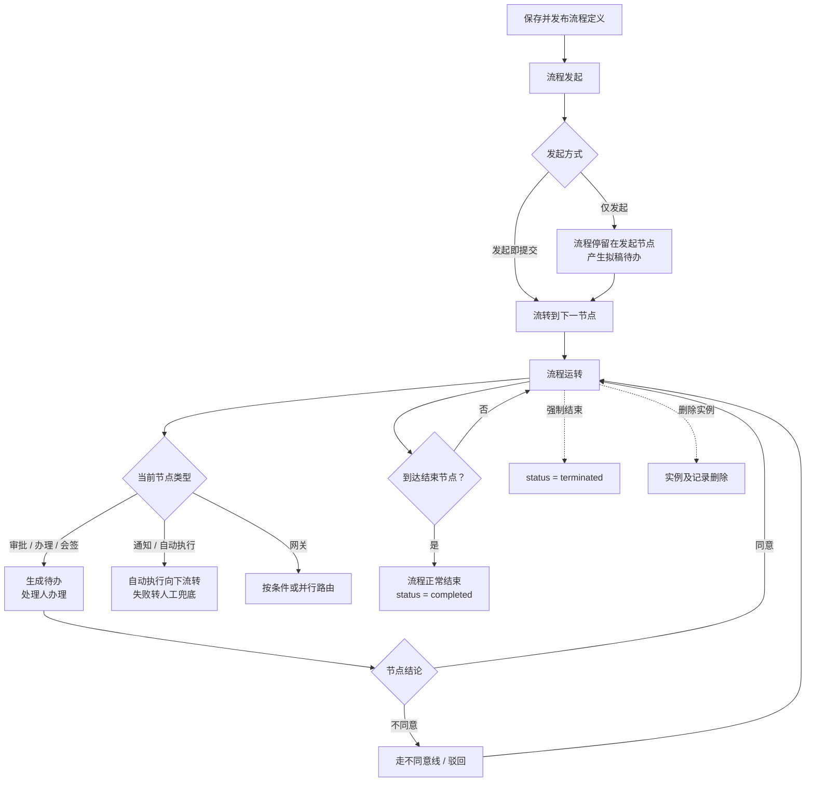
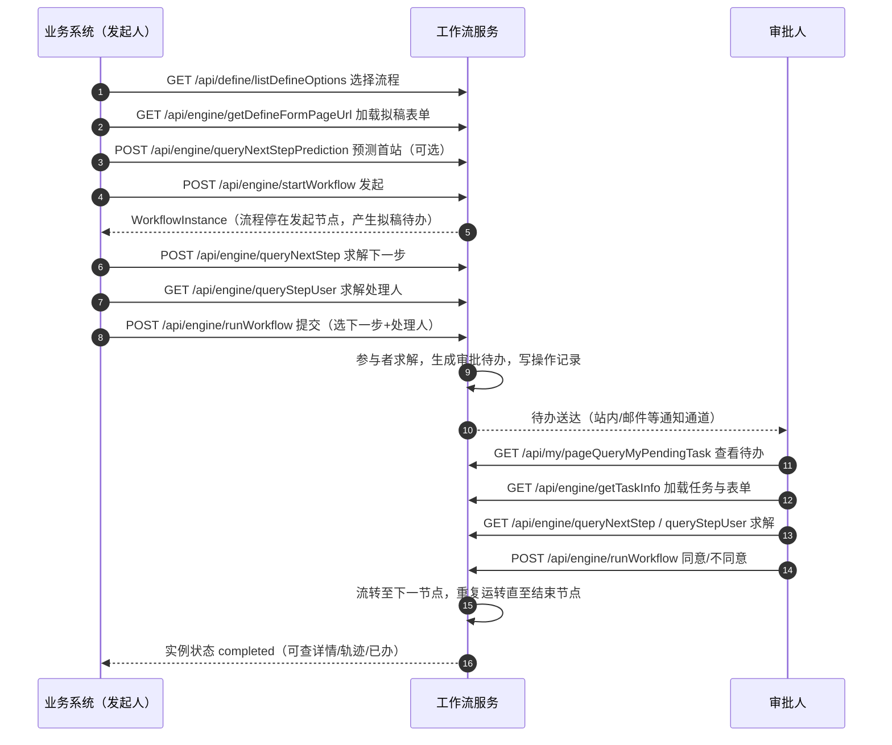

# 流程运转

本页说明一个流程实例从发起到结束的完整生命周期：**流程发起 → 流程求解 → 流程运转 → 流程结束**，以及期间可介入的撤回、驳回、转办、传阅、催办等动作。各动作对应的 REST 接口见[流程运行集成](integration-runtime.md)与[个人流程集成](integration-my.md)。

## 生命周期总览

实例状态三种取值贯穿全程：`running` 进行中、`completed` 已完成（正常走到结束节点）、`terminated` 已终止（强制结束）。

## 流程发起

发起 = 把一条业务数据挂到某个已发布的流程定义上运行。发起前需要三样东西：流程定义（`defineKey`）、业务标识（`bizId`）与业务名称（`bizName`）。

标准发起链路：

1. **选择流程**：`GET /api/define/listDefineOptions` 拉取当前应用可发起的流程定义选项。
2. **加载拟稿表单**：`GET /api/engine/getDefineFormPageUrl` 获取定义绑定的表单页地址，以 iframe 加载业务表单填写。
3. **发起前预测**（可选）：`POST /api/engine/queryNextStepPrediction` 预演第一站将到达的节点，`GET /api/engine/queryStepUserPrediction` 预演该节点的候选处理人。
4. **发起**：`POST /api/engine/startWorkflow` 传入定义 key、业务 id/名称与表单数据。

发起后的两种走向：

| 接口 | 行为 |
| --- | --- |
| `POST /api/engine/startWorkflow` | 流程启动后**停留在发起节点**，为发起人生成拟稿待办；发起人补充信息后再通过提交接口送出 |
| `POST /api/engine/startWorkflowAtomicity` | **发起即提交**：启动后在同一次调用中完成发起节点的提交，直接流转到下一节点（需带 `selectStepList` 下一步选择） |

两者入参一致（原子性版本多 `selectStepList` 与可选 `comment`），返回均为流程实例详情（`WorkflowInstance`，含实例 id、当前任务等）。调试验证使用 `startDebugWorkflow` / `startDebugWorkflowAtomicity`，区别仅在于按 `debug` 状态版本运行，流程数据同样落库，验证后删除即可。

:::note 实例名称与业务关联
发起时引擎按 `【定义名】业务名` 生成实例名称，`bizId` 作为业务关联键（businessKey）写入实例。业务系统凭 `bizId` 可反查实例，流程侧凭实例的 `formRecordId` 可回跳业务数据。
:::

## 流程求解

"求解"指引擎在提交时确定**下一个到达哪些节点、由谁处理**。这一步发生在每次提交（发起提交、审批提交）时，也提供预测接口供提交前调用。

求解分两层：

1. **路由求解**：从当前节点的出线中确定目标。审批类节点按本次结论筛选同意线/不同意线（`isAgree`），排他网关按迁移线条件评估，并行网关分叉多路。当出线直达的是网关或自动类节点时，引擎沿路径继续透传，直到命中实际产生待办的用户任务或结束节点，并以 `routeTargetRefs`、`pathText` 回传完整路径。
2. **参与者求解**：对目标节点解析处理人。提交人显式选择的处理人（`stepUserList`）优先；未选择时按节点 `assignee` 配置自动解析（用户/角色/部门/部门角色/发起人）；解析为空时按节点 `emptyAssigneeStrategy` 兜底。会签节点在解析后按分组来源（部门/角色/自定义）划分为小组并行投票。

求解结果统一为 `NextStep` 列表：每项含目标节点（`targetRef`/`stepTargetName`）、候选处理人（`stepUserList`）、是否需要选人（`needAssignee`）、并行子步骤（`subStepList`）等，完整结构见[流程运行集成 · NextStep](integration-runtime.md#nextstep)。

相关接口：

| 接口 | 时机 | 说明 |
| --- | --- | --- |
| `POST /api/engine/queryNextStepPrediction` | 发起前 | 按定义预测首站节点（可用表单数据驱动条件线） |
| `GET /api/engine/queryNextStep` | 提交前 | 对运行中实例的当前任务预测下一步（可按结论筛选） |
| `GET /api/engine/queryStepUserPrediction` | 发起前 | 按定义预测指定节点的候选处理人 |
| `GET /api/engine/queryStepUser` | 提交前 | 对运行中实例预测指定节点的候选处理人 |

## 流程运转

流程实例处于 `running` 状态期间，围绕待办任务展开：

### 审批提交

处理人对当前任务给出结论并送出：

1. `GET /api/my/pageQueryMyPendingTask` 查看待办列表，`GET /api/engine/getTaskInfo` 加载任务详情（含节点信息、表单页地址、是否需要选下一步 `needNextStep`、会签进度）。
2. `GET /api/engine/queryNextStep` + `GET /api/engine/queryStepUser` 求解并确认下一步与处理人。
3. `POST /api/engine/runWorkflow` 提交：携带实例 id、任务 id、下一步选择（`selectStepList`）、审批意见与本次附件 id。

提交时引擎完成：任务权限校验（须为本人待办）→ 写入目标节点参与者变量 → 分组会签变量预置 → 未选人节点兜底解析 → 记录意见与附件关联 → 驱动流转 → 写入操作记录。若多人多实例中有一人投"不同意"，其余同节点待办自动取消，按不同意线流转。

### 会签推进

会签节点多人并行持有待办：非最后一个处理人提交时仅记录意见，不弹出下一步选择（`needNextStep=false`）；节点完成条件（全部同意/任一同意/比例/票数，含分组规则）满足时，由最后完成的提交驱动节点整体流转。会签进度通过实例详情的 `countersignProgress` 或任务详情查询。

### 全部运转动作

| 动作 | 接口 | 说明 |
| --- | --- | --- |
| 审批/办理提交 | `POST /api/engine/runWorkflow` | 核心提交动作，见上 |
| 撤回 | `POST /api/engine/withdraw` | 发起人撤回已送出的流程（撤回任务其后无其他节点处理记录时可用），流程回到本人待办 |
| 驳回上一步 | `POST /api/engine/rejectToLastStep` | 退回上一处理节点 |
| 驳回发起人 | `POST /api/engine/rejectToStart` | 退回到发起节点，发起人重新提交 |
| 驳回指定节点 | `POST /api/engine/rejectToNode` | 退回到流程中任意指定节点 |
| 转办 | `POST /api/engine/transferTask` | 将本人待办转给他人办理 |
| 传阅 | `POST /api/toRead/sendToRead` | 把实例发给指定人员查阅，产生对方待阅 |
| 催办 | `GET /api/engine/remindTargets` + `POST /api/engine/remind` | 发起人对当前活跃任务处理人发送催办提醒 |
| 附件 | `POST /api/attach/upload` | 上传附件，id 随提交参数回传建立与操作记录的关联 |
| 查询 | 实例详情 / 任务详情 / 流程轨迹 / 实例 BPMN | 见[流程运行集成](integration-runtime.md) |

## 流程结束

| 结束方式 | 触发 | 实例状态 |
| --- | --- | --- |
| 正常结束 | 流转到达结束节点（`end`） | `completed`，记录结束时间 |
| 强制结束 | `POST /api/engine/forceEndProcInstance`（管理员/发起人） | `terminated`，未走完的待办终止 |
| 删除实例 | `POST /api/engine/deleteProcInstance` | 实例及其任务删除，业务数据不受影响 |

流程结束后仍可查询：实例详情（以历史实例呈现）、流程轨迹（`getProcessTrace`）、实例 BPMN（`getProcBpmn`）、已办列表。

## 全链路时序

业务系统与工作流服务的典型交互时序（发起 → 审批 → 结束）：

发起即提交的场景把第 4~7 步合并为一次 `POST /api/engine/startWorkflowAtomicity` 调用。

## 相关页面

- [流程编排](orchestration.md)：节点、迁移线、参与者与属性模型
- [流程运行集成](integration-runtime.md)：本页全部动作的接口契约
- [个人流程集成](integration-my.md)：待办、已办、待阅、已办、传阅接口
- [流程定义集成](integration-define.md)：定义保存与发布接口
